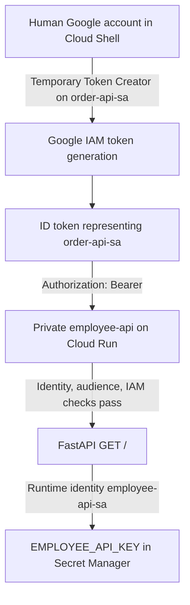

# Day 20 — Cloud Run Service-to-Service Authentication

**Date:** 11 October 2026  
**Learning journey:** Python → FastAPI → Docker → GCP Cloud Run  

## 1. What I achieved

I created `order-api-sa`, granted it permission to invoke the existing private `employee-api`, and tested that identity through Cloud Shell impersonation. After fixing a separate impersonation permission, the authenticated request returned **HTTP/2 200** and the expected JSON.

The caller was deliberately **simulated in Cloud Shell**. I did not build or deploy an `order-api` application on Day 20. This demonstrated the service-account authentication mechanism used in service-to-service communication; it did not demonstrate two deployed Cloud Run services communicating.

I removed the temporary Service Account Token Creator role and saved the change. My last screenshot shows the role removed from the edit form before saving; I did not capture a post-save policy verification screenshot.

## 2. Exact environment

| Item | Value |
|---|---|
| Project | `cloud-genai-learning` |
| Region | `europe-west2` |
| Receiving service | `employee-api` |
| Base URL and token audience | `https://employee-api-972261256506.europe-west2.run.app` |
| HTTP endpoint tested | `https://employee-api-972261256506.europe-west2.run.app/` |
| Intended calling service | `order-api` — not deployed in this experiment |
| Caller identity | `order-api-sa@cloud-genai-learning.iam.gserviceaccount.com` |
| Receiver runtime identity | `employee-api-sa@cloud-genai-learning.iam.gserviceaccount.com` |
| Secret | `EMPLOYEE_API_KEY` |
| Human identity | My active Google account in Cloud Shell |

The base service URL was used as `--audiences`, without the trailing request `/`. Preserve that audience exactly when repeating this example.

## 3. Connect Day 19 to Day 20

| Concept | Day 19 | Day 20 experiment | Future real Cloud Run caller |
|---|---|---|---|
| Who runs the command/application? | Human in Cloud Shell | Human in Cloud Shell | `order-api` container |
| Whose identity is in the ID token? | Human Google account | `order-api-sa` | Attached `order-api-sa` |
| How is the token obtained? | Active gcloud human credentials | Authorized service-account impersonation | Metadata server / Google authentication library |
| HTTP scheme | Bearer | Bearer | Bearer |
| Who needs permission on `employee-api`? | Human principal | `order-api-sa` | `order-api-sa` |
| Does the human need Token Creator for this flow? | Not for the ordinary human-token test | Yes, for the chosen impersonation test | No, for the runtime's own attached identity |
| Who reads `EMPLOYEE_API_KEY`? | `employee-api-sa` | `employee-api-sa` | `employee-api-sa` |

Day 19 secured the receiving application and its access to a secret. Day 20 introduced a separate caller identity. Neither the HTTP Bearer scheme nor the receiver's runtime identity changed.

For comparison, my Day 19 request used a token for my active Google account:

```bash
curl -H "Authorization: Bearer $(gcloud auth print-identity-token)" \
  https://employee-api-972261256506.europe-west2.run.app/
```

This is a historical comparison command. It tests the active human credentials rather than the intended service-account caller.

### Three terms that must stay separate

- **Impersonation:** an authorized principal requests short-lived credentials representing another service account.
- **ID token:** a Google-signed token proving a caller's identity, intended for a specific audience.
- **Bearer:** the HTTP authentication scheme used to present the token: `Authorization: Bearer <identity-token>`.

Generating a token does not invoke the API. Sending the token in an HTTP request is a separate step.

## 4. Architecture and the building/robot analogy



Think of `employee-api` as a private building and `order-api-sa` as an order-processing robot that needs to enter it. Cloud Run Invoker places that robot on **this building's** visitor list. A Google-signed ID token is the robot's identity card; the audience tells security which building the card is intended for.

The human is a building administrator. Being able to administer the project does not, by itself, prove permission to ask Google for identity cards in the robot's name. Service Account Token Creator supplies that separate authorization during this experiment.

Inside the building, the employee application operates as a different robot: `employee-api-sa`. Its Secret Manager Secret Accessor permission is the key to the `EMPLOYEE_API_KEY` cabinet. Permission to enter the building does not give the visiting order robot access to that cabinet.

### The three gates

1. **Identity:** is the presented Google ID token valid, signed appropriately and unexpired?
2. **Audience:** is the token intended for the receiving Cloud Run service?
3. **IAM authorization:** may the represented principal invoke this service?

These gates are a learning model for the checks, not a promise about an implementation's internal processing order. After admission, FastAPI runs. Its downstream Secret Manager access is a separate authorization boundary.

## 5. Why separate service accounts?

My understanding of why separate service accounts are needed:

> employee-api-sa is belongs to employee-api application and have assigned its own roles. for example Secret Manager to access the EMPLOYEE_API_KEY but order-api also belongs to employee-api-sa then I would be combining the rules that order-api may not required to access EMPLOYEE_API_KEY and vice versa that order-api required some other roles and access then I would need to assign the roles to employee-api-sa that may not be needed by employee-api application So creating a separate service account would benefit to assign only the required roles. Also Cloud Run would able identify the caller based on service account and validate assigned roles

This is least privilege: each application receives only the access it needs. Sharing a service account would combine both applications' permissions and make it harder to distinguish their activity.

The key detail is that Cloud Run does not simply trust a service-account name supplied by a client. It validates the signed token, its audience, and the principal's IAM authorization.

## 6. Practical sequence and evidence

### Step 1 — Verify the existing private receiving service

Open **Cloud Run → Services → employee-api → Security**. Confirm **Require authentication**, with IAM selected, and the **Service Account** field showing `employee-api-sa`. Cross-check its full email under IAM & Admin → Service Accounts if needed.

I cross-checked the runtime identity below Authentication. The existing setting was correct, so no change was needed.

**Evidence E01:** `image(20261011-065623).png` — private authentication and runtime identity.

### Step 2 — Create the caller identity without broad roles or keys

In **IAM & Admin → Service Accounts**, with project `cloud-genai-learning` selected:

1. Choose **Create service account**.
2. Set the name and ID to `order-api-sa`.
3. Use description `Identity used by order-api to call private Cloud Run services`.
4. Choose **Create and continue**.
5. Leave **Permissions (optional)** empty; choose Continue.
6. Leave **Principals with access (optional)** empty; choose Done.

The optional role step offers project-level grants. The experiment required access to one Cloud Run service, so that permission was granted directly on the target service later.

**E02:** `image(20261011-071352).png` — creation notification and optional role step.  
**E03:** `image(20261011-071546).png` — both dedicated accounts enabled, with **No keys**.

Creating an identity grants no automatic right to invoke another service. No JSON key was created or downloaded.

### Step 3 — Find the service-level permissions panel

The first attempts used the navigation menu beside Services and then the global console menu. They did not expose the desired service IAM action.

The successful route was **Cloud Run → Services → select the checkbox beside employee-api → Permissions in the blue toolbar**. This opened **Permissions for employee-api**. Inherited Owner/Editor entries came from parent policies; they were not the new direct caller grant.

**E04–E05:** `image(20261011-072106).png`, `image(20261011-072316).png` — menu confusion.  
**E06–E07:** `image(20261011-072449).png`, `image(20261011-072510).png` — selected service and correct panel.

This IAM change did not require redeployment or changing the runtime account.

### Step 4 — Grant Cloud Run Invoker on employee-api

Choose **Add principal** in the service permissions panel:

| Field | Value |
|---|---|
| Resource | `employee-api` |
| Principal | `order-api-sa@cloud-genai-learning.iam.gserviceaccount.com` |
| Role | Cloud Run → Cloud Run Invoker (`roles/run.invoker`) |
| Scope | This specific Cloud Run service |

Save and inspect the resulting binding.

**E08:** `image(20261011-072649).png` — grant dialog.  
**E09:** `image(20261011-072819).png` — saved Cloud Run Invoker binding for `order-api-sa`.

The robot is now on the visitor list. It still needs to present its identity card.

### Step 5 — Understand the active human identity in Cloud Shell

I checked the active Cloud Shell account with:

```bash
gcloud auth list
```

My understanding check: was Cloud Shell already running as `order-api-sa`?

> No. Google account is owners account.

Creating a service account and granting it Invoker does not change the active CLI account. A plain `gcloud auth print-identity-token` normally uses the active credentials, assuming no impersonation configuration overrides them.

My question:

> impersonate-service-account means it creates token temporally? yesterday we had used Bearer scheme

My understanding: impersonation changes **whose identity is represented**; Bearer still carries the resulting token over HTTP.

My initial confusion:

> No where my google account comes in picture here. We just gave Cloud Run Invoker permission from employee-api service to order-api-sa meaning now order-api-sa can call employee-api that's it. Im not sure why we're using impersonate account here and not original account. bit confused

The missing link was that there was no running `order-api` application. Cloud Shell was being used by the human to simulate it. Testing a human token would prove the human's access; it would not prove the order service account's access.

Once I understood the distinction, I chose to continue the simulation:

> Yes I got it.. since Im using my google account and I do impersonate as order-api-sa account so make sense. We're on the flow I mimic as order-api-sa account so lets continue instead creating application and deploying in cloud-Run.

### Step 6 — Initial token request and PERMISSION_DENIED

I used this command to generate the identity token:

```bash
gcloud auth print-identity-token \
  --impersonate-service-account=order-api-sa@cloud-genai-learning.iam.gserviceaccount.com \
  --audiences=https://employee-api-972261256506.europe-west2.run.app
```

**E10:** `image(20261011-080223).png` captured `PERMISSION_DENIED` and the missing permission:

```text
Permission 'iam.serviceAccounts.getAccessToken' denied
Reason: IAM_PERMISSION_DENIED
```

My question:

> Permission Denied why? im the owner correct

The human's effective access did not include the required impersonation permission for this attempt. This failed at credential generation, **before any request to employee-api**. It did not show a broken Invoker binding or a Secret Manager failure.

Although the goal was an ID token, the observed error mentioned `getAccessToken` in the CLI impersonation flow. Token Creator covers access-token and ID-token generation permissions. An access token and an ID token are different credentials; do not substitute an OAuth access token for the Cloud Run ID token in this example. [Google IAM role reference](https://docs.cloud.google.com/iam/docs/service-account-permissions).

### Step 7 — Correct the IAM direction: TO versus ON

The first screenshot was on the correct account's **Permissions** tab. The second dialog said **Edit access to cloud-genai-learning**, with `order-api-sa` as the principal. That would assign a role **to the SA on the project**.

The desired operation was to grant the **human principal access on the SA resource**.

| View / operation | Principal | Resource | Meaning |
|---|---|---|---|
| Roles assigned TO the account | `order-api-sa` | Project or another resource | What the robot may access |
| Principals with access ON the account | Human Google account | `order-api-sa` | Who may use or impersonate the robot |

**E11–E12:** `image(20261011-085645).png`, `image(20261011-085820).png` — correct account, wrong direction/dialog.

Cancel that project-role dialog. Open **order-api-sa → Principals with access → Grant access**. Enter my Google account and select **Service Account Token Creator**, then Save. Grant it on this service account only, rather than across the whole project.

**E13–E14:** `image(20261011-090022).png`, `image(20261011-090115).png` — correct access tab and grant dialog.  
**E15:** `image(20261011-090248).png` — saved policy update and Token Creator role visible.

### Step 8 — Successful token generation with redaction

Retry the same token-generation command. **E16**, `image(20261011-091056).png`, shows the impersonation warning and a returned token, which I redacted before capturing the evidence.

My question:

> i will paint the key.. and give the output so that you can include that as well in documentation?

The credential here is an ID token, not a downloaded service-account JSON key. Cover the entire token. I have not included the token value in these notes.

A safer way to capture evidence of successful token generation is:

```bash
TOKEN=$(gcloud auth print-identity-token \
  --impersonate-service-account=order-api-sa@cloud-genai-learning.iam.gserviceaccount.com \
  --audiences=https://employee-api-972261256506.europe-west2.run.app) \
  && echo "Identity token generated successfully"
```

It stores the token in a shell variable and prints only success text. Redacting a screenshot does not remove a previously printed token from terminal scrollback. Avoid shell tracing and verbose output that could expose authorization headers.

### Step 9 — Successful impersonated HTTP request

I used this command to call the API:

```bash
curl -i \
  -H "Authorization: Bearer $(gcloud auth print-identity-token \
    --impersonate-service-account=order-api-sa@cloud-genai-learning.iam.gserviceaccount.com \
    --audiences=https://employee-api-972261256506.europe-west2.run.app)" \
  https://employee-api-972261256506.europe-west2.run.app/
```

**E17**, `image(20261011-091351).png`, shows:

```text
HTTP/2 200
content-type: application/json
```

```json
{
  "message": "Employee API",
  "version": "3.0",
  "environment": "staging",
  "api_key_configured": true
}
```

The request passed the identity, audience and IAM checks and reached FastAPI. Cloud Run evaluated the token's `order-api-sa` identity for invocation. The response reports that the API key was configured; it does not disclose the key, prove a fresh Secret Manager lookup on every request, or independently verify the exact secret IAM policy.

For a repeat test, the separate TOKEN assignment above also allows invocation to be conditional on successful token generation:

```bash
curl -i -H "Authorization: Bearer $TOKEN" \
  https://employee-api-972261256506.europe-west2.run.app/
unset TOKEN
```

These last two lines are repeat-test guidance, not an additional Day 20 execution claim.

### Step 10 — Remove temporary Token Creator

Return to **IAM & Admin → Service Accounts → order-api-sa → Principals with access**. Edit the human's direct access.

My question:

> i just need to click Role drop down to make empty?

Use the **trash icon beside Service Account Token Creator**, then Save. If removal of the only direct role disables Save, cancel and use Remove access for only that direct binding, taking care not to target inherited access.

Preserve the inherited Project Owner role, the service account itself, and the caller's Cloud Run Invoker binding on `employee-api`.

**E18:** `image(20261011-091604).png` — role present with trash icon.  
**E19:** `image(20261011-091649).png` — role removed from the edit form; Save still visible.

I removed the role and saved the change. E19 captures the edited form before Save; I did not capture a separate screenshot confirming the saved policy. Removing a minting grant does not retroactively revoke an already issued ID token; short-lived tokens can remain usable until expiry.

## 7. Role matrix: principal, role, resource

| Principal | Role | Resource | Purpose / final state |
|---|---|---|---|
| `order-api-sa` | Cloud Run Invoker (`roles/run.invoker`) | `employee-api` | Permit the intended caller to invoke this service; retain |
| Human Google account | Service Account Token Creator (`roles/iam.serviceAccountTokenCreator`) | `order-api-sa` | Temporary Cloud Shell impersonation; removed and saved; no post-save screenshot |
| `employee-api-sa` | Secret Manager Secret Accessor (`roles/secretmanager.secretAccessor`) | `EMPLOYEE_API_KEY` | Receiver runtime secret access from Day 19; retain |
| Human Google account | Inherited Project Owner (`roles/owner`) | `cloud-genai-learning` | Existing administration role; preserve |

A future deployer may need Service Account User (`iam.serviceAccounts.actAs`) to attach `order-api-sa` to an application. That deployment permission is distinct from token minting and invocation; it was not a grant performed in this Day 20 experiment.

## 8. Real Cloud Run metadata identity versus Cloud Shell impersonation

When an actual `order-api` runs on Cloud Run with `order-api-sa` attached, it can obtain an ID token for the receiver from the metadata server using its own runtime identity. A human Token Creator grant is unnecessary for this ordinary attached-identity flow. [Google Cloud Run service-to-service guide](https://docs.cloud.google.com/run/docs/authenticating/service-to-service).

```text
Real runtime:
order-api running as order-api-sa
  → metadata ID token with employee-api audience
  → Authorization: Bearer
  → employee-api IAM checks order-api-sa
  → FastAPI runs as employee-api-sa
```

The following is a **reference example for a future deployment**, not something executed on Day 20:

```python
import google.auth.transport.requests
import google.oauth2.id_token
import requests

audience = "https://employee-api-972261256506.europe-west2.run.app"
auth_request = google.auth.transport.requests.Request()
token = google.oauth2.id_token.fetch_id_token(auth_request, audience)
response = requests.get(
    audience + "/",
    headers={"Authorization": f"Bearer {token}"},
    timeout=30,
)
response.raise_for_status()
```

The `google-auth` and `requests` dependencies belong in that future application. Do not log the token. This library example assumes an environment with the expected attached identity; running it locally does not automatically reproduce Cloud Run's metadata identity.

An equivalent metadata request inside the running Cloud Run container is:

```bash
curl -s \
  -H "Metadata-Flavor: Google" \
  "http://metadata.google.internal/computeMetadata/v1/instance/service-accounts/default/identity?audience=https://employee-api-972261256506.europe-west2.run.app"
```

This reference command returns a credential, so do not capture or share its output. The `/identity` endpoint returns an ID token for the audience; the metadata `/token` endpoint serves a different OAuth access-token purpose. Cloud Shell's metadata identity is not automatically the intended caller's Cloud Run service identity.

## 9. My understanding checks and corrections

### Question 1: Does real order-api need the human account or Token Creator?

My answer:

> Both not required. We have already assigned role on employee-api for order-api-sa to Cloud Run invoker permission.

Correct for the real runtime: attach `order-api-sa`, obtain an audience-specific ID token using metadata, and send it with Bearer. The caller still needs its retained Invoker authorization on the receiver.

### Question 2: Valid identity token, but Cloud Run returns 403

My initial answer:

> Secret Manager Secret Accessor as any of validation/access would have been failed

I corrected my understanding: investigate **Cloud Run Invoker on employee-api for order-api-sa**, plus the expected token identity and audience. The question assumed the rejection happened at Cloud Run before FastAPI ran. Secret Manager is another layer.

### Follow-up: FastAPI runs, then fails reading EMPLOYEE_API_KEY

My question:

> has FastAPI have resource (EMPLOYEE_API_KEY) level access?

This identifies the right resource-level check. Refine the identity: **FastAPI itself has no IAM role; its runtime service account employee-api-sa has permissions.** Inspect Secret Manager Secret Accessor on `EMPLOYEE_API_KEY`, the configured runtime account, the secret reference and version.

The Day 19 understanding check had already connected these layers. My explanation of an invocation failure was:

> the caller identity as url because did have the token details or wrong(failed in verification) and the request didn't even the FastAPI application

For a secret access failure, my answer was:

> The service account mapped for EMPLOYEE_API_KEY and have IAM role for Secret Manager Secret Accessor

Day 20's correction reinforces that same reasoning: identify **which principal is trying to access which resource** before choosing a role.

## 10. Troubleshooting by boundary

| Symptom | First boundary to investigate | Action |
|---|---|---|
| Missing Permissions option | Console navigation | Select the actual service row checkbox and use its toolbar |
| `getAccessToken` PERMISSION_DENIED | Human → service-account impersonation | Check human Token Creator access ON `order-api-sa` |
| Wrong project-role edit dialog | IAM principal/resource direction | Cancel; use Principals with access ON the service account |
| Token generation succeeded but no response | Request sequence | Token generation alone does not call the API; invoke with curl |
| Cloud Run rejects the invocation | Caller → `employee-api` | Check ID token, audience, expiry, represented principal and Invoker binding |
| FastAPI/downstream secret access fails | `employee-api-sa` → `EMPLOYEE_API_KEY` | Check runtime identity, secret reference/version, Secret Accessor |
| Cleanup screenshot still shows Save | Evidence state | Distinguish an edited form from a saved policy |

A 403 status alone cannot identify every failure. It may originate at the platform, application, or downstream API; use response context and logs to locate the boundary. Invalid/missing tokens can also produce different status behavior. Do not assume every 403 is Secret Manager or every 403 proves FastAPI was never reached.

## 11. Security and outcome recap

- Keep the receiving service's IAM authentication requirement.
- Use one service account per application to avoid combining permissions.
- Grant roles on the narrow resource needed: service, service account, or secret.
- No service-account JSON key was created or downloaded.
- Keep tokens out of screenshots, files and logs; I redacted the token in the retained screenshot.
- Token Creator is powerful: someone able to impersonate an SA may exercise that SA's permissions. Its grant was temporary for this simulation.
- Leave the caller's Cloud Run Invoker role and receiver's necessary secret access in place.
- Record the successful **HTTP/2 200** response as observed evidence.
- I removed temporary Token Creator access and saved the change; I did not capture a post-save verification screenshot.

The practical recall question is: **Who is acting, what resource are they accessing, and which role allows that action on that resource?** For this experiment the answers are three distinct rows: human → `order-api-sa` → Token Creator; `order-api-sa` → `employee-api` → Invoker; `employee-api-sa` → `EMPLOYEE_API_KEY` → Secret Accessor.

## 12. Original screenshot index

I kept 19 original screenshots from this exercise as evidence. They are embedded in the Excel workbook and included in the accompanying evidence folder under E01–E19 identifiers. The original filenames are listed below for traceability.

The workbook's **Evidence Setup** and **Evidence Test** sheets contain the images, captions and limitations. The ZIP package keeps this Markdown and its relative screenshot links together.

### E01 — Verify Cloud Run security

Original: `image(20261011-065623).png`  
IAM authentication required; employee-api-sa runtime identity visible. Confirms the private receiving service and its runtime identity.


### E02 — Create caller identity

Original: `image(20261011-071352).png`  
Service account created notification; optional project role left empty. Create identity first, then grant only the required resource access.


### E03 — Verify no keys

Original: `image(20261011-071546).png`  
employee-api-sa and order-api-sa enabled with No keys. No downloaded JSON credentials are needed for this experiment.


### E04 — Find service permissions

Original: `image(20261011-072106).png`  
Service details and navigation menu. The navigation menu is not the service IAM permissions panel.


### E05 — Find service permissions

Original: `image(20261011-072316).png`  
Global console menu open. Close the global menu and select the employee-api row checkbox.


### E06 — Select employee-api

Original: `image(20261011-072449).png`  
Service selected; Permissions action visible in blue toolbar. The checkbox exposes the correct service-level action.


### E07 — Inspect target IAM

Original: `image(20261011-072510).png`  
Permissions for employee-api; inherited roles shown. Inherited Owner/Editor grants differ from the new direct service grant.


### E08 — Grant Cloud Run Invoker

Original: `image(20261011-072649).png`  
Grant access to employee-api; order-api-sa and Cloud Run Invoker selected. Principal is the caller SA; resource is this Cloud Run service.


### E09 — Verify Invoker saved

Original: `image(20261011-072819).png`  
Cloud Run Invoker expanded with order-api-sa. Saved role binding permits invocation, but a valid token is still required.


### E10 — Attempt impersonation

Original: `image(20261011-080223).png`  
PERMISSION_DENIED; iam.serviceAccounts.getAccessToken missing. Token generation failed before any request reached employee-api.


### E11 — Inspect account permissions

Original: `image(20261011-085645).png`  
order-api-sa Permissions tab. This view concerns roles assigned TO the service account on other resources.


### E12 — Identify wrong dialog

Original: `image(20261011-085820).png`  
Edit access to cloud-genai-learning; order-api-sa as principal. Cancel this project-role dialog. It cannot authorize the human to impersonate the SA.


### E13 — Open Principals with access

Original: `image(20261011-090022).png`  
Principals with access to order-api-sa; inherited human Owner shown. The service account is now the resource whose access policy is being edited.


### E14 — Grant temporary Token Creator

Original: `image(20261011-090115).png`  
Grant access to order-api-sa; human Google account; Token Creator. Narrow grant on the specific SA, for the Cloud Shell simulation.


### E15 — Verify grant saved

Original: `image(20261011-090248).png`  
Policy updated; human has Service Account Token Creator. Human may now request short-lived tokens representing order-api-sa.


### E16 — Generate ID token

Original: `image(20261011-091056).png`  
Impersonation warning and token output; token redacted. Token generation succeeded. I have not included the token value in my notes.


### E17 — Invoke employee-api

Original: `image(20261011-091351).png`  
Impersonated curl; HTTP/2 200; expected JSON. Proves invocation as order-api-sa through Cloud Shell. A second service was not deployed.


### E18 — Remove temporary access

Original: `image(20261011-091604).png`  
Edit access to order-api-sa with Token Creator and trash icon. Remove only the direct temporary Token Creator role, preserving inherited Owner.


### E19 — Cleanup edit form

Original: `image(20261011-091649).png`  
Token Creator role removed from form; Save button still visible. I saved the removal after this screenshot. I did not capture a post-save verification screenshot.


## Technical references

References I used for the technical concepts:

- [Google Cloud: authenticating service-to-service](https://docs.cloud.google.com/run/docs/authenticating/service-to-service)
- [Google IAM: roles for service-account authentication](https://docs.cloud.google.com/iam/docs/service-account-permissions)
- [Google Cloud: introduction to Cloud Run service identity](https://docs.cloud.google.com/run/docs/securing/service-identity)
