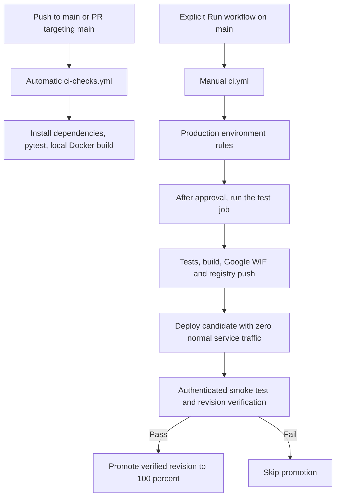

# Day 30 — Controlled deployments with GitHub Actions and Cloud Run

My objective was to keep automatic feedback on code changes while deciding deliberately when my Employee API changes production. I carried forward the Day 29 release sequence: deploy a candidate with no normal service traffic, smoke-test the deployed revision, verify its identity, then promote it. On Day 30 I changed what starts that sequence and who can authorise it. My final test was Employee API CI Run #23. It waited for approval, completed successfully, and promoted `employee-api-00050-ram` to 100% of normal service traffic.

I use **observed** for what my run or original image showed, **configured** for settings I saved, and **example** or **deferred** for explanations and possible future changes. The companion [screenshot workbook](Day-30-Screenshot-Workbook.xlsx) has an index. I can jump to an image by looking up its S-number there.

## CI and workflow triggers

### What did I mean by run tests, validate code, and build?

I originally connected testing with the smoke test we had already implemented. I now distinguish the target and timing of each check.

| Check | Where and when | What I learn |
| --- | --- | --- |
| `pytest -q` | On the GitHub Actions runner, before deployment, with project dependencies installed | My automated Python test cases behave as expected. `-q` keeps output brief. |
| `docker build -t employee-api:ci .` | On the runner, in `01-python-fastapi` | Docker can build the image from the current directory. The tag identifies the resulting local image on that runner. |
| Authenticated candidate smoke test | Over HTTPS after deploying a specific Cloud Run revision | My deployed candidate can start and respond to the small set of checks I actually execute. |
| Verify and promote | After the candidate check | I can send production traffic to the revision the pipeline actually verified. |

My teaching example for a FastAPI test was:

```python
def test_get_employees():
    response = client.get("/employees")
    assert response.status_code == 200
```

Here `client` is a test client supplied by the test setup. This illustrates a status assertion and does not identify the live smoke-test endpoint or prove every employee operation works. A deployed smoke test exercises a real network request and the deployed configuration. An MES component can pass its test suite on a runner while the deployed service still has a configuration or connectivity issue. A green smoke test likewise covers only the path tested.

I also separated my familiar C# `dotnet build` from a Docker image build. `dotnet build` checks syntax, types and references and produces assemblies. My Python workflow does not have an equivalent mandatory compilation phase. Importing and running the application in tests catches many errors on executed paths. The Docker build packages the source, runtime and dependencies. The image can build even when a business rule fails. By itself it also does not publish the image anywhere.

I was right to think of SonarQube when I heard “validate code.” Validation can include linting for coding issues, static analysis for potential bugs or maintainability and security issues, dependency scanning for known package vulnerabilities, and type checking for some type-related mistakes. I discussed these as options. My Day 30 checks were dependency installation, pytest and Docker build. I did not add SonarQube or a new security scan.

### What starts a workflow?

GitHub discovers the YAML under `.github/workflows/`. The `on:` section tells GitHub which events create runs. My workflow’s filename, display name and trigger are separate. `ci.yml` retained the display name **Employee API CI** even after it became the manual deployment workflow. **Employee API - CI Checks** is the separate automatic workflow.

My old Day 29 header in `ci.yml` was:

```yaml
name: Employee API CI
on:
  push:
    branches: [main]
  workflow_dispatch:
```

A push to `main` and a manual dispatch were two ways to start the same full pipeline. A documentation-only push could therefore lead to a new candidate and a real 100% traffic promotion. I changed only the trigger first, leaving the existing job and release steps intact:

```yaml
on:
  workflow_dispatch:
```

`workflow_dispatch` enables a manual request, such as choosing **Run workflow** in Actions. After that request, GitHub runs the steps automatically as the gates and dependencies allow. This resolved my later confusion about why #22 and #23 executed even after I removed `push`. I initiated both runs through Actions. The automated steps after dispatch did not require me to click each one.

### What does a pull request to main mean?

I first associated `pull_request` with pulling code down from `main`. In this workflow the branch filter names the **target branch of the proposed merge**. For example, `feature/employee-search` is the source branch and `main` is the target. Opening or updating that PR checks the proposed change before it reaches `main`. The merge then creates a push event on `main`, which checks the resulting state.

| Event | `push` filtered to `main` | `pull_request` filtered to `main` |
| --- | --- | --- |
| Direct push to `main` | Runs | No PR event from the push alone |
| Push to a feature branch with no PR | Does not run | Does not run |
| Open a feature PR targeting `main` | Does not run | Runs |
| Push more changes to the source of that open PR | Does not run | Runs on the PR update |
| Merge the PR into `main` | Runs | PR closure would require explicitly including that activity |

My MES example was a new `ManualLoad` activity for a PLC station. The developer can work on a feature branch and ask a lead to merge it into the common MES codebase. PR CI checks the proposal. Push CI checks the common branch after integration. A separate release decision controls when that version reaches the plant. Required CI status checks as a branch protection rule were discussed for later. A successful push test does not by itself demonstrate a tested PR path or enforce merge protection.

### How I separated the workflows

I used VS Code to save the files, then ran Git in PowerShell from the repository root with the repository checked out and permission to push `main`.

```powershell
git add .github/workflows/ci.yml
git commit -m "Day 30 - Make Cloud Run deployment manual only"
git push origin main
```

I observed commit `5d1d4da` reach `main`. Actions still showed Day 29 Run #21 as the latest deployment. At this intermediate point removing the push trigger also removed the automatic tests that had been part of that combined job. [S01–S05]

I then added `.github/workflows/ci-checks.yml`:

```yaml
name: Employee API - CI Checks
on:
  push:
    branches: [main]
  pull_request:
    branches: [main]
permissions:
  contents: read
jobs:
  validate:
    runs-on: ubuntu-latest
    defaults:
      run:
        working-directory: 01-python-fastapi
    steps:
      - name: Checkout source code
        uses: actions/checkout@v4
      - name: Set up Python
        uses: actions/setup-python@v5
        with:
          python-version: "3.12"
      - name: Install dependencies
        run: pip install -r requirements.txt
      - name: Run pytest
        run: pytest -q
      - name: Build Docker image
        run: docker build -t employee-api:ci .
```

`contents: read` gives checkout the read scope it needs. This job does not request `id-token: write` for Google federation. `ubuntu-latest` selects the hosted runner image. The working-directory default applies to shell `run:` steps, so `requirements.txt` and the Docker build context are taken from the FastAPI project. The checkout and Python setup steps use actions. Installing dependencies prepares pytest to import and run the application. Docker’s final dot passes the project directory as build context.

```powershell
git add .github/workflows/ci-checks.yml
git commit -m "Day 30 - Add automatic CI checks without deployment"
git push origin main
```

**Observed.** CI Checks #1 ran automatically on commit `2a68a2b` and passed in **1m 03s**. Checkout, Python setup, dependency installation, pytest and Docker build succeeded. The image `employee-api:ci` existed on the GitHub runner. There was no Artifact Registry upload or Cloud Run deployment in this job. The pip root-user warning and Node.js/Ubuntu runner annotations did not make it fail. [S06–S13]



The two lanes are independent. The deployment job still runs its own tests and builds its own image. I did not create an automatic handoff from CI, a required proof that the selected commit previously passed CI, or a build-once artifact promotion chain.

## GitHub production environment

I opened **Repository → Settings → Environments**, saw an empty list, selected **New environment**, entered `production` and opened its configuration. I reused the existing Cloud Run service. The GitHub environment is a named policy and configuration boundary for jobs that reference it. It does not provision a second cloud service or project. I think of DEV, QA, SIT and PROD as different release targets for developer checks, functional testing, integration testing and live operations. Only the `production` target was created here. [S14–S17]

| Control | What it means | What I configured |
| --- | --- | --- |
| Deployment branches and tags | Which refs may use this environment | Initially unrestricted. I chose **Selected branches and tags**, set ref type **Branch**, entered `main` and clicked **Add rule**. Saved state showed **1 branch and 0 tags allowed**. |
| Required reviewers | The protected job waits for a permitted user or team to approve | Off for #22. Enabled and saved for #23 with `Rajadurai0606`. |
| Prevent self-review | Prevents the initiating user from approving their own deployment | Unchecked for my solo learning test. |
| Wait timer | Adds a timed delay before deployment may proceed | Disabled. The wait in #23 was the reviewer gate. |
| Allow administrators to bypass | Permits an administrator to bypass protection where available | Enabled in my configuration. I tested normal approval. |
| Environment secrets and variables | Environment-scoped sensitive values and ordinary configuration, respectively | Both left empty. The existing WIF setup worked. |
| Custom rules via GitHub Apps | Can add external protection checks where supported | I saw the option and did not configure a custom rule. |

I chose an explicit rule instead of **Protected branches only**, whose behaviour depends on the repository’s branch protections. Selecting `main` in the run form chooses the ref used by that dispatch. The saved environment rule independently determines eligibility. I verified the positive `main` path. I did not run a negative test from a feature branch or tag. Required reviewers are subject to GitHub plan and visibility. In my repository the setting was available and the waiting run proved it applied. [S18–S20]

### Job binding and concurrency

I put `environment: production` directly under the existing job identifier `test`. The identifier is just its name in the workflow. The job includes CI-like steps as well as the deployment operations. This excerpt omits those existing steps.

```yaml
on:
  workflow_dispatch:
jobs:
  test:
    environment: production
    concurrency:
      group: employee-api-deployment
      cancel-in-progress: false
```

I chose the group name myself. Jobs with the same concurrency key share a gate, like work orders that must pass through the same MES station. I initially thought setting `true` was necessary to prevent overlapping releases. Serialization comes from the group. `false` keeps the active job running. `true` can cancel the active job when another enters the group. Cancellation may occur after a candidate was deployed or while traffic is being changed. It does not undo completed cloud operations.

| Teaching timeline with my saved default | A | B | C |
| --- | --- | --- | --- |
| Dispatch A | Running | — | — |
| Dispatch B | Running | Pending | — |
| Dispatch C before A ends | Running | Canceled | Pending |
| A finishes | Complete | Canceled | Eligible to run |

No extra `wait: true` is needed. By default the group can retain one pending job, so a new one can replace the older pending job while leaving A alone. GitHub also documents `queue: max` with up to 100 pending jobs. I considered that an example and kept the default for Day 30. Preserving a long queue can also mean older requested versions are still waiting when a newer release becomes the priority. The A/B/C timeline explains concurrency and was not a live test of three overlapping deployments. Concurrency and production approval are separate checks.

```powershell
git add .github/workflows/ci.yml
git commit -m "Day 30 - Configure production environment for manual deployment"
git push origin main
```

**Observed.** The push of `9573e59` started CI Checks #2, which passed in **49 seconds**. It did not start Employee API CI. [S21–S26]

## Manual Run 22 and the 404

I selected **Actions → Employee API CI → Run workflow**, chose `main` and clicked the green dispatch button. This was a real release request to the existing Employee API service. Reviewers were disabled, so the branch rule applied and the job could proceed without a second approval. If its smoke test and verification passed, normal traffic could move to the new revision. [S27–S28]

A GitHub **404** appeared after dispatch. I had two possibilities to distinguish: the dispatch was accepted and navigation failed, or a run was never created. I returned to Actions, refreshed and looked for a new **Manually run** entry after #21 on `main`. Run #22 was already in progress. That was the evidence that the dispatch succeeded, so I did not send a duplicate. The 404 did not show a WIF failure or a Cloud Run failure. If there had been no new run after checking the correct workflow and branch, the exercise guidance was to dispatch once and recheck. [S29–S30]

### Why this reminded me of Day 24

My question was whether this was like an SQL operation completing even when its caller saw a timeout. The similarity is uncertainty about the operation’s outcome from the caller’s point of view. An HTTP navigation 404 and a database command timeout have different mechanisms.

| Teaching timeline | What I see | What I need to check |
| --- | --- | --- |
| `t = 0 s` | The client sends an SQL INSERT | What transaction or business identifier identifies the operation? |
| `t = 30 s` | The client gives up waiting | Has SQL already committed, is it still processing, or was it canceled? |
| `t = 40 s` | In this example the operation could complete 10 s after the caller timed out | Check actual transaction state. Cancellation, connection and rollback behaviour can change the outcome. |
| Retry | Another INSERT may repeat the side effect | Use a stable transaction ID and an idempotency check or appropriate database constraint where applicable. |

An API POST can likewise complete even when the client gets no response. On an MES/HMI screen a delayed PLC acknowledgment does not prove a station command was never executed. I would check the transaction or machine state before repeating it. For GitHub, the Actions run list gave me the equivalent confirmation. I did not establish that the GitHub dispatch itself has an idempotency guarantee.

**Observed.** Run #22 finished successfully in **2m 08s**, manually triggered from `main` at `9573e59`. The job went through tests, Docker build, WIF authentication, Artifact Registry push, candidate deployment, ID token and smoke test, revision verification, and promotion. This proved the manual job could run with the environment bound and `main` allowed. It did not exercise a required-reviewer gate. [S31–S34]

## Approval and Run 23

My release request and the decision to authorise it are separate. In the MES/PDT example a developer or release engineer requests a rollout. A plant support lead or release manager approves the live deployment. The workflow then carries out the operations automatically. In my exercise I used the same account for both actions to demonstrate the mechanism. It was not independent sign-off.

1. I opened **Settings → Environments → production** and inspected **Required reviewers** before saving. The first form had no reviewer. I searched for `Rajadurai0606`, selected the account, left **Prevent self-review** unchecked, and saved the protection rules. The wait timer stayed off and administrator bypass stayed on. [S35–S38]
2. I manually dispatched Employee API CI again from `main`. Run #23 showed **production waiting for review** and **Review deployments**. I inspected the waiting state before approving. The protected `test` job had not begun deploying a new revision. [S39–S40]
3. I opened **Review deployments**, selected `production`, entered a comment, and approved. GitHub displayed **The deployments have been approved**, retained the comment and showed the job in progress. A release version, change ticket and precise scope were discussed as examples of audit context for a real plant release. [S41–S44]
4. I waited for a terminal result, reviewed the completed job, and checked Cloud Run traffic. Approval meant the job had permission to proceed. The completed logs and the Cloud Run revision view showed the actual outcome. [S45–S48]

I can approve after several hours or the next day while the request is still waiting. Rejecting blocks the protected job and canceling stops the run. GitHub documents a maximum of 30 days waiting on environment approval. This limit is separate from the optional environment wait timer and was not tested by waiting 30 days.

### Where exactly is the gate?

```text
Implemented on Day 30
  Manual request
    → Branch eligibility and production review
      → Entire test job starts
        → pytest/build → deploy candidate → smoke test → verify → promote

Discussed design for a separate promotion decision
  Candidate job → deploy at 0% → smoke-test and record verified revision
    → Separate protected promotion job → approved traffic change
```

In my saved YAML, the environment is attached to the whole job. Approval happens before any of that job’s steps, including pytest and the build. It does not pause again between successful smoke testing and promotion. A future design could split candidate verification and promotion into separate jobs. The promotion job would have to consume the verified revision identity and keep the protection on the operation that actually changes traffic.

## Run 23 results and timing

| Measurement | Conversion | Result |
| --- | --- | --- |
| Total elapsed for Run #23 | `6 × 60 s + 34 s` | **394 s = 6m 34s** |
| Job execution time | `1 × 60 s + 48 s` | **108 s = 1m 48s** |
| Difference | `394 s − 108 s = 286 s` and `286 s = 4 × 60 s + 46 s` | **4m 46s** |

The difference includes waiting for approval and any other overhead, such as scheduling. I cannot attribute all 286 seconds to the reviewer without more precise timestamps. Run #22’s 2m 08s was a different run and is not the execution-time input for this calculation.

**Observed.** Run #23 passed the tests, built and pushed the image, authenticated to Google through WIF, deployed the candidate, authenticated the smoke-test request, verified the candidate and promoted it. The Cloud Run **employee-api** revision list in **europe-west2** showed **employee-api-00050-ram** receiving **100%** normal service traffic. The previous **employee-api-00048-del** had **0%** normal service traffic. [S45–S48]

### What I carry forward from Day 29

The GitHub runner’s WIF setup provides Google credentials for deployment operations. The authenticated smoke test needs an ID token suitable for calling the private Cloud Run service. The management credential and the token presented to the candidate endpoint serve different purposes. At 0% normal service traffic, a tagged candidate can still have a direct URL for testing subject to its access controls. I keep the candidate revision identity through the test and promotion so the traffic switch targets what I actually verified. A failed check should stop promotion, but an unpromoted candidate or pushed image can still exist.

A release to 100% affects the live service. The routing change can take time and in-flight requests can continue. A traffic rollback sends traffic to a previous revision and does not reverse writes, schema changes or external side effects. In a real MES/PDT release I would consider compatibility of the new version with ongoing transactions and the shared backend, verify what the HMI or clients actually see, and treat the smoke test as a limited post-deploy check. These are operational implications, not additional deployment tests I ran on Day 30.

**Deferred.** The Node.js deprecation warning remained cleanup for later. I did not add independent reviewers, a second traffic approval, a larger deployment queue, PR-required checks, additional analysis tools or a feature-branch denial test.

## Deferred topic — Stateless and stateful

I explicitly parked this for separate study. My shorthand was that stateless means no local memory and stateful means local memory. The more precise distinction is that a stateless API instance does not need its own memory of previous requests. A stateful operation relies on previous state, which may be in local memory or in shared storage such as Redis or SQL. The question of where an idempotency key should persist across instances belongs in that separate topic.

## Quick recall

| If I forget… | I can remember… | Workbook |
| --- | --- | --- |
| Where GitHub discovers YAML versus when it runs | Folder discovers. `on:` selects events. Dispatch is a manual start followed by automatic execution. | S02–S07 |
| What CI proved | pytest and Docker build succeeded on the runner. Cloud deployment has its own steps. | S08–S13, S23–S26 |
| How production eligibility works | The job references `production`. The environment allows `main`. Branch selection and approval do separate jobs. | S14–S26 |
| Whether a 404 means I must retry | Check Actions for a new run first. #22 already existed. | S27–S34 |
| When approval applies | #23 waited before the entire protected job. Successful smoke testing then allowed automatic promotion. | S35–S47 |
| How I know traffic moved | GitHub success plus the Cloud Run revision view at 100%. | S45–S48 |

### Documentation references

- My Day 29 learning notes cover automated smoke testing, candidate verification, promotion and the previous failure-path exercise. My Day 24 notes cover transaction IDs, idempotency and retry behaviour.
- Workflow discovery, triggers and YAML configuration. [GitHub Actions workflow syntax](https://docs.github.com/en/actions/reference/workflows-and-actions/workflow-syntax)
- Branch restrictions, reviewers, environment secrets and bypass settings. [GitHub deployment environments](https://docs.github.com/en/actions/reference/workflows-and-actions/deployments-and-environments)
- Reviewing and approving a pending deployment and the approval time limit. [Reviewing deployments](https://docs.github.com/en/actions/how-tos/deploy/configure-and-manage-deployments/review-deployments) · [GitHub Actions limits](https://docs.github.com/en/actions/reference/limits)
- Candidate tags, migration and rollback. [Cloud Run traffic management](https://docs.cloud.google.com/run/docs/rollouts-rollbacks-traffic-migration)
