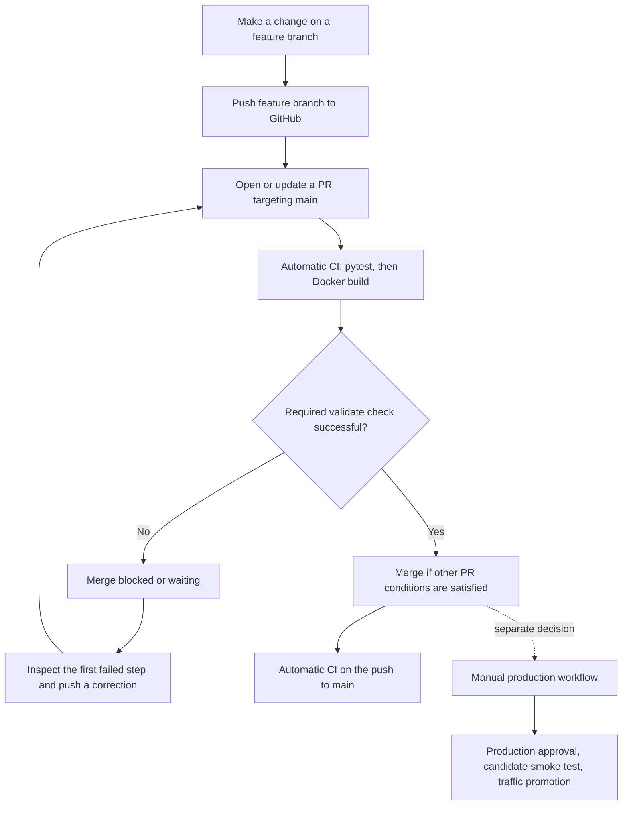

# Day 31 · My first protected pull request

I practised the whole path from a small README edit to a protected merge into `main`. I used the Employee API project because a documentation-only change let me exercise Git, CI and branch protection without changing application behaviour. I deliberately broke a test, repaired it, removed the temporary test and merged the remaining documentation change.

**Evidence key.** I distinguish what I actually did and saw from examples and proposed settings. Screenshot IDs refer to the original images in the companion workbook. I covered the learning sequence from the Day 31 task through the final branch deletion and subsequent documentation requests. The Day 30 checkpoint below is included where it informs this exercise.

### What I set out to prove

Before Day 31, my push-triggered CI could detect a bad commit after it landed on `main`. I wanted the validation to run while the change was still a proposal and GitHub to enforce its result. The exercise separated three questions: **Did the change pass the tests and build?** **Is the protected branch allowed to accept it?** **Has someone authorised production deployment?** I first opened the PR without the new requirement, then activated the rule and tested the same PR on green, red and green heads. The planned scope was about an hour. I kept the separate stateless/stateful discussion and the deeper exploration of multi-remote Git tracking for another session.

## My learning map



The original lesson drew a decision between passing CI and blocked merging. I add the pending state here because I saw it twice during the exercise. While a new head was waiting for validation, the previous green result could not approve the new code. The diagram also separates the automatic check after merging from the optional release to production.

| When I ask myself… | Which control answers it? | Evidence I look at |
| --- | --- | --- |
| Has the change been saved in Git? | Local commit | Terminal commit ID and working-tree status |
| Can GitHub see my proposed change? | Branch push and PR | Remote feature ref, source, target and PR number |
| Can the branches be combined cleanly? | Merge compatibility | “Able to merge” or “No conflicts with base branch” |
| Did the proposed revision pass our automated tests and build? | CI workflow | Latest `validate` result and step logs |
| Can the proposed revision enter the shared baseline? | Ruleset and other merge conditions | Saved Active ruleset, Required badge, enabled or blocked merge |
| Has the approved revision actually been released? | Manual production workflow and environment gate | Dispatch, reviewer approval, candidate checks and Cloud Run traffic |

The practical sequence went from branch creation to local commit to remote publication. Each step changed a different part of the system. After that I kept one PR open while I changed the repository policy and deliberately changed the code under test. This gave me a before-and-after comparison on the same PR rather than forcing me to compare unrelated branches or runs.

## Git and ancestry

**What does Git actually pull?** I think of a branch as a movable name pointing to one commit. Each commit records a snapshot and links to its parent or parents. In my clone, `main` names my local branch. `origin/main` is my local record of the last fetched state of GitHub's `main`. I can inspect that remote-tracking reference offline, although it can be stale.

| Operation | What I expect |
| --- | --- |
| `git fetch origin` | Download objects and refresh remote-tracking references according to the configured fetch rules. My checked-out branch stays where it is. |
| `git fetch --all` | Fetch the configured remotes, subject to their fetch configuration. Useful when I have both a fork and a canonical repository. |
| `git pull` | Fetch, then integrate the configured upstream into my current branch. The integration can fast-forward, merge or rebase depending on ancestry and options/configuration. |
| `git pull --all` | Fetch from all eligible remotes. The pull still integrates into the checked-out branch using its selected source. It does not update every local branch or merge all the fetched branches together. |
| `git pull origin main` | Fetch the requested branch and integrate it into whichever branch I am currently on. I check my current branch first. |
| `git push -u origin feature/day31-pr-demo` | Publish my branch and set its upstream on a successful push. Later argument-free pulls can use that tracking configuration. Future argument-free pushes also depend on my push settings. |

**Why does “upstream” sound like two different things?** The upstream *of a branch* is its configured tracking branch. A remote *named* `upstream` is a convention, often for the canonical repository when `origin` points to my fork. I can use upstream tracking without ever having a remote literally named `upstream`. The local configuration currently shows `main` tracking `origin/main`.

**What if two branches have the same files?** They may still have unrelated histories. Two separate `git init` operations followed by independent first commits create two roots even if both people copied the same README. For a normal branch comparison I want a common ancestor. I can use `git merge-base main feature/day31-pr-demo` to find it while both refs exist, and `git log --oneline --graph --decorate --all` to visualise it. If I hit an unrelated-histories error, I first check the remote URL and confirm I branched from the intended project. A fresh branch from the correct base with my change reapplied is a clean recovery for an accidental independent history. Git's `--allow-unrelated-histories` deliberately overrides the safeguard for a merge of independent projects. In my exercise the reflog records the feature and main at the same starting commit, `cda051a`. [Git pull reference](https://git-scm.com/docs/git-pull)

### The tracking example that helped me

In the teaching example, my local `main` points to commit 2 while remote main is already at commit 4. After `git fetch`, `origin/main` advances to 4 and local `main` stays at 2. A pull while I am on main, with main tracking `origin/main` and no divergence, then moves my local branch to 4. There are two commits to incorporate, 3 and 4, and Git can advance the pointer directly.

My second teaching example used two remotes. `origin` had branches `main`, `feature/login` and `feature/employee`. The hypothetical `upstream` had `main` and `feature/payment`. `git fetch origin` visits just origin, whereas `git fetch --all` visits both under the example configuration. If I am on main tracking origin/main, `git pull --all` integrates origin/main. None of the feature refs is thereby merged. With just origin configured, fetching all remotes usually adds nothing to the fetch portion. `git remote -v` lists URLs, so one remote can appear twice, once for fetch and once for push. `git branch -vv` shows the tracking relationship in brackets. Example branches such as `feature/employee-validation` were teaching examples. I deferred the deeper tracking investigation and proceeded with the explicit `git pull origin main`.

### Draw the fetch and pull example from memory

In the source example my local main has commits 1 and 2, while the server already has 3 and 4. Before fetching, the cached remote-tracking ref still points to 2. The branch pointers below are observations at three moments in a hypothetical exercise.

```text
Commit ancestry                    1 ── 2 ── 3 ── 4
                                           
Before fetch                        local main = 2
                                    origin/main = 2
                                    GitHub main = 4

After git fetch                     local main = 2
                                    origin/main = 4
                                    GitHub main = 4

After a fast-forwarding pull        local main = 4
                                    origin/main = 4
                                    GitHub main = 4
```

When I first said that fetch downloads changes and pull downloads and merges them locally, my basic distinction was right. The word *merge* needed more precision. In this graph the checkout advances to commit 4 without creating a new commit. If both sides have advanced independently, Git may reconcile the diverging histories by merging or rebasing, or it may stop under a fast-forward-only policy. I need to know which branch I am on and which branch I want to integrate before choosing the command.

When I asked what `--all` referred to, the useful shift was from counting branches to counting remote repositories. A remote is a named connection to a repository. A remote-tracking ref records the last known state of a particular branch on that connection. A local branch's upstream is the one it follows by default. For example, my `main` can follow `origin/main` even when a remote named `upstream` also exists. The keyword *upstream* in a tracking explanation and the label *upstream* in `git remote -v` describe different things.

| Teaching command | Expected observation | What I still need to decide |
| --- | --- | --- |
| `git remote -v` | Names and their fetch/push URLs | Which remote contains the branch I need |
| `git branch -vv` | Current branch marked with an asterisk and upstream in square brackets if configured | Whether the tracking relationship is the intended one |
| `git fetch origin` | Updates from origin available locally | Whether to integrate any of the fetched changes |
| `git fetch --all` | Configured remote updates available locally | Which single branch, if any, should be integrated |
| `git pull origin main` | Integration of remote main into my checked-out branch | Whether my checked-out branch is the intended recipient |

The branch-list example used `* main a1b2c3d [origin/main] Latest commit` and `feature/employee-validation d4e5f6a [origin/feature/employee-validation] Add validation`. The hashes were illustrative. In the real exercise S01 showed that main was already up to date, and S04 gave direct evidence of the feature tracking setup. I deferred the wider multi-remote question because those two pieces were enough to proceed.

### Why GitHub offered a PR and how it computed the change

Pushing `041e30c` published a feature ref with a change GitHub could propose. The suggestion and link from the push output were conveniences. I still had to submit a PR. Starting the feature at main gave Git a common starting commit. In the teaching graph A → B → C, both branch tips initially point to C. A new D points back to C and is reachable from the feature tip only. Git uses those parent links. The `feature/` prefix carries no ancestry information. A fork can share the same ancestry, while two branches in one repository can have independent roots. `git merge-base main feature/day31-pr-demo` locates the common ancestor, and `git diff main...feature/day31-pr-demo` shows the feature diff from the merge base without changing either branch. I run these while the branch refs still exist.

### Ancestry, the proposed diff and the final merge

```text
Starting point          A ── B ── C    main and feature
After my new commit     A ── B ── C    main
                                   ╲
                                    D  feature

Independent roots       A ── B ── C    main
                        X ── Y ── Z    independent branch
```

In my example, D was the README commit `041e30c`. A branch is a pointer and D points back to C through its parent. Git can identify C as the shared starting point and show what the feature introduced between C and D. If main advances independently later, the feature-side comparison can still start at the common ancestor while the actual merge must account for changes on both sides. That is why “What does this PR propose?” and “Can the branches merge without conflicts?” are different questions.

Two snapshots can have identical files while their commit histories are unrelated. Conversely, a feature branch in a fork can share a merge base with the original repository. Being in one GitHub repository helps GitHub find the refs, but the parent graph explains how Git computes the relationship. The two inspection commands discussed were `git merge-base main feature/day31-pr-demo` for the starting commit and `git diff main...feature/day31-pr-demo` for the feature-side file changes. Neither publishes a branch or changes either tip.

## README branch and PR

**Why is a pull request different from pull?** My terminal's `git pull` updates a local branch. A GitHub PR creates a shared proposal, showing the change between my source branch and the target, plus discussion, checks, reviews and a final merge record. Publishing a branch gives GitHub the commits. Opening the PR chooses where I propose to integrate them. On PR #1 the **compare/head/source** was `feature/day31-pr-demo` and the **base/target** was `main`. If I reverse those fields, I ask to change the wrong branch.

**Verified README change.** At `01-python-fastapi/README.md`, I added:

```markdown
## Day 31 - Pull Request Practice

This change is created in a feature branch to practise
GitHub Pull Requests, automatic CI checks, and merging into main.
```

### Steps 1–5 · Actual commands and checkpoints

I worked in VS Code PowerShell from the repository root. The clean working tree was my prerequisite before switching branches.

```bash
git status
git switch main
git pull origin main
git switch -c feature/day31-pr-demo
# Edit and save 01-python-fastapi/README.md
git status
git add 01-python-fastapi/README.md
git commit -m "Day 31 - Add pull request practice notes"
git status
git push -u origin feature/day31-pr-demo
```

1. **S01** showed main already checked out and in sync with origin/main, and the explicit pull reported “Already up to date.” `-c` created and switched to my local feature branch. The new branch and main started at `cda051a`.
2. **S02** showed the README edit under `01-python-fastapi`. The initial instruction referred to the root README. The screenshot clarified the actual location, which became the file we staged and kept. `git status` initially showed the modification as unstaged.
3. **S03** showed commit `041e30c`, one file changed and five insertions, followed by a clean tree. The local commit moved my feature ref. Main and GitHub were still unchanged at this stage.
4. **S04** showed a successful new branch push, tracking of `origin/feature/day31-pr-demo` and a GitHub link suggesting a PR. `-u` records tracking, which let me use plain `git push` for the later commits in this repo.
5. **S05–S07** showed the compare form and creation. Base was `main`; compare was `feature/day31-pr-demo`. “Able to merge” meant GitHub saw no conflict at that point. One commit and one changed file were visible. The suggested title was “Day 31 - Pull Request Practice.” The actual title was “Day 31 - Add pull request practice notes.” I entered the description “Practising GitHub Pull Requests and automatic CI checks,” with bullets for creating the feature branch from main, updating the Employee API README and testing CI before merging into main. Once I clicked **Create pull request**, it became PR #1.

**Teaching example.** For a future Employee API validation change I could use `git switch main`, `git pull origin main`, then `git switch -c feature/employee-validation`. After writing the change, the lesson's example used `git add .`, `git commit -m "Add employee validation"`, and `git push -u origin feature/employee-validation`. The correct next step is to open a PR targeting main. Pulling all remotes from my feature branch would not propose my code for integration, and pushing directly to main would skip the proposal. The actual exercise staged only the intended README path.

### What I learned by separating commit, push and proposal

A saved README modification existed first in my working tree. Staging selected it for the next snapshot. The commit gave the staged change its own identity in local Git. Push sent that commit to GitHub and created a remote branch ref. At that point I had all the ingredients for a proposal, but I still had to choose the direction, inspect the change and click **Create pull request**. This explains why the terminal could print a PR creation link without automatically opening one.

I used the small Employee API documentation edit to isolate the behaviour I was testing. If I had changed API logic and several tests at the same time, a failing run could have raised questions about whether the feature itself was wrong or the gate was working. The small change gave me a clean initial PR and a deliberately controlled failure later.

```text
Working tree: saved README change
    ↓ git add
Index: README staged for the next snapshot
    ↓ git commit
Local feature branch: 041e30c
    ↓ git push -u origin feature/day31-pr-demo
GitHub feature branch: 041e30c
    ↓ Create pull request with main as base
PR #1: proposal from feature/day31-pr-demo into main
```

## Ruleset and verification

A running job can report red after a change lands on an unprotected branch. The ruleset moved the decision to before integration. I kept PR #1 open while going to **Settings → Rules → Rulesets → New ruleset → New branch ruleset**. I used the first green PR run to identify the check before enforcing it. Screenshots S12–S29 preserve each stage.

### Steps 7.1–7.4 · Build the rule while Disabled

| Field | Value I used | Meaning and interaction |
| --- | --- | --- |
| Ruleset name | Protect main - Require PR and CI | A clear description of the target and two principal gates. |
| Enforcement | Disabled during configuration and first save, Active after a separate save | Disabled keeps a saved rule from enforcing. Evaluate, where supported, observes without blocking. Active enforces against matching branches. |
| Bypass | Empty | The test needed the rule to apply to me. A bypass could leave merging available despite a failed required check. The UI can filter or add eligible actors, roles, teams and apps. |
| Target | Include default branch | Resolves to main. Include all branches and inclusion/exclusion patterns were available. I scoped the rule to the integration branch so I could push and later delete the feature branch. |
| Restrict creations / updates | Both unchecked | These restrictions can limit who creates or updates matching refs. I used specific PR and status-check requirements for ordinary changes. |
| Restrict deletions / Block force pushes | Both checked | Protect matching refs against deletion or history rewrites by users without bypass. |
| Linear history, successful deployments, signed commits | All unchecked | A linear-history gate would rule out merge commits. Deployment and signature gates are distinct from the PR and CI gates tested here. |
| Require a pull request before merging | Checked | A matching branch update must normally use a PR. This checkbox alone supplies no Python or Docker validation. |
| Required approvals | 0 | I could exercise the gates with my own account. A team might choose one or two eligible reviewer approvals in addition to CI. Day 30 production review is a separate control. |
| Dismiss stale approvals | Unchecked | An earlier approval is not automatically dismissed by this option when the approved diff changes. |
| Review from specific teams / Code Owners | Both unchecked | No extra team or ownership approval was required. |
| Approval of most recent reviewable push | Unchecked | No separate latest-push approval condition. With it enabled, someone other than the most recent pusher would need to approve that push. |
| Conversation resolution | Unchecked | Unresolved review threads were not an additional blocker. |
| Additional approval for unauthored Copilot PRs | Checked | A conditional extra approval option for applicable Copilot PRs when approvals are required. It was separate from automatic Copilot review and did not add a reviewer to my solo exercise. |
| Allowed merge methods | Merge, Squash, Rebase | All three were available. I made the actual selection at the end. |
| Require status checks to pass | Checked | This exposes the list of mandatory checks. S17 still says “No checks have been added”; enabling the checkbox was only the first step. |
| Require branches to be up to date before merging | Unchecked | I did not impose the additional requirement that the proposed head be up to date with the latest base before merging. |
| Do not require status checks on creation | Unchecked | No special exception to the configured check requirement at matching-ref creation. |
| Required check and expected source | `validate` from GitHub Actions | One job executes both pytest and Docker. Choosing the GitHub Actions source binds the requirement to the producer I observed. |
| Code scanning, code quality, restrict code coverage, automatic Copilot code review | All unchecked | Separate analysis, coverage and review options. I kept the exercise focused on the existing validation job. |

### Step 7.5 · Answer my two questions with evidence

**How do I find the job if I don't read YAML or haven't run Actions?** I opened **Actions → Employee API - CI Checks → Run #4 → Jobs → validate** (S19–S20). The workflow is the overall pipeline, `ci-checks.yml` is its file, `validate` is the job, and pytest and Docker are steps. I need the check name that GitHub reports, which can differ from the YAML key if a custom display name is used. One workflow can report several jobs. If no workflow has run and reported the desired check, the selector has no recent result for me to identify. I first configure and run the workflow, then verify the actual check name and provider. In this exercise typing `validate` found it immediately (S18). Run #4 reported a Node.js 20 deprecation warning and upcoming Ubuntu runner image notice. The run succeeded and I deferred both maintenance items.

**How do I know Default targets main?** I opened repository **Settings → General** separately to preserve the unsaved ruleset tab. **Default branch** displayed `main` (S21). An explicit pattern for `main` would continue matching main if the default later changed to develop. **Include default branch** would follow develop. The saved rule later confirmed “Applies to 1 target: main” (S25).

### Steps 7.6–8 · Review, create, activate, verify

1. I checked the lower section with `validate` and the GitHub Actions source, force-push protection and unchecked advanced options before **Create** (S22).
2. GitHub showed **Confirm access**. I completed its email-based security verification using the GitHub sudo message (S23–S24). This was proof of account access during configuration. It did not supply a PR review or authorise Cloud Run. I verified **Ruleset created**, the Disabled status and resolved scope in S25.
3. I changed the dropdown to **Active** (S26–S27). The header still said **Disabled**. That mismatch meant I had changed the form but had yet to persist it. I clicked **Save changes** and verified the **Ruleset updated** banner plus the **Active** header (S28).
4. I returned to the still-open PR. Its 52-second green `Employee API - CI Checks / validate (pull_request)` check now had a **Required** badge. The merge button was enabled and no conflicts were shown (S29). The badge confirmed that the passing job was now a gate. The deliberate failure would test whether GitHub enforced it. [GitHub ruleset fields](https://docs.github.com/en/repositories/configuring-branches-and-merges-in-your-repository/managing-rulesets/available-rules-for-rulesets)

### What I was trying to prove at each ruleset checkpoint

The ruleset form had several states that looked similar if I only glanced at the page. In the first state I had typed a name but the target was still missing. Selecting **Default** populated the targeting criterion, but I had to verify separately that the repository's default was `main`. Turning on required status checks exposed the list, but the list still said “No checks have been added.” Searching for the job and adding `validate` from GitHub Actions completed that field. Only then did I have the intended rule in the form.

Creation and activation were separate. After the email verification I had a saved ruleset that applied to one target, but enforcement was still Disabled. Selecting Active changed the form while the header continued to show the last saved value. The final save changed the header and produced the update banner. Each of these stages has its own original screenshot. When I need to troubleshoot a rule later, the resolved target, saved status and PR badge are three independent places to check.

```text
New form
  → Name entered; no target
  → Default selected; resolve it to main in General
  → PR required; zero human approvals
  → Status-check gate enabled; required check list still empty
  → Add validate (GitHub Actions)
  → Create; complete Confirm access
  → Saved and Disabled; Applies to 1 target: main
  → Select Active; header still Disabled
  → Save changes; header Active and Ruleset updated
  → Return to PR #1; validate displays Required
  → Push a bad revision; verify GitHub actually blocks the merge
```

A review requirement governs who has looked at the change. A status-check requirement governs which machine-produced result must exist and pass. With zero required approvals I could do the exercise alone and still prove that code could only enter main through the PR and passing check. This was a deliberate exercise choice. In the UniversalStep example, an organisation could require a team reviewer for business logic or ownership reasons alongside automated tests. A reviewer being satisfied with the change would not turn a failed test green.

If I am configuring a different project and do not know the required job name, I can start from an actual successful run or the PR Checks display, find the exact published check and choose that source. I should not infer the check name from the filename. In this project `Employee API - CI Checks` is the display name of the whole workflow and `validate` is the name I selected. Asking GitHub to require a check that the workflow never reports can leave a PR waiting for a result indefinitely. I also keep the form tab open while checking repository General so I can return to the unsaved form.

## CI and failure

This is the **verified repository YAML** for `.github/workflows/ci-checks.yml`. It is the automatic validation workflow.

```yaml
name: Employee API - CI Checks

on:
  push:
    branches: [main]
  pull_request:
    branches: [main]

permissions:
  contents: read

jobs:
  validate:
    runs-on: ubuntu-latest

    defaults:
      run:
        working-directory: 01-python-fastapi

    steps:
      - name: Checkout source code
        uses: actions/checkout@v4

      - name: Set up Python
        uses: actions/setup-python@v5
        with:
          python-version: "3.12"

      - name: Install dependencies
        run: pip install -r requirements.txt

      - name: Run pytest
        run: pytest -q

      - name: Build Docker image
        run: docker build -t employee-api:ci .
```

The PR filter applies to the **base branch**, so my feature branch can be the source. Opening it starts a run. Pushing a new commit to the existing PR starts a `synchronize` run. The push filter applies to the branch that received the commit. The squash put a commit on `main`, which then triggered the push run. Opening the PR does not move main. The Actions runner checks out source, selects Python 3.12, installs dependencies, runs pytest quietly and builds the Dockerfile with the FastAPI directory as the build context. A successful build creates a runner-local image tagged `employee-api:ci`. The YAML contains no registry push or Cloud Run step.

| Run | Trigger | Change or ref | Result | Duration |
| --- | --- | --- | --- | --- |
| #4 | PR opened | `041e30c` README proposal | Passed | 55 s |
| #5 | PR synchronize | `1298355` intentional failure | Failed | 29 s |
| #6 | PR synchronize | `cd07a00` corrected assertion | Passed | 1 min 2 s |
| #7 | PR synchronize | `8442417` temporary test removed | Passed | 57 s |
| #8 | Push to main | `a2fc5a9` squash commit | Passed | 1 min 13 s |

**Step 6 and run timings.** S07 showed the check queued as soon as I opened PR #1. The visible merge control was no proof of CI success or enforcement. I waited and used the PR check and Actions details (S08–S11). The initial `validate` job showed 52 seconds, including pytest and Docker. S40 reports 58 seconds for the corrected job and S46 reports 54 seconds for the cleanup check. The table uses total workflow durations from S51, which include workflow overhead. For example, #8 lasted `1 × 60 + 13 = 73 seconds`. These are observed durations from different UI scopes, not conflicting values.

**What did I break?** Commit `1298355` added `01-python-fastapi/tests/test_day31_ci_failure.py`. This was a test of the workflow and the gate. It made no changes to an endpoint or production environment.

```python
def test_day31_required_check():
    assert 1 == 2
```

S30 showed the file as untracked while the feature branch was up to date with its upstream. I staged and committed it, then pushed (S31). S32–S35 show the run, job summary, detailed log and still-single open PR. The exact pytest output was **1 failed, 6 passed, 1 warning in 7.76s**. The log identifies `tests/test_day31_ci_failure.py::test_day31_required_check`, `AssertionError: assert 1 == 2` and exit code 1. The warning was separate from the failing test count. The suite therefore had `1 + 6 = 7` test outcomes in that run. One failed assertion was enough for pytest to exit unsuccessfully. Actions stops later ordinary steps in the same job after failure, so S34 shows that the Docker step was skipped. A skip in that position tells me to fix the first failed step before investigating Docker. S36 shows “All checks have failed,” the Required label and the disabled merge button. A successful branch push therefore gave GitHub a commit to test without giving it permission to enter main.

**What fixed it?** I changed the same assertion to `assert 1 == 1` in `cd07a00` and pushed the correction to the **same source branch**. The PR updated in place and #6 passed. The older failure remained in the history as evidence. I then removed the temporary file in `8442417` and pushed again. #7 validated the final head. A pass on the corrected test proved the pipeline could return to green. Removing it meant the artificial test would never ship. Both passing builds followed the test step under the recovered YAML.

**Steps 10–11 screenshots.** S37 shows my saved edit as modified and unstaged. S38 shows the repair commit and push; S39 shows the check in progress; S40–S41 confirm the green required check, re-enabled merge and successful pytest and Docker steps. With one demonstration assertion corrected, I expected 7 passing tests. S42 shows I inspected all three merge methods but deferred the merge. S43 shows `git rm` both removed the file from the working tree and staged the deletion. No second `git add` was needed. S44 confirms cleanup commit `8442417` with two deleted lines and its successful push. S45 shows CI pending on the fourth commit, S46 shows the required check passing, and S47 confirms the list still showed one open PR. Removing the demonstration file returned the intended suite to its original six tests.

**Commands used for the failure, repair and cleanup**, from the repository root. I ran `git status` after creating the file, after correcting it and after staging removal:

```bash
git add 01-python-fastapi/tests/test_day31_ci_failure.py
git commit -m "Day 31 - Test branch protection with failing CI"
git push
# Edit the assertion to 1 == 1, then stage and commit the correction.
git add 01-python-fastapi/tests/test_day31_ci_failure.py
git commit -m "Day 31 - Fix failing CI test"
git push
git rm 01-python-fastapi/tests/test_day31_ci_failure.py
git commit -m "Day 31 - Remove temporary CI test"
git push
```

For a local reproduction with Python and requirements installed, I run `python -m pytest -q` from `01-python-fastapi`. To reproduce the build there I need a running Docker engine, then `docker build -t employee-api:ci .`. These are practice commands. The actual staging, commits and pushes are captured in S30–S31, S37–S38 and S43–S44. I used the Actions log for the observed pytest failure.

### My failure investigation, in the order I used it

1. I first verified that the push had reached the intended feature branch. The terminal showed `041e30c..1298355` on `feature/day31-pr-demo` (S31). A successful push told me GitHub received the commit. I still needed the Actions result and PR merge state.
2. I looked at the Actions run list (S32) and opened the failed run #5 summary (S33). The failure was inside `validate` after checkout, Python setup and installing dependencies. This narrowed the investigation from the whole workflow to the first red step.
3. I expanded **Run pytest** (S34). The failed test ID pointed to the file and function I had added. At line 2 the test compared 1 with 2. Of the seven test outcomes, six passed and one failed. The one warning came from Starlette's use of the deprecated AnyIO `BlockingPortal` alias. It was distinct from the assertion error. The decisive signal was the nonzero exit code, so I left warning maintenance aside.
4. I checked the steps following pytest. The Docker build showed the skipped icon. In this workflow it depends on the earlier steps succeeding. That explained why I had no Docker failure to fix. A skipped build and a build that starts and then fails require different investigations.
5. I checked PR #1 itself (S35–S36). The check was red **and Required**. The merge control was disabled. This verified enforcement against the actual proposed revision rather than simply observing an Actions failure.
6. I repaired only the assertion and pushed the correction to the same branch. First I saw pending on the new head, then a green `validate` and the re-enabled merge button (S39–S41). After removing the demonstration file, the fourth head went through the same pending-to-green transition again (S45–S46).

| Head or moment | Gate at that moment | What I learned |
| --- | --- | --- |
| Initial PR queued, before ruleset | Job visible and merge control present | A visible check and a compatible diff do not establish that a pass is mandatory. |
| Initial PR green, after activation | Required badge on the green job | An already successful result can meet the newly configured requirement. |
| Intentional failure | Required check failed and merge disabled | The rule is enforced even when the feature push succeeds. |
| Correction in progress | Required result still pending | GitHub waits for the new revision rather than reusing the previous result. |
| Correction green | Required check passed and merge enabled | Changing the offending assertion repaired the gate without a new PR. |
| Cleanup green | Final head validated and merge enabled | I can now merge a proposal whose net diff contains only the README update. |

I use three time measurements for different questions. The 7.76 seconds is pytest's reported execution time for the failing suite. The failed `validate` job took 26 seconds in the job view because it includes setup and other steps. Run #5 took 29 seconds in the workflow list because that view measures the entire run. In the source exercise I used the green and red states to test enforcement, not speed. The timing distinctions help me compare the same scope when I revisit the screenshots.

## Merge and cleanup

My four feature commits tell the story of the experiment. Squash merge gave main one new commit with the final net change.

```text
cda051a ── 041e30c ── 1298355 ── cd07a00 ── 8442417   feature history
    └───── a2fc5a9                                      main
```

| Method | What I would find on main | When I can use it |
| --- | --- | --- |
| Create a merge commit | A two-parent commit links the base and original feature tip. The original feature commits are ancestors of main. | I want to retain the branch graph and individual commit IDs. |
| Squash and merge | One new commit records the cumulative changes. Original feature commits do not become ancestors of main. | I want one cohesive integration commit and can keep the experimental history in the PR. This is what I used. |
| Rebase and merge | Individual changes are replayed in a linear series onto the base. GitHub assigns new commit IDs. | I want meaningful individual steps in linear history. |

**One PR or several?** I asked whether the repeated checks meant several merge requests. The open PR list showed one, PR #1. Each push advanced its source branch, generated a new check for that revision and left the previous result in the timeline. The four feature commits are four checkpoints in that one proposal. We initially left the default merge-commit option selected and discussed using it again after the repair. Once we saw that three of the four commits existed solely for the exercise, we chose squash to keep one meaningful integration commit.

**Step 12 and the comment-box correction.** I opened the dropdown, selected **Squash and merge** and saw that the PR still had its green required check and no conflicts. In S48 I typed the proposed title in **Add a comment**. That field posts discussion text. The commit message belongs in the confirmation section reached by clicking the green **Squash and merge** button. The next screenshot, S49, shows the completed merge. There is no separate confirmation-form capture among the original attachments. The resulting commit title was “Day 31 - Add pull request practice notes (#1).”

**Verified net effect.** `git show a2fc5a9` gives only the five added README lines, including blank separators. No test file or workflow change is in the diff. S54 shows the PR's four commits and the merge event. S53 shows PR #1 under the closed filter as merged with one passing check. The commit message lists the four feature commit subjects and attributes the contributor. GitHub's noreply author on the squash and the local author in the feature history are distinct attribution fields. They do not establish the account verification steps.

**Sync my clone.** The reflog records a return to `main` at `cda051a`, followed by `pull origin main: Fast-forward` to `a2fc5a9`. The exact command sequence shown in S50 was:

```bash
git status
git switch main
git pull origin main
git log -1 --oneline
```

The branch pointer moved forward because my old main was an ancestor of the new main. This local sync created no additional merge commit. The closing discussion reports verification of the README update on main. The terminal printed `Updating cda051a..a2fc5a9`, `Fast-forward`, the README with five insertions, and `a2fc5a9 (HEAD -> main, origin/main)`. Before the fetch the local tracking ref could still say the branch was up to date with its last-known value. The pull refreshed that value.

**Delete the feature locally first.** S52 shows the exact commands and result:

```text
git branch -d feature/day31-pr-demo
warning: deleting branch 'feature/day31-pr-demo' that has been merged to
         'refs/remotes/origin/feature/day31-pr-demo', but not yet merged to HEAD.
Deleted branch feature/day31-pr-demo (was 8442417).
git branch
* main
```

The warning compares ancestry. The local feature tip was already on its tracked remote branch, which satisfied the safe deletion check in this case. Its four original commits were not ancestors of `HEAD` on main, because the squash made a new commit. I verified the net README change independently of the ancestry warning. The warning and successful deletion are compatible.

**Delete the remote branch.** I returned to the merged PR and used **Delete branch**. S54 shows the deletion event and **Restore branch**. Local deletion and remote deletion are separate ref updates. The merged PR remains in GitHub and the squash remains on main. If my local remote-tracking reference is stale after GitHub deletes the branch, `git fetch --prune origin` is a practice cleanup command. Its execution was not verified for this exercise. [Original PR #1](https://github.com/Rajadurai0606/cloud-genai-learning/pull/1)

### Draw all three histories before choosing a merge method

These sketches reuse the lesson's comparison. C is the pre-exercise main tip, F1–F4 are the feature commits, and the labels show what `main` would point to after each choice.

```text
Create a merge commit
             F1 ── F2 ── F3 ── F4
            ╱                    ╲
           C ──────────────────── M     main
M has parents C and F4. The original feature commits remain reachable.

Squash and merge (what I did)
           C ── S                       main
            ╲
             F1 ── F2 ── F3 ── F4       feature / PR history
S contains the final diff and points back to C.

Rebase and merge
           C ── F1′ ── F2′ ── F3′ ── F4′  main
The individual changes are replayed with new commit identities.
```

If I choose a merge commit in the sketch, main gains the four original feature commits in its ancestry plus the merge commit. If I rebase, it gains four replayed commits. If I squash, it gains one new commit. The final file snapshot can be the same for these choices. The difference is the history I leave readers and tools. I chose squash because the intermediate failure, correction and removal were intentional exercise scaffolding, and the PR itself already documented those events.

To verify the net diff, I compare the test file before the feature started and at its final tip. It was absent at both endpoints. Adding it, changing one line and deleting it makes zero lasting test-file change. The README was changed at the final tip and therefore contributes five inserted lines to the squash commit. A green run before removing the test did not prove I had removed it. I needed the cleanup commit, a new pass and the final one-file diff.

When I switched to local main after the GitHub merge, I had a clean feature working tree and a local main behind the server. The pull was the fast-forward case from the earlier teaching example. The remote update brought `origin/main` forward and local main followed to `a2fc5a9`. The warning at local deletion was then expected: content on main was correct, but the feature tip `8442417` was not its ancestor. Git checked the feature's tracked remote relationship and still allowed `-d`. I verified the README, current branch and two refs before moving on to the remote delete. At that point GitHub still offered **Delete branch**, demonstrating that local deletion had not removed the server ref. After using it, the PR timeline and **Restore branch** confirmed remote cleanup.

## Day 30 integration and my MES analogy

Day 31 protects **source integration**. Day 30 protects **release to production**. In the local repository, the deployment workflow `.github/workflows/ci.yml`, named **Employee API CI**, declares `workflow_dispatch` and `environment: production`. The closing discussion reports manual dispatch and environment approval. I can read the environment name and trigger from Git. The list of environment reviewers and other server-side settings are separate.

```text
feature branch → PR → required automatic CI → merge into main
                                                 ↓
                                    automatic validation on push
                                                 │
                             separate manual deployment decision
                                                 ↓
                       production environment approval → Cloud Run candidate
                                                 ↓
                                  smoke test → traffic promotion
```

The manual file builds the image, authenticates to Google Cloud, tags it with the GitHub commit SHA, pushes it to Artifact Registry and deploys a candidate with no production traffic. It captures the revision, requests an identity token, checks an authenticated candidate response, verifies the candidate tag still points to the captured revision and then assigns that revision 100% of traffic. The smoke test expects HTTP 200, Employee API, version 3.0 and `api_key_configured` true. The concurrency group serialises deployment work without cancelling the in-progress run. Run #8 validated the source. It did not start the deployment workflow.

**My actual MES analogy.** I pictured developing a new UniversalStep activity. In an uncontrolled workflow a developer directly integrates it into the shared codebase and colleagues may discover the issue afterwards. In the controlled workflow I prepare the change on a feature branch, submit it for review, let CI validate the implementation, and integrate it into the approved MES baseline once the conditions are satisfied. A team reviewer is part of the teaching example. In my solo exercise the actual required review count was zero. A similar HMI example would be an engineer changing an operator-facing machine state label in a separate working copy, validating the mapping before it enters the shared baseline and seeking separate release authorisation before it appears at live stations.

**Day 30 checkpoint I revisited.** I had made `ci.yml` manual-only, created `ci-checks.yml` and verified its automatic pytest and Docker build, created the GitHub production environment, restricted deployment to main, configured a required reviewer and tested the waiting and approved states. The closing evidence was manual Actions Run #23 succeeding and Cloud Run revision `employee-api-00050-ram` receiving 100% traffic after approval. The deployment workflow tests its candidate before promotion. Day 31 never ran that release. Practical Day 30 was complete, with its documentation still pending at that point.

### Carry the lesson back to MES and HMI work

The UniversalStep example gave me a way to separate working code, the approved baseline and a deployed revision. Suppose an engineer changes how an activity validates a step's input. On a feature branch I can develop that change without moving the shared baseline. A PR makes the change visible and gives reviewers a place to discuss whether it matches the intended manufacturing procedure. An automated check can catch a repeatable error. A branch rule can require that evidence before the change enters the baseline. A deployment approval still controls when operators receive it.

I can extend that analogy to the HMI state-label example in these notes. If the label mapping fails validation, I fix it in the engineering branch. If it passes validation, it may be ready for the controlled baseline, but the release decision may still depend on production scheduling and a trial on the candidate revision. These are separate decisions even when the same team makes both. For my actual Employee API exercise, the post-merge check ran automatically on main and the production deployment did not start. That was the expected boundary between Day 31 and Day 30.

### My troubleshooting map for a future PR

| Symptom | Where I look first | What I check before acting |
| --- | --- | --- |
| GitHub suggests a PR right after push | Push output and compare form | The suggestion is a shortcut. Verify base, compare and diff before submitting. |
| “Able to merge” appears while CI is queued | PR merge panel | Confirm whether the check is required and wait for the new head to finish. |
| I cannot find the required job in Add checks | Actions run and PR Checks | Identify a recently reported check and source, then compare job display name with the YAML. |
| I selected Active but the title says Disabled | Ruleset header and save result | Save the change and check the persisted header and target. |
| Pytest fails and Docker shows skipped | First red Actions step | Read file, function, assertion and exit code. Treat warnings separately from the failure. |
| The PR still displays an old failure after a repair | Latest commit and latest check | Compare head hashes. Old results are history. The current required check controls merging. |
| I expect one commit on main but see four on the PR | PR commits and merge dropdown | Select the intended merge method and check the final diff. |
| My squash title is in Add a comment | PR merge control and confirmation form | The comment field is discussion. Enter the commit message in the merge confirmation. |
| Local main says “up to date” before I fetch | Local and remote-tracking refs | Refresh from the server and check the new hash. |
| Git warns when I use `git branch -d` | Main history, feature upstream and net diff | Verify the squash commit and its content before cleaning up the feature refs. |

## Quick recall

- **Where am I?** Use `git status`. Confirm the current branch before a pull.
- **Who points where?** Local `main`, last-fetched `origin/main` and server `main` are distinct. A branch upstream describes tracking.
- **Where is the proposed change going?** PR compare is the feature, base is main.
- **Why did Docker skip?** Read the first failed step. My deliberate assertion made pytest fail before Docker started.
- **What finally shipped into main?** A README edit in `a2fc5a9`. The add/fix/remove test sequence stayed in the PR history.
- **Did the merge deploy?** The push started CI run #8. Deployment had its own manual trigger and production gate.
- **Why did deletion warn?** Squash preserved the result while main had a different commit ancestry.

## Screenshot index and coverage audit

I reviewed the Day 31 task, theory questions and follow-ups, all 16 practical steps, the closing verification and subsequent documentation requests. The source inventory contains **54 Day 31 user attachments**. I embedded all 54 in chronological order, each at cell A5 on its own worksheet and at original dimensions. The preceding handwritten Day 30 photo belongs to Day 30 and is outside this workbook.

| Discussion and evidence | Where I can revisit it |
| --- | --- |
| Task, remote/upstream, PR vs pull, actual feature creation, Git ancestry and independent roots | Git and ancestry; README branch and PR; S01–S05 |
| Compare form, PR submission, CI queued vs successful, workflow details and merge options | README branch and PR; CI and failure; S05–S11 |
| Disabled draft, targeting, approvals, check selection, default verification, advanced settings, email verification, activation and Required badge | Ruleset and verification; S12–S29 |
| Intentional test, exit code and warning, Docker skip, rejected merge, repair and green builds | CI and failure; S30–S42 |
| Temporary test removal, pending and passing checks, one PR and four commits, comment-box correction and completed squash | CI and failure; Merge and cleanup; S43–S49 |
| Fast-forward, post-merge push CI, warning on local branch deletion and completed remote deletion | Merge and cleanup; CI and failure; S50–S54 |
| Day 30 distinction and manufacturing change-control analogy | Day 30 integration and my MES analogy |

### What I checked before finishing these notes

I followed the original discussion in sequence, including the repeated questions about remotes, the compare-screen question about independent branches, both ruleset-verification questions, and the one-PR-versus-many question before merging. I reconstructed the original visual explanations as text or Mermaid so the comparison and decision flows remain readable offline. I also checked the screenshot captions and section references against the existing workbook. No separate squash-confirmation image was shared. The preceding and following originals show the selected method and the completed merge.

### Image-by-image references

- **S01 · Step 1 · Create the feature branch.** Clean main; pull already up to date; switch -c creates the local branch. [Handbook section](#git-and-ancestry)
- **S02 · Step 2 · Edit the Employee API README.** The actual edit is in 01-python-fastapi/README.md. Git reports it modified but unstaged. [Handbook section](#readme-branch-and-pr)
- **S03 · Step 3 · Stage and commit the README.** Commit 041e30c records one file and five insertions. The working tree is clean. [Handbook section](#readme-branch-and-pr)
- **S04 · Step 4 · Publish and track the branch.** The -u push establishes tracking and prints a PR suggestion. It does not create the PR. [Handbook section](#readme-branch-and-pr)
- **S05 · Step 5 · Verify base and compare.** main is the base, feature/day31-pr-demo is compare, and Able to merge indicates compatibility. [Handbook section](#readme-branch-and-pr)
- **S06 · Step 5 · Complete the PR description.** The form records the practice goal, branch origin, README change and CI testing. [Handbook section](#readme-branch-and-pr)
- **S07 · Step 5 · Open PR #1 with CI queued.** validate is waiting and there are no conflicts. A merge control is already visible before enforcement. [Handbook section](#ci-and-failure)
- **S08 · Step 6 · First PR check goes green.** The PR shows one successful check in 52 seconds and no deployment. [Handbook section](#ci-and-failure)
- **S09 · Step 6 · Inspect successful validate steps.** Run #4 includes checkout, Python setup, dependency installation, pytest and Docker build. [Handbook section](#ci-and-failure)
- **S10 · Step 6 · Confirm the one open PR.** The PR list shows one open proposal, with its check successful. [Handbook section](#ci-and-failure)
- **S11 · Step 6 · Compare the merge methods.** The initial dropdown offers merge commit, squash and rebase. No method has been executed. [Handbook section](#merge-and-cleanup)
- **S12 · Step 7 · Open new branch ruleset.** The unsaved form opens with Disabled, no bypass entries and no target. [Handbook section](#ruleset-and-verification)
- **S13 · Step 7.1 · Name the ruleset.** Protect main - Require PR and CI entered. Enforcement still Disabled and target unset. [Handbook section](#ruleset-and-verification)
- **S14 · Step 7.2 · Inspect target options.** Include default branch, include all branches, and include/exclude by pattern are available. [Handbook section](#ruleset-and-verification)
- **S15 · Step 7.2 · Select Default targeting.** Default selected. Restrict deletions and Block force pushes are checked; PR/check gates are still unchecked. [Handbook section](#ruleset-and-verification)
- **S16 · Step 7.3 · Require a PR and inspect review fields.** Zero approvals, optional review settings off, additional Copilot approval option on, three merge methods allowed. [Handbook section](#ruleset-and-verification)
- **S17 · Step 7.4 · Enable required status checks.** No checks have been added is an intermediate state. Strict up-to-date and creation exception are off. [Handbook section](#ruleset-and-verification)
- **S18 · Step 7.5 · Select validate from GitHub Actions.** Add checks search finds validate and associates it with GitHub Actions. [Handbook section](#ruleset-and-verification)
- **S19 · Step 7.5 · Locate the workflow runs.** Actions shows Employee API - CI Checks and the successful run opened by PR #1. [Handbook section](#ruleset-and-verification)
- **S20 · Step 7.5 · Verify the job and read its annotations.** Run #4 explicitly shows validate. Node.js 20 and upcoming Ubuntu runner notices are non-blocking. [Handbook section](#ruleset-and-verification)
- **S21 · Step 7.5 · Verify Default resolves to main.** Settings → General identifies main as the repository default branch. [Handbook section](#ruleset-and-verification)
- **S22 · Step 7.6 · Review advanced options before Create.** validate is selected. Scanning, quality, coverage and automatic Copilot review are off. [Handbook section](#ruleset-and-verification)
- **S23 · Step 7.7 · GitHub asks to confirm access.** The security challenge interrupts creation and asks for a verification code. [Handbook section](#ruleset-and-verification)
- **S24 · Step 7.7 · Receive GitHub verification email.** The inbox shows GitHub’s sudo email verification message for the security challenge. [Handbook section](#ruleset-and-verification)
- **S25 · Step 7.7 · Ruleset created, still Disabled.** Creation banner and Applies to 1 target: main confirm the saved configuration and its scope. [Handbook section](#ruleset-and-verification)
- **S26 · Step 7.8 · Open enforcement options.** The saved header is Disabled while the dropdown offers Active. [Handbook section](#ruleset-and-verification)
- **S27 · Step 7.8 · Active selected but unsaved.** Dropdown says Active, but the header still says Disabled. Save changes is still needed. [Handbook section](#ruleset-and-verification)
- **S28 · Step 7.8 · Save and confirm enforcement.** Ruleset updated and the Active header confirm persisted activation. [Handbook section](#ruleset-and-verification)
- **S29 · Step 8 · Verify Required label on PR #1.** The existing green validate check now has the Required badge. The PR remains open. [Handbook section](#ruleset-and-verification)
- **S30 · Step 9.1 · Write the deliberately failing assertion.** assert 1 == 2 is in the new untracked test file on the feature branch. [Handbook section](#ci-and-failure)
- **S31 · Step 9.2 · Commit and push the intentional failure.** 1298355 advances the tracked feature branch. Push success and merge permission are distinct. [Handbook section](#ci-and-failure)
- **S32 · Step 9.2 · See red Run #5 in Actions.** The synchronize event updates the same PR and starts a failed validation run. [Handbook section](#ci-and-failure)
- **S33 · Step 9.2 · Inspect failed validate summary.** The workflow summary shows Failure and a nonzero process exit annotation. [Handbook section](#ci-and-failure)
- **S34 · Step 9.2 · Read pytest failure and Docker skip.** One failed, six passed, one warning in 7.76 seconds; exit code 1. The build step is skipped. [Handbook section](#ci-and-failure)
- **S35 · Step 9.2 · Locate the existing PR after the push.** The open list still contains PR #1. The push has not created a second proposal. [Handbook section](#ci-and-failure)
- **S36 · Step 9.2 · Verify merge blocked.** Red required validate and the disabled merge button demonstrate enforcement. [Handbook section](#ci-and-failure)
- **S37 · Step 10.1 · Correct the test locally.** assert 1 == 1 replaces the intentional failure. Git reports an unstaged modification. [Handbook section](#ci-and-failure)
- **S38 · Step 10.2 · Commit and push the repair.** cd07a00 is published to the same feature branch. [Handbook section](#ci-and-failure)
- **S39 · Step 10.2 · Watch the repaired head check start.** The required check is pending. The old failure stays in the timeline. [Handbook section](#ci-and-failure)
- **S40 · Step 10.2 · Verify merge is allowed again.** Required validate passes in 58 seconds and the merge button is enabled. [Handbook section](#ci-and-failure)
- **S41 · Step 10.2 · Check successful Run #6 steps.** The Actions job shows successful pytest and Docker build. [Handbook section](#ci-and-failure)
- **S42 · Step 10.2 · Revisit all three merge methods.** A green check makes a merge possible. Cleanup is still pending and the method is not committed. [Handbook section](#merge-and-cleanup)
- **S43 · Step 11.1 · Stage removal of the temporary test.** git rm removes the tracked file and stages the deletion in one command. [Handbook section](#ci-and-failure)
- **S44 · Step 11.2 · Commit and push cleanup.** 8442417 records two deleted lines and advances the remote feature branch. [Handbook section](#ci-and-failure)
- **S45 · Step 11.2 · Wait for the final head check.** Four commits are on the same PR and the required check is in progress again. [Handbook section](#ci-and-failure)
- **S46 · Step 11.2 · Confirm cleanup passes the gate.** validate succeeds in 54 seconds and merging is enabled for the cleaned head. [Handbook section](#ci-and-failure)
- **S47 · Step 11.2 · Confirm there was one PR.** One open proposal still contains the multiple commits and CI runs. [Handbook section](#merge-and-cleanup)
- **S48 · Step 12 · Select squash and correct the input field.** The text is in Add a comment. The squash commit message belongs in the confirmation form. [Handbook section](#merge-and-cleanup)
- **S49 · Step 12 · Verify merged PR and squash commit.** PR #1 is merged and closed; a2fc5a9 is on main. Remote deletion remains available. [Handbook section](#merge-and-cleanup)
- **S50 · Step 13 · Fast-forward local main.** git pull origin main advances cda051a to a2fc5a9; local main and origin/main now agree. [Handbook section](#merge-and-cleanup)
- **S51 · Step 14 · Verify post-merge CI and full run history.** Runs #4–#8 show open, synchronize and main push events. #8 passes in 1m 13s. [Handbook section](#ci-and-failure)
- **S52 · Step 15 · Delete the local feature branch.** Git warns the old tip is not in HEAD ancestry, but deletes using the tracked upstream relationship. [Handbook section](#merge-and-cleanup)
- **S53 · Step 16 · Verify PR is in the closed list.** One closed PR is shown as merged, with a green 1/1 check. [Handbook section](#merge-and-cleanup)
- **S54 · Step 16 · Delete the remote branch.** The timeline shows the deletion, Restore branch and preserved merged status. [Handbook section](#merge-and-cleanup)
