# Day 33 — My Cloud Run and Kubernetes learning notes

## Navigation
- [Why Docker, Cloud Run and Kubernetes exist](#01)
- [Docker Desktop, images, runtimes and Pods](#02)
- [VM, Node, scheduling, workload and Deployment](#03)
- [Independent MES scaling and in-memory state](#04)
- [Autoscaling, failures and business recovery](#05)
- [MQTT, AMQP, Redis and concurrent processing](#06)
- [Measure capacity and identify the bottleneck](#07)
- [Line databases, common master data and deferred resilience](#08)

<a id="01"></a>
## Why Docker, Cloud Run and Kubernetes exist

<a id="t001"></a>
### T001 — My starting point and objective

**My question:** Why am I learning Kubernetes after Cloud Run?

I already have an Employee API built with Python and FastAPI, packaged as a Docker image and deployed to Cloud Run in earlier lessons. I also use Pods, replicas and workloads when troubleshooting MES logs, but I had not understood the full infrastructure hierarchy. Day 33 connects those familiar screens to the underlying concepts.

My sequence was: understand orchestration; clarify Docker and Pods; resolve VM versus Node and workload versus Pod; examine scaling and recovery; connect messaging and Redis to replicas; then explore the database bottleneck as an architecture extension. This was a conceptual lesson. I did not create a cluster or deploy Kubernetes resources during Day 33.

**My recall cue:** Explain the hierarchy before learning YAML.

**Revision location:** `01 Foundations` in the Excel workbook. The evidence manifest maps this stable topic ID to its source locator.

<a id="t002"></a>
### T002 — Packaging versus orchestration

**My question:** Why do I need Kubernetes if Docker already runs containers?

I use Docker to build and run a packaged application. Once applications run on several machines, I also need decisions about placement, desired instance counts, crashes, server failures, communication and version updates. Kubernetes coordinates containerised workloads across machines and reconciles their desired state.

The opening MES illustration had 3 PDT, 2 Station Manager and 2 Keyence instances: 3 + 2 + 2 = 7 application instances. It was an introductory example, not a verified production inventory. Docker alone does not make another server available when the current server fails. Kubernetes can arrange replacement Pods only when suitable resources and scheduling conditions allow it.

**My recall cue:** Docker packages/runs; Kubernetes orchestrates across machines.

**Revision location:** `01 Foundations` in the Excel workbook. The evidence manifest maps this stable topic ID to its source locator.

<a id="t003"></a>
### T003 — Cloud Run versus Kubernetes

**My question:** Is Kubernetes simply a better Cloud Run?

I compare responsibility and control. With Cloud Run I deploy a service/revision referencing my image and configure service settings. Google manages the underlying execution infrastructure and instance scaling. With Kubernetes I define workload resources, Pods, replicas and resource requirements, and the cluster runs the Pods on Nodes.

Cloud Run generally needs less infrastructure management. Kubernetes offers more explicit organisation and control with more configuration and operational complexity. My Employee API is the Cloud Run example; MES microservices illustrate Kubernetes. Neither platform is universally better. We did not finish a detailed service-specific selection exercise during this day.

**My recall cue:** Choose according to requirements and operational responsibility, not product ranking.

**Revision location:** `01 Foundations` in the Excel workbook. The evidence manifest maps this stable topic ID to its source locator.

<a id="t004"></a>
### T004 — GKE and Kubernetes

**My question:** Are GKE and Kubernetes the same product?

I understand Kubernetes as the orchestration platform and Google Kubernetes Engine (GKE) as Google’s managed Kubernetes service. GKE runs Kubernetes clusters on Google Cloud infrastructure. Standard and Autopilot represent different degrees of infrastructure management.

Managed Kubernetes still exposes Kubernetes workload concepts. It does not turn a Deployment into a Cloud Run revision. I do not need Anthos or the internal details of either GKE mode for the current objective.

**My recall cue:** Docker builds the image; Kubernetes orchestrates; GKE supplies managed Kubernetes.

**Revision location:** `01 Foundations` in the Excel workbook. The evidence manifest maps this stable topic ID to its source locator.

### D001 — Application delivery routes (reconstructed)

Reconstructed from the opening lesson and later Cloud Run/GKE clarification. No new deployment was performed.

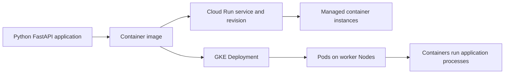

### D002 — Opening cluster illustration (reconstructed)

Reconstructed conceptual two-node/four-Pod layout. The original opening illustration omitted the control plane visually; it remains part of the cluster definition.

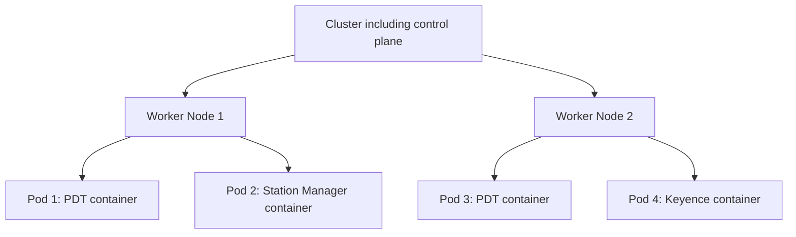

<a id="02"></a>
## Docker Desktop, images, runtimes and Pods

<a id="t005"></a>
### T005 — Where my local container runs

**My question:** Is the container inside Docker or on my PC?

My PC supplies the CPU, RAM, disk and network. For Linux containers on Windows, Docker Desktop typically uses a Linux environment through WSL 2 or a VM. The Linux container processes execute there using my PC’s resources. Docker Desktop is the management interface; Docker Engine and the underlying container runtime start and manage containers. Docker does not supply a separate physical server.

On a Linux server, containers can run as isolated Linux processes sharing that server’s kernel without a separate Linux VM. On a cloud VM they use that VM’s resources and kernel. The exact Windows backend and networking depend on configuration; Day 33 did not verify my machine’s current backend settings.

**My recall cue:** Windows PC → WSL 2/Linux VM → runtime → container.

**Revision location:** `02 Docker and Pods` in the Excel workbook. The evidence manifest maps this stable topic ID to its source locator.

<a id="t006"></a>
### T006 — Image, container and runtime

**My question:** If a Pod runs an application, why do I still need a container?

An image is the packaged application before execution. My Employee API image contains application code, Python runtime, FastAPI dependencies and a startup command. A container is an isolated execution environment created from the image, running the application process. One image can start several separate containers.

The container runtime performs execution. Containers normally share a host kernel rather than bringing a complete independent operating system like a VM. A Pod groups one or more containers into the Kubernetes scheduling and deployment unit. These are distinct responsibilities rather than alternative names for the same object.

**My recall cue:** Image = package; runtime = executor; container = running application environment; Pod = Kubernetes grouping.

**Revision location:** `02 Docker and Pods` in the Excel workbook. The evidence manifest maps this stable topic ID to its source locator.

<a id="t007"></a>
### T007 — Commands shown in the discussion

**My question:** Which Docker commands were actually run today?

The lesson referred to commands similar to earlier work. They were teaching examples, not a recorded Day 33 execution. I would run the build from a directory with the Dockerfile and build context, with Docker available. The tag employee-api:v1 identifies the image. The dot supplies the current build context.

The run command creates and starts a container and publishes host port 5000 to container port 5000. Reaching localhost:5000 additionally requires the application to listen appropriately inside the container. No successful build, local request or observed command output was recorded for these examples during Day 33.

```bash
docker build -t employee-api:v1 .
docker run -p 5000:5000 employee-api:v1
```

**My recall cue:** Keep illustrative commands separate from execution evidence.

**Revision location:** `02 Docker and Pods` in the Excel workbook. The evidence manifest maps this stable topic ID to its source locator.

<a id="t008"></a>
### T008 — Deployable does not mean already deployed

**My question:** Why call a Pod deployable if it is already deployed?

Deployable describes a unit Kubernetes can create, schedule and manage. A definition can exist before a Pod is running. The teaching sequence was: define the Pod’s containers; request creation; choose a suitable Node; obtain the image if necessary; start containers through the runtime; reach Running if startup succeeds.

I normally use a Deployment to manage application Pods rather than manually creating individual Pods. A Pod may be pending or fail to start, so the shorthand ‘one running application’ is useful for recall but is not a complete technical definition.

**My recall cue:** A Pod is a unit Kubernetes can deploy, not proof of successful deployment.

**Revision location:** `02 Docker and Pods` in the Excel workbook. The evidence manifest maps this stable topic ID to its source locator.

<a id="t009"></a>
### T009 — Multiple containers and sidecars

**My question:** Can a Pod contain more than one application?

Yes. A Pod can contain multiple closely related containers, such as PDT and a supporting log collector. They run on the same Node, share the Pod network namespace/IP and can communicate using localhost on different ports. They can share volumes when configured. Their application processes and local in-memory objects remain separate.

Their placement and Pod-level lifecycle are coupled, although individual containers can restart independently. A helper is commonly called a sidecar. Separate independent main services usually deserve separate Deployments so their scaling and lifecycle can differ.

**My recall cue:** Group tightly coupled helpers, not every MES service in one Pod.

**Revision location:** `02 Docker and Pods` in the Excel workbook. The evidence manifest maps this stable topic ID to its source locator.

<a id="t010"></a>
### T010 — How the logging helper works

**My question:** How does a separate log collector know my application’s logs?

In the sidecar illustration, PDT writes files to a shared Pod volume and the collector reads those files and forwards them to a destination. Both containers are separate applications; their explicit shared storage and configuration connect them. Shared networking is another possible communication path.

A sidecar is optional. GKE applications can write stdout/stderr for platform logging agents to collect. We did not configure a collector, shared volume or logging destination. The actual logging architecture was left for a later lesson.

**My recall cue:** PDT writes → shared volume → collector reads → logging destination.

**Revision location:** `02 Docker and Pods` in the Excel workbook. The evidence manifest maps this stable topic ID to its source locator.

### D003 — My Windows execution environment (reconstructed)

Reconstructed typical Linux-container setup on Windows; backend settings were not inspected during the lesson.

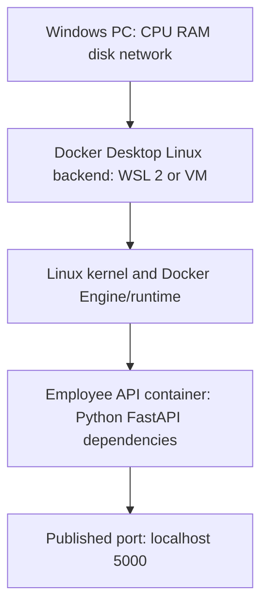

### D004 — Image execution and Pod creation (reconstructed)

Two related flows, reconstructed from the image/container and deployable-unit explanations.

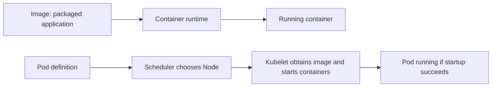

### D005 — Log collection sidecar (reconstructed)

Proposed alternatives, not a deployed Day 33 configuration.

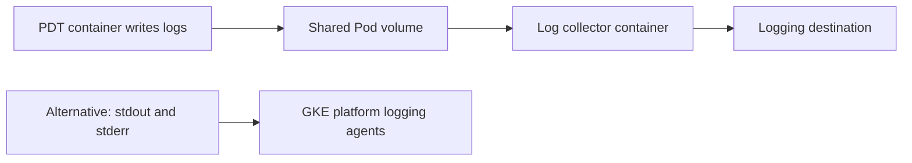

<a id="03"></a>
## VM, Node, scheduling, workload and Deployment

<a id="t011"></a>
### T011 — VM and Node describe the same machine differently

**My question:** Does the application run on a cloud VM or on a Kubernetes Node?

A cloud VM is a virtual computer with CPU, RAM, disk, networking and an operating system. A Node is a machine’s role in Kubernetes. A Compute Engine VM configured and registered as a Kubernetes worker is a Node. In GKE the application therefore runs on a Node that is typically a cloud VM; these are not two nested machines.

The explanation that finally helped me was: Google creates VM-01; initially it is just a virtual computer; after registration as a Kubernetes worker, Kubernetes recognises it as a Node. One person can be an employee and a team leader without being two people. VM describes the computer type; Node describes its role. A physical on-premises server can also be a Node.

**My recall cue:** Node (VM) → Pod → Container.

**Revision location:** `03 Hierarchy` in the Excel workbook. The evidence manifest maps this stable topic ID to its source locator.

<a id="t012"></a>
### T012 — My incorrect hierarchy and its correction

**My question:** I drew Node → VM → Pod. What was wrong?

My initial diagram placed a VM inside a Node as if Node were an additional machine layer. That was incorrect. I now draw Cluster → Node (VM-01) → Pod → Container → application process. The Node is the VM acting as a Kubernetes worker.

I also separate the physical/runtime view from the management view. A Deployment manages Pods across Nodes; it is not another physical box inside a Node. Several Pods can share one Node. Three replicas do not imply three servers.

**My recall cue:** Preserve my wrong diagram as a correction, never as the final architecture.

**Revision location:** `03 Hierarchy` in the Excel workbook. The evidence manifest maps this stable topic ID to its source locator.

<a id="t013"></a>
### T013 — Scheduling is placement

**My question:** Does scheduling mean run the Pod tomorrow?

Scheduling primarily means deciding which suitable Node should host an unscheduled Pod. It is not a time-of-day instruction. In the example the PDT Pod requests 4 GiB memory. Node 1 has 2 GiB available and cannot fit that request. Node 2 has 8 GiB available and is potentially suitable. CPU and scheduling constraints also matter.

The kube-scheduler selects the Node. The Node’s kubelet and container runtime do the work of starting containers. Placement and execution are related but separate. The 4/2/8 GiB values were illustrative and no resource settings were saved.

**My recall cue:** Scheduler chooses; kubelet/runtime starts.

**Revision location:** `03 Hierarchy` in the Excel workbook. The evidence manifest maps this stable topic ID to its source locator.

<a id="t014"></a>
### T014 — Workload is not a Pod alias

**My question:** Is workload just a name I assign to a Pod?

A workload is the application or task I want Kubernetes to run. In our example the workload is PDT. A Deployment is a concrete Kubernetes resource that manages the workload’s Pods, commonly through a ReplicaSet. A Pod is a particular execution unit containing containers. Workload is not a separate machine, container or required object named Workload.

Kubernetes also has other workload resources such as StatefulSets, DaemonSets and Jobs. We named them without studying them in depth. The beginner shorthand ‘managed application’ helps me interpret GKE’s Workloads screen, which can show several resource types.

**My recall cue:** Workload = what I run; Deployment = how I manage these Pods; Pod = execution unit.

**Revision location:** `03 Hierarchy` in the Excel workbook. The evidence manifest maps this stable topic ID to its source locator.

<a id="t015"></a>
### T015 — My GKE log navigation

**My question:** Why do workload and Pod look like the same thing when there is one replica?

I described selecting stg-wol or prod-wol, finding a station/application workload, selecting its Pod and viewing logs. I use stg for SIT and prod for production. Station Manager, PDT, Keyence and API appear as separate applications in my workflow.

For a one-replica workload I normally see one Pod, which makes the terms seem interchangeable. The workload/controller can persist while a failed Pod is replaced with a new Pod identity. The lesson used station-manager-stn100 and a generated-looking Pod suffix as illustrative names, not verified production resources. I offered office screenshots, but continued without uploading them.

**My recall cue:** Cluster → workload/controller → Pod → container logs.

**Revision location:** `03 Hierarchy` in the Excel workbook. The evidence manifest maps this stable topic ID to its source locator.

<a id="t016"></a>
### T016 — Replica versus instance

**My question:** Are three replicas three containers or three Pods?

A replica is one desired copy of a Pod template. A Deployment with replicas: 3 asks Kubernetes to maintain three corresponding Pods. If each has one PDT container, that normally gives three PDT container/application instances. If each has PDT plus a collector, it gives 3 × 2 = 6 containers in 3 Pods.

Instance describes an actual running copy. A Cloud Run instance is a running service instance, not a Kubernetes Pod I manage. Desired and actual counts may differ temporarily during startup, failures or rolling updates. Container restarts also do not necessarily create a new Pod.

```yaml
spec:
  replicas: 3
```

This is a partial teaching fragment, not an apply-ready manifest. No namespace, resource name, full template or execution command was provided.

**My recall cue:** Count Pods separately from containers per Pod.

**Revision location:** `03 Hierarchy` in the Excel workbook. The evidence manifest maps this stable topic ID to its source locator.

<a id="t017"></a>
### T017 — Docker-built images on GKE and Cloud Run

**My question:** Must Docker Engine be installed wherever my Docker image runs?

No. Docker commonly builds the image, but another compatible container runtime, such as containerd, can execute it on a Kubernetes Node. Kubernetes orchestrates the Pods. Cloud Run runs compatible Docker/OCI images in Google’s managed execution environment; I do not install Docker Engine there.

The lesson’s delivery sequence was local docker build → image employee-api:v1 → push to Artifact Registry → Cloud Run → running Employee API. That was a conceptual recap of earlier work, not a new push or deployment. Runtime internals and Cloud Run sandbox details were outside scope.

**My recall cue:** Image format/build tool and execution runtime are different concerns.

**Revision location:** `03 Hierarchy` in the Excel workbook. The evidence manifest maps this stable topic ID to its source locator.

### D006 — Wrong and corrected VM hierarchy (reconstructed)

Reconstructed correction. The incorrect branch is retained only to explain my misunderstanding.

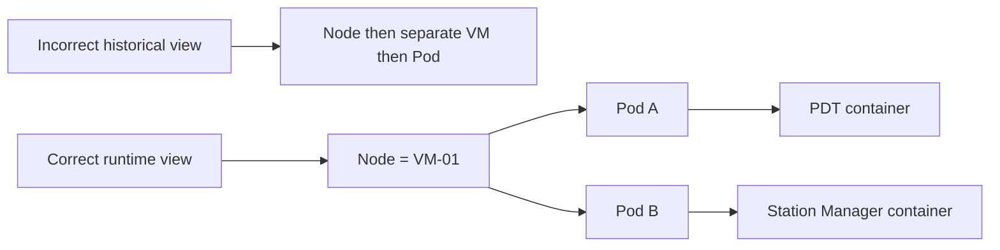

### D007 — Scheduling example (reconstructed)

Reconstructed memory-only example; actual scheduling also checks CPU and other constraints.

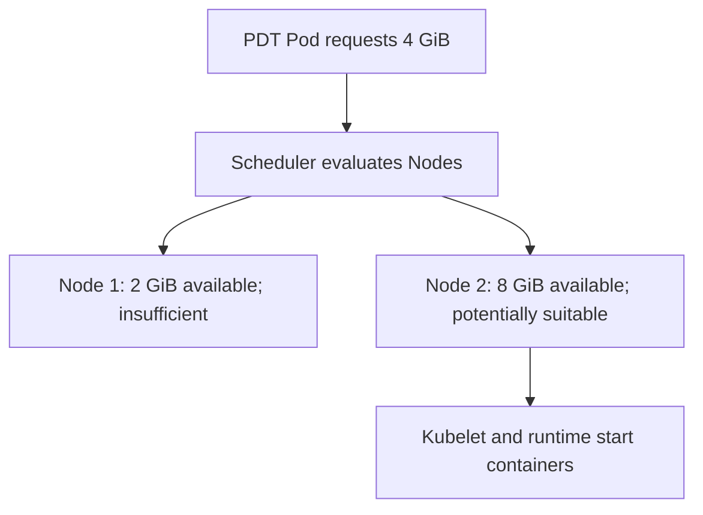

### D008 — Management and runtime views (reconstructed)

Reconstructed management diagram. The Deployment is a controller resource, not a physical layer inside a Node.

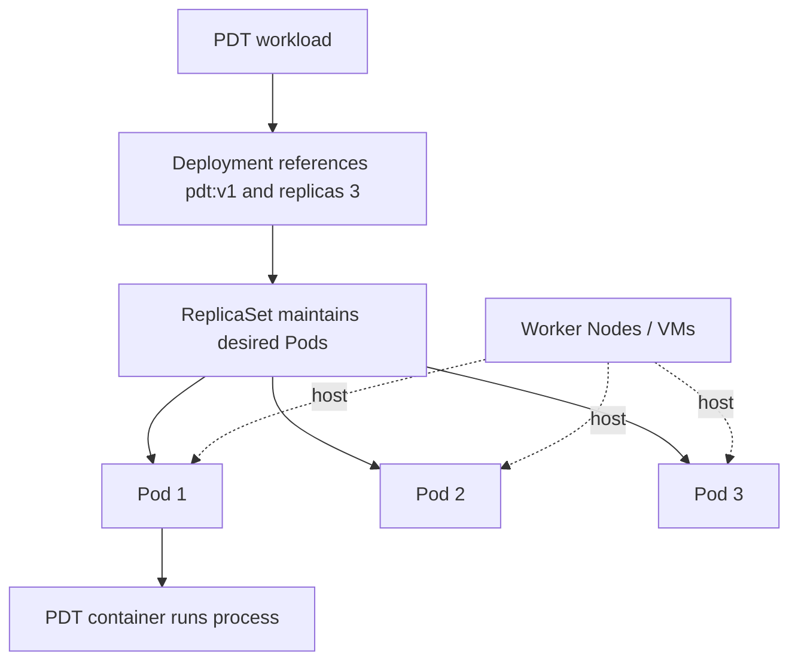

<a id="04"></a>
## Independent MES scaling and in-memory state

<a id="t018"></a>
### T018 — Why the example counts changed

**My question:** Were all the replica counts claims about my live system?

No. The opening lesson used 3 PDT + 2 Station Manager + 2 Keyence = 7 instances. The next generic illustration used 3 PDT + 2 Station Manager + 1 Keyence = 6 instances. My specific follow-up proposed PDT minimum 3, Station Manager 1 and Keyence 1 because the latter two use local state.

I keep these stages separate. The later 3/1/1 example is the architecture scenario used to reason about independent scaling. None of these examples verifies the running production configuration.

**My recall cue:** Introductory counts and my later stateful-service scenario are separate examples.

**Revision location:** `04 MES Placement` in the Excel workbook. The evidence manifest maps this stable topic ID to its source locator.

<a id="t019"></a>
### T019 — All services in one replicated Pod

**My question:** What happens if I put PDT, Station Manager and Keyence in one Pod?

It is technically possible, but all three containers are copied with the Pod template. Three replicas create three Pods, each containing all three applications: 3 × 3 = 9 container instances. That gives 3 PDT, 3 Station Manager and 3 Keyence instances even though my scenario needs 3/1/1.

The coupling affects scheduling, scaling and lifecycle. I cannot set a separate replica count for each container in that single Pod template. This is a practical reason to avoid grouping independent main services together.

**My recall cue:** A replica duplicates the whole Pod template.

**Revision location:** `04 MES Placement` in the Excel workbook. The evidence manifest maps this stable topic ID to its source locator.

<a id="t020"></a>
### T020 — Separate Deployments allow 3/1/1

**My question:** How do I scale only PDT?

I use separate Deployment/Pod templates: PDT with 3 desired replicas, Station Manager with 1 and Keyence with 1. This produces 3 + 1 + 1 = 5 Pods when each has one main container and the desired state is reached. Increasing PDT from 3 to 4 then leaves the other services at one each.

This was a conceptual design, not a saved manifest. Separate Deployments solve independent scaling and lifecycle. They do not automatically solve persistence, broker routing or safe transaction recovery.

**My recall cue:** Independent scaling needs independent workload resources.

**Revision location:** `04 MES Placement` in the Excel workbook. The evidence manifest maps this stable topic ID to its source locator.

<a id="t021"></a>
### T021 — Local transaction memory across replicas

**My question:** Why can Station Manager replica 2 not see replica 1’s trigger?

If replica 1 receives a PLC trigger and stores TX1001 in its local ConcurrentDictionary, replica 2 does not inherit that dictionary. If the next PLC message goes to replica 2, it may not find the transaction context, causing missing-state errors, duplicates or incorrect handling. Each process has its own memory.

Keeping one replica avoids this particular cross-replica inconsistency, but a crash still destroys the process memory. I need message-routing decisions and shared or durable state with recovery logic when business requirements demand continuity.

**My recall cue:** One replica limits cross-instance state problems; it does not preserve memory after a crash.

**Revision location:** `04 MES Placement` in the Excel workbook. The evidence manifest maps this stable topic ID to its source locator.

### D009 — Coupled versus independent replicas (reconstructed)

Reconstructed proposed 3/1/1 scenario, not verified live MES settings.

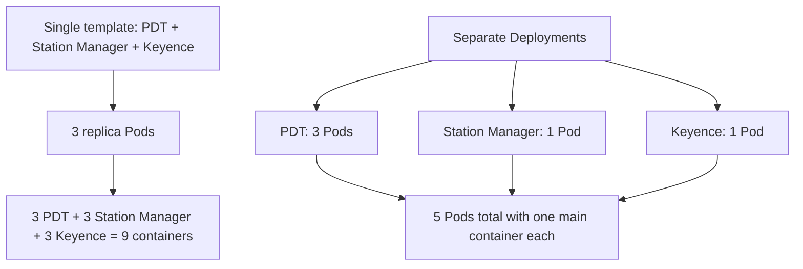

<a id="05"></a>
## Autoscaling, failures and business recovery

<a id="t022"></a>
### T022 — Horizontal scaling and demand

**My question:** Does three Pods guarantee five times the work?

Horizontal scaling increases application copies. The illustration moved from one to three PDT instances when arrival volume rose from 100 to 500 messages/minute. It demonstrates adding capacity, not proof that three copies can meet that rate.

Actual improvement depends on processing capacity, message distribution and shared dependency capacity. Kubernetes controls how many Pods run; it does not decide MQTT delivery semantics or eliminate SQL, Redis, broker, API or PLC bottlenecks.

**My recall cue:** More running copies are only one part of throughput.

**Revision location:** `05 Scaling and Recovery` in the Excel workbook. The evidence manifest maps this stable topic ID to its source locator.

<a id="t023"></a>
### T023 — Cloud Run autoscaling

**My question:** Which settings shape Cloud Run scaling?

Cloud Run can adjust service instances using demand and configuration, including concurrency and CPU utilisation. I configure minimum/maximum instances and request concurrency rather than creating Pods or selecting Nodes. A hypothetical maximum of 3 caps that example; it is not a Day 33 change to my Employee API.

When demand falls, suitable services can scale down to zero if minimum instances permit. Platform capacity and limits still apply. The lesson revisited earlier scaling settings without recording a new service configuration or test.

**My recall cue:** Cloud Run manages instance scaling within service settings.

**Revision location:** `05 Scaling and Recovery` in the Excel workbook. The evidence manifest maps this stable topic ID to its source locator.

<a id="t024"></a>
### T024 — Desired replicas and HPA

**My question:** Does replicas: 3 automatically become four under load?

A fixed Deployment replica count tells Kubernetes to maintain the desired count. It does not by itself add another replica when traffic grows. A Horizontal Pod Autoscaler (HPA) can change the target replica count based on configured metrics, such as CPU utilisation.

More Pods need available Node capacity. GKE node autoscaling addresses machine capacity separately. Ordinary Deployments do not automatically scale to zero without additional mechanisms. We did not create an HPA, set a CPU target or test scaling during this lesson.

**My recall cue:** Deployment maintains a count; HPA adjusts it; node scaling supplies machine capacity.

**Revision location:** `05 Scaling and Recovery` in the Excel workbook. The evidence manifest maps this stable topic ID to its source locator.

<a id="t025"></a>
### T025 — Container restart versus replacement Pod

**My question:** Does Kubernetes move the crashed Pod to another Node?

If a container crashes, the Node’s kubelet can restart it in the same Pod according to restart policy. If a Pod or Node becomes unavailable, workload controllers can arrange a replacement Pod on a suitable Node. Kubernetes does not physically move the old Pod between Nodes.

Cloud Run also manages instances and can start replacements as needed. Recovery is conditional on available capacity and platform conditions. Restarting a process is a different event from creating a new Pod identity, and neither event proves a business transaction recovered.

**My recall cue:** Restart container in a Pod; replace unavailable Pods; do not describe live Pod migration.

**Revision location:** `05 Scaling and Recovery` in the Excel workbook. The evidence manifest maps this stable topic ID to its source locator.

<a id="t026"></a>
### T026 — Restart does not restore my transaction

**My question:** Will TX1001 return after a crash?

If TX1001 existed only in a ConcurrentDictionary, the new process starts without it. Infrastructure recovery restores application execution, not application-specific business state. A single replica has the same memory-loss problem after restart.

Shared durable state can support application recovery only if the required state was stored and recovery logic is correct. Redis sharing alone is not a guarantee of persistence: durability, retention and failure recovery must meet requirements. No Redis persistence or high-availability settings were configured or verified on Day 33; that distinction is a reconstruction clarification, not an executed lesson step.

**My recall cue:** Recover the process and recover the business transaction separately.

**Revision location:** `05 Scaling and Recovery` in the Excel workbook. The evidence manifest maps this stable topic ID to its source locator.

### D010 — Scaling responsibility (reconstructed)

Reconstructed comparison. No HPA or new Cloud Run settings were applied.

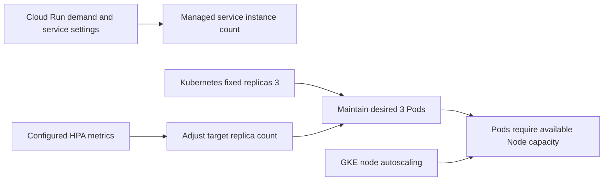

### D011 — Failure and state recovery (reconstructed)

Reconstructed failure flow. Infrastructure recovery does not imply successful business recovery.

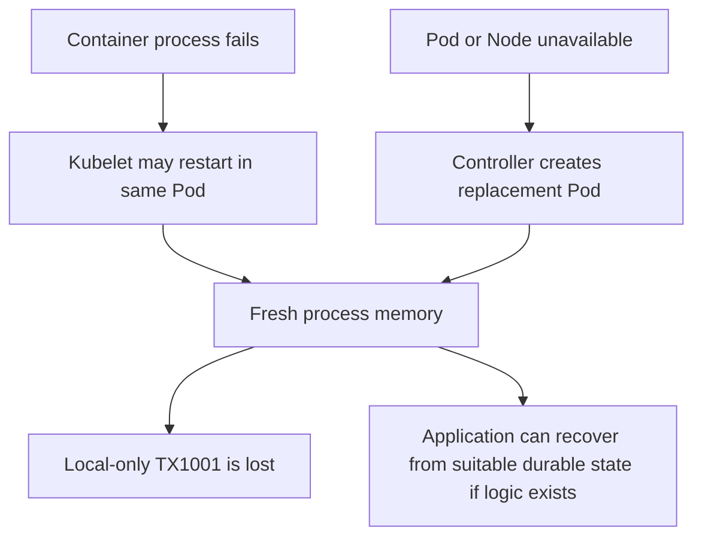

<a id="06"></a>
## MQTT, AMQP, Redis and concurrent processing

<a id="t027"></a>
### T027 — Ordinary MQTT subscriptions

**My question:** Do three subscribers share the messages automatically?

For ordinary matching subscriptions with distinct MQTT client IDs/sessions, all three Pods receive a copy of a published Station100/PLCUPDATE message. This is publish/subscribe fan-out. It can create duplicate processing, repeated PLC commands or conflicting transaction updates if all act on the same event.

Kubernetes does not decide which subscriber gets an MQTT message. Broker redelivery under QoS/session conditions also means I should not infer exactly-once business processing even with one subscriber.

**My recall cue:** Three ordinary subscribers can receive three copies of TX1001.

**Revision location:** `06 Messaging and State` in the Excel workbook. The evidence manifest maps this stable topic ID to its source locator.

<a id="t028"></a>
### T028 — MQTT shared subscriptions

**My question:** How can MQTT send one message to one worker?

Where the broker supports it, all workers can join the same shared group using $share/station-manager/Station100/PLCUPDATE. Under normal delivery a message goes to one member of that group rather than all members. Which member is chosen depends on the broker’s policies and configuration.

The lesson identified MQTT 5 shared subscriptions but did not verify support or configuration in my RabbitMQ MQTT setup. The subscription string is an architecture example, not a setting we saved. Redelivery and application idempotency still need consideration.

**My recall cue:** Same shared group distributes work; it is not proof of exact-once processing.

**Revision location:** `06 Messaging and State` in the Excel workbook. The evidence manifest maps this stable topic ID to its source locator.

<a id="t029"></a>
### T029 — RabbitMQ competing consumers

**My question:** Is AMQP automatically round-robin?

AMQP is the protocol; the broker and queue topology determine distribution. With three competing consumers on the same RabbitMQ queue, messages can be distributed across those consumers. TX1001→Pod1, TX1002→Pod2, TX1003→Pod3 is an illustration.

Availability, acknowledgements and prefetch affect actual distribution. I cannot promise an exact one-third split or assume every consumer is equally busy. We did not inspect or change queue, ack or prefetch settings during Day 33.

**My recall cue:** Same queue plus competing consumers distributes messages.

**Revision location:** `06 Messaging and State` in the Excel workbook. The evidence manifest maps this stable topic ID to its source locator.

<a id="t030"></a>
### T030 — Separate AMQP queues can fan out

**My question:** What changes if every Pod has its own queue?

If an exchange routes matching events to three separate bound queues, each queue can receive its own copy. A consumer on each queue can then process that copy. This resembles fan-out and differs from three consumers sharing one queue.

I must describe topology, routing/bindings and consumers rather than say ‘AMQP always sends to only one Pod’. Useful parallel processing depends on the correct work-distribution design, not merely the existence of multiple replicas.

**My recall cue:** One queue/three consumers differs from three queues/one consumer each.

**Revision location:** `06 Messaging and State` in the Excel workbook. The evidence manifest maps this stable topic ID to its source locator.

<a id="t031"></a>
### T031 — Redis enables cross-Pod continuity

**My question:** Can Pod 2 continue the transaction Pod 1 started?

My proposed flow was: Pod 1 receives a station trigger, sends Echo to the PLC and stores the TX1001 context in Redis. Later Pod 2 receives PLC result data, reads the shared Redis hash and continues the transaction. Pod 2 does not require Pod 1’s local dictionary if all necessary state and transition rules are externalised.

This is a valid conceptual distributed design, not a verified implementation. The exact fields, save ordering, recovery rules and state transitions depend on the application. Redis, SQL Server, RabbitMQ and a PLC can all be shared dependencies while each Pod retains separate local memory.

**My recall cue:** External shared state enables continuity; Pods still have separate process memory.

**Revision location:** `06 Messaging and State` in the Excel workbook. The evidence manifest maps this stable topic ID to its source locator.

<a id="t032"></a>
### T032 — Shared state is not concurrency safety

**My question:** Can two Pods both see Pending and process TX1001?

Yes. At T1 Pod 1 reads Pending; at T2 Pod 2 reads Pending before the first update; at T3 Pod 1 starts; at T4 Pod 2 also starts; at T5 both write Completed. A shared store does not automatically make that multi-step workflow atomic.

The application may need an atomic Redis operation, ownership/claim reservation, a protected state transition or another cross-instance coordination mechanism. This connects to earlier PDT claim/reservation work, whose implementation was not reproduced here. A local SemaphoreSlim coordinates only its process and does not automatically protect work across Pods. Distributed locking and exact queue configurations were deferred.

**My recall cue:** Protect the business state transition atomically, not just the individual read/write.

**Revision location:** `06 Messaging and State` in the Excel workbook. The evidence manifest maps this stable topic ID to its source locator.

### D012 — Normal MQTT and shared MQTT (reconstructed)

Reconstructed delivery comparison. Distinct ordinary subscriber sessions assumed; shared support was not verified.

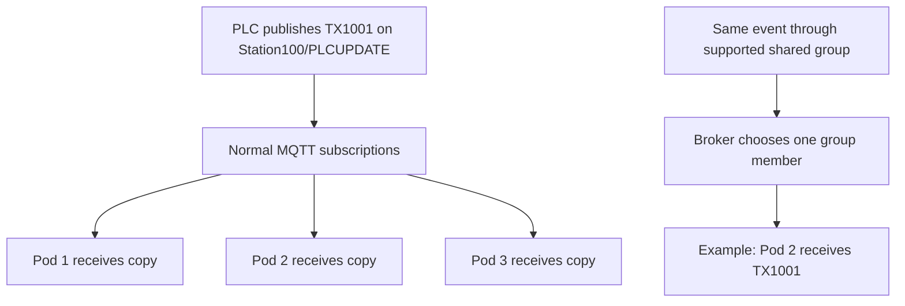

### D013 — AMQP queue topology (reconstructed)

Reconstructed comparison: routing into multiple queues may copy the event; competing consumers share work within one queue.

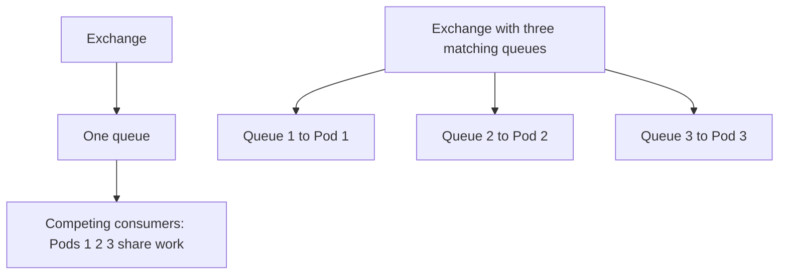

### D014 — Cross-Pod Redis transaction (reconstructed)

Reconstructed conceptual sequence. The diagram does not establish atomicity, durability or a verified implementation.

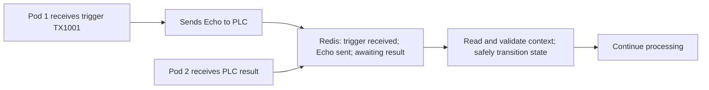

### D015 — Concurrent read race (reconstructed)

Reconstructed unsafe timeline retained to show why shared state alone does not prevent duplicate work.

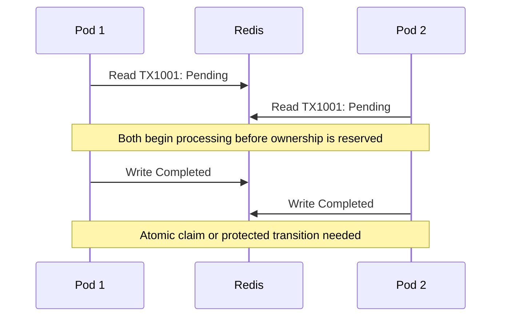

<a id="07"></a>
## Measure capacity and identify the bottleneck

<a id="t033"></a>
### T033 — The theoretical limit calculation

**My question:** Why do 3 PDT Pods not guarantee 300 messages/minute?

The teaching assumption was 100 messages/minute per Pod. Three independent workers give an ideal 3 × 100 = 300 messages/minute. If their common database supports only 180 corresponding transactions/minute, sustainable system throughput is at most min(300,180) = 180/minute in that simplified model.

The three factors are per-Pod processing capacity, message distribution and shared dependencies. SQL, Redis, broker, network, downstream API and PLC constraints may dominate. These numbers are hypothetical; they are not measurements of my MES.

**My recall cue:** Scale only the bottleneck that measurements identify.

**Revision location:** `07 Throughput` in the Excel workbook. The evidence manifest maps this stable topic ID to its source locator.

<a id="t034"></a>
### T034 — Measure stages instead of guessing

**My question:** How can I know capacity when SQL and network latency vary?

I measure completed transactions and stage durations under controlled load. The lesson’s sample stages were Redis lookup 5 ms, business logic 15 ms, SQL 250 ms and acknowledgement 10 ms. Total = 5 + 15 + 250 + 10 = 280 ms. For one strictly sequential worker at constant 280 ms, 60,000 ms/min ÷ 280 ms/transaction ≈ 214.29 transactions/minute.

This reciprocal is a simplified estimate, not a service guarantee. Async processing may overlap work, and load can increase contention and latency. I need representative tests and sustainable throughput under latency and reliability limits, not a fixed capacity promise from one average duration.

**My recall cue:** Measure throughput and latency together; averages alone hide contention.

**Revision location:** `07 Throughput` in the Excel workbook. The evidence manifest maps this stable topic ID to its source locator.

<a id="t035"></a>
### T035 — Metrics and the saturation curve

**My question:** What should I record during a load test?

I record completion rate, end-to-end p50/p95/p99 latency, SQL duration/CPU/waits/locks/connection pools, Redis and broker latency, backlog/message age, errors and timeouts. Arrival rate and completion rate are separate measurements.

The illustrative replica curve was 1→100, 2→165, 3→180, 4→182, 5→179 transactions/minute. It plateaus instead of scaling linearly. I should investigate shared saturation rather than assume adding replicas solves it. The sample operating ranges also noted acceptable latency near 100/min, increasing DB waits near 150/min, growing backlog near 180/min and overload at 200/min. All figures were illustrative.

**My recall cue:** Watch queue growth, tail latency and errors, not only received-message count.

**Revision location:** `07 Throughput` in the Excel workbook. The evidence manifest maps this stable topic ID to its source locator.

<a id="t036"></a>
### T036 — Backlog arithmetic

**My question:** What happens at 200 arrivals and 180 completions per minute?

Assuming no retries, drops or other effects, backlog grows by 200 − 180 = 20 messages/minute. Receiving messages faster does not mean completing more business work. Queue age can become unacceptable even when all Pods look healthy.

I should establish a sustainable operating range with headroom under representative traffic, data volume and dependency latency. No actual Day 33 load test was executed, and none of the sample rates validates production capacity.

**My recall cue:** Backlog growth = arrival rate minus completion rate.

**Revision location:** `07 Throughput` in the Excel workbook. The evidence manifest maps this stable topic ID to its source locator.

<a id="t037"></a>
### T037 — Optimise SQL before distributing databases

**My question:** What if the database really limits me to 180/minute?

I first check execution plans, indexes and expensive scans; then locking/blocking, transaction duration, redundant database calls, repeated reference-data reads, connection pooling/concurrency and CPU/memory/storage throughput. A missing index or five round trips that could become one well-designed batch may explain the limit.

I apply justified optimisation and retest throughput, tail latency, error rate, queue growth and saturation. Only then do I evaluate partitioning. Splitting a database to hide a query problem adds distributed-system complexity without fixing the cause. These were investigation options, not changes we implemented.

**My recall cue:** Measure → optimise → retest → consider partitioning if still justified.

**Revision location:** `07 Throughput` in the Excel workbook. The evidence manifest maps this stable topic ID to its source locator.

### D016 — Per-message timing path (reconstructed)

Reconstructed illustrative timing path; not measured production results.

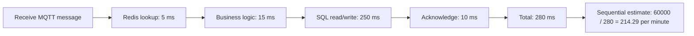

### D017 — Bottleneck decision path (reconstructed)

Reconstructed architecture reasoning. No SQL optimisation or sharding was executed.

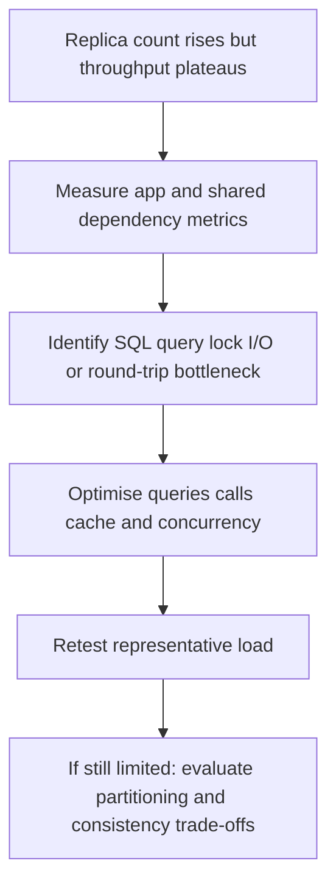

<a id="08"></a>
## Line databases, common master data and deferred resilience

<a id="t038"></a>
### T038 — Partitioning by production line

**My question:** If DB1 serves Prod1 and DB2 serves Prod2, who owns each transaction?

The architecture extension assumed Prod1 = 150 and Prod2 = 150 transactions/minute, for 300/minute total against a hypothetical single-DB capacity of 180/minute. Line-based partitioning/sharding is an option if ownership can be made clear. DB1 owns Prod1 transactions; DB2 owns Prod2 transactions.

Common product definitions and plant station configuration need an authoritative central owner. Cross-line reporting can use a separate integration/reporting database. Real-time transaction state may be shared or line scoped as requirements dictate. The central operational master-data owner and reporting database need not be the same database. No database was split.

**My recall cue:** Separate ownership of operational transactions, master data and reporting.

**Revision location:** `08 Database Architecture` in the Excel workbook. The evidence manifest maps this stable topic ID to its source locator.

<a id="t039"></a>
### T039 — Common master data without a lookup on every message

**My question:** Does every line still need the central database for each transaction?

My concern was valid: a live central query on every MES event can recreate a bottleneck and outage dependency. Where controlled propagation delay is acceptable, local caches/read models can receive versioned master-data updates. The example used a central configuration change assigned V15, published to lines, then applied to their local reference data.

The design needs initial load, version checks, missed-event detection, retries and reconciliation. Some information needs immediate plant-wide consistency and may require authoritative synchronous lookup or another stronger mechanism. Caching is a consistency choice, not a universal fix.

**My recall cue:** Distribute suitable versioned reference data; define freshness and recovery explicitly.

**Revision location:** `08 Database Architecture` in the Excel workbook. The evidence manifest maps this stable topic ID to its source locator.

<a id="t040"></a>
### T040 — Reliable central integration with an outbox

**My question:** What if the DB commit succeeds but RabbitMQ is unavailable?

A naive sequence commits DB1 business data and then publishes TransactionCompleted. If publication fails after the commit, the central system may never receive the event. The proposed transactional outbox commits business data and an event record in the same local database transaction. A background publisher retries delivery to the broker; central consumers process idempotently into reporting/integration storage.

Retries can produce duplicates, so outbox does not guarantee exactly-once end-to-end processing. I also challenge whether every transaction must be copied into a central operational master or whether reporting/integration is the real requirement. We discussed the pattern without building it.

**My recall cue:** Business commit + outbox record together; publish later; consume idempotently.

**Revision location:** `08 Database Architecture` in the Excel workbook. The evidence manifest maps this stable topic ID to its source locator.

<a id="t041"></a>
### T041 — Synchronisation adds real load and trade-offs

**My question:** Am I adding another bottleneck by syncing everything?

Yes, line business writes, outbox writes, broker delivery and central writes still consume resources. The design distributes work and decouples timing rather than eliminating work. Line processing may continue through short central outages while a bounded durable backlog accumulates and drains at a controlled rate.

Costs include infrastructure, propagation delay, monitoring, retries, duplicates and reconciliation. Central storage/consumer capacity and recovery limits still matter. If production must wait for synchronous central commitment of every transaction, an asynchronous reporting design does not satisfy that requirement.

**My recall cue:** Decoupling changes timing and isolation; it does not create free capacity.

**Revision location:** `08 Database Architecture` in the Excel workbook. The evidence manifest maps this stable topic ID to its source locator.

<a id="t042"></a>
### T042 — Cross-line correctness and architecture constraints

**My question:** Would I immediately recommend line-based sharding for MES?

No. I ask whether lines must operate during central outages; whether each transaction belongs to one line; whether marriage, sequencing or order movement crosses lines; how quickly master updates must appear; how global order/serial uniqueness is maintained; what happens when DB1 fails but DB2 survives; and whether eventual reporting consistency is acceptable.

My interview approach is to explain evidence and trade-offs: measure the actual bottleneck, optimise, retest, partition only if justified, define ownership/consistency, and plan idempotency/replay/reconciliation/monitoring. Naming Kubernetes, Redis or sharding alone does not answer these questions.

**My recall cue:** Architecture follows data ownership, consistency and recovery requirements.

**Revision location:** `08 Database Architecture` in the Excel workbook. The evidence manifest maps this stable topic ID to its source locator.

<a id="t043"></a>
### T043 — Single database failure and three shifts remain deferred

**My question:** What if the only DB fails or the plant grows from one shift to three?

I explicitly raised the risk that a single database failure could stop the whole plant. I also challenged a capacity result based on low current volume and one shift when three shifts might be planned. These questions were retained as valuable high-availability, disaster-recovery and future-capacity concerns, then paused to keep the lesson bounded.

We did not design or implement SQL failover, backup/restore, disaster recovery, Redis resilience or a multi-shift capacity plan. Three shifts do not by themselves establish a peak-rate multiplier: future workload, retained data volume and operating hours still need investigation. That last distinction is an additional clarification, not a calculation performed in the original lesson.

**My recall cue:** Deferred means recorded for later, not solved or implemented.

**Revision location:** `08 Database Architecture` in the Excel workbook. The evidence manifest maps this stable topic ID to its source locator.

<a id="t044"></a>
### T044 — Final state and next learning boundary

**My question:** Did finishing Day 33 mean I had deployed Kubernetes?

I completed the conceptual learning objective: architecture, terminology, scaling, recovery and the link to message distribution/shared state. I did not create a cluster, apply YAML, configure HPA, change MQTT subscriptions, deploy a sidecar, split SQL databases or implement an outbox. The full Cloud Run versus Kubernetes service-selection exercise was also left open.

Day 34 was proposed as a gentle hands-on introduction to Deployments, Pods, replicas and Services. I retain the agreed boundary: this is enough understanding for the current objective; advanced details can follow when needed. Documentation completion is a separate evidence and file-verification task.

**My recall cue:** Conceptual learning complete; hands-on implementation and advanced architecture deferred.

**Revision location:** `08 Database Architecture` in the Excel workbook. The evidence manifest maps this stable topic ID to its source locator.

### D018 — Line databases and central ownership (reconstructed)

Reconstructed proposed architecture. Distribution is controlled; master data is not necessarily queried centrally on every MES transaction.

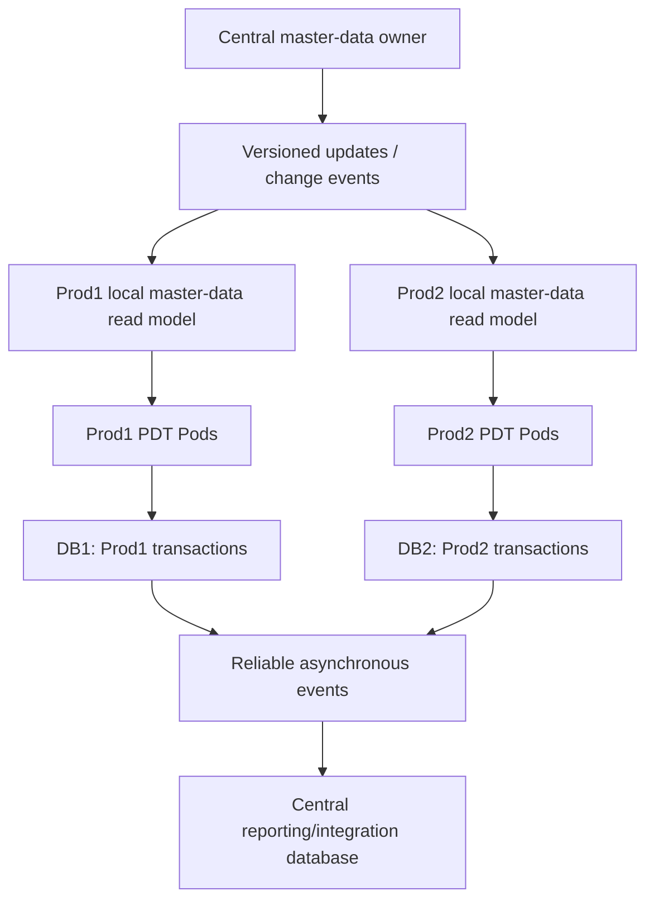

### D019 — Outbox integration (reconstructed)

Reconstructed proposal. Duplicate delivery remains possible and no outbox was implemented during Day 33.

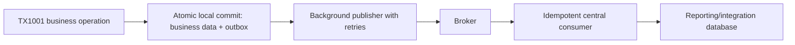

## My quick recall and checks

| Question | My answer |
|---|---|
| Who manages replacement instances after a server fails in Kubernetes? | Kubernetes controllers and scheduling, subject to capacity. |
| Three Pods with PDT and a collector each? | 3 Pods, 6 containers. |
| Three Pods containing all three MES applications? | 3 Pods, 9 containers. |
| Separate 3/1/1 workloads? | 5 Pods with one main container each. |
| Does Node contain another VM? | No: the VM can be the Node. |
| Does a Pod replacement restore my dictionary? | No. |
| Does Redis automatically prevent two consumers processing Pending? | No: business transitions need coordination. |
| Do ordinary MQTT subscribers split one event? | They normally each receive a copy with distinct matching client sessions. |
| Does 3 × 100/min override a DB limit of 180/min? | No: the simplified system bound is 180/min. |

## Evidence and audit boundary

My evidence folder includes original browser source captures, both prompt texts, the fine-grained topic manifest, diagram map, screenshot inventory and file verification. Source locators use exact opening phrases or headings where message IDs were not exposed. These are transparent substitutes for navigation, not fabricated message IDs.

Remaining limitations: original graphical layouts were not individually exported; stable IDs and exact timestamps for older messages were unavailable; virtualization prevents a proven exhaustive message count; no final Excel-native application review is implied. The audit records visual and structural checks actually performed. Library saving is unavailable through the exposed file tools, so the deliverables are local downloadable files.
