# Day 34 — Kubernetes Fundamentals

## My completed learning day

I moved from Kubernetes architecture to running my own Employee API in a local cluster. I enabled Docker Desktop Kubernetes, deployed `employee-api:v16`, tested `/health`, created an internal Service, scaled to three Pods, deleted a Pod to observe recovery, inspected logs and Pod details, and saved Deployment and Service configuration as YAML. I confirmed that I committed the work to Git.

The practical sequence was setup → image/deployment → networking/Service → scaling → recovery/logs → YAML/apply → Git confirmation. These notes group the original learning under stable topic IDs T001–T006, so networking appears after replicas even though I explored it first. **T007** records my later follow-up doubts about Pod, Container, Node IP, Service, Deployment and office `localhost` behavior.

My final **observed pre-apply** state was three ready Pods at `10.1.0.6`, `10.1.0.8`, and `10.1.0.9`, behind `employee-api-service` at `10.105.206.127:8000`. The first actual apply later returned `configured` for both resources. **Final post-apply Deployment/Pod/Service health verification was proposed but not observed.** No final resource deletion or cluster cleanup was performed in the conversation. The earlier deliberate deletion of one Pod was a recovery exercise.

I should read the detailed explanations here and use the Excel workbook for visual revision. All 35 chronological original screenshot occurrences are retained in `Day34_assets` and embedded on the six concept sheets. The source manifest and audit distinguish actual observations, teaching examples, deferred work, and verification limits. All diagrams below are **reconstructed supplementary diagrams**, not original screenshots.

## T001 — Local setup and the control plane

<a id="t001-01"></a>

### T001.01 — My starting point and local cluster setup

I already had Docker Desktop, my Python/FastAPI Employee API project and earlier Docker images. I used my Windows PC's CPU, RAM and disk rather than creating a paid GKE cluster. In Docker Desktop → Kubernetes, I selected **kubeadm**, created the cluster, confirmed installation and waited for startup. My actual cluster had **one Node**, Kubernetes **v1.36.1**, and an Active dashboard with the Node Ready. The `default` namespace initially had no application Deployments or Pods.

S001–S005 preserve the initial disabled screen, kubeadm configuration, installation confirmation, startup and active dashboard. The “show system containers” advanced option is visible in S002; I did not need to enable it for this exercise. The Docker Desktop implementation supplies a local Linux Kubernetes environment using my PC's resources. I did not create a Google Cloud VM.

<a id="t001-02"></a>

### T001.02 — kubectl, context and Node verification

In PowerShell, I ran:

```powershell
kubectl config current-context
kubectl get nodes
```

My context was `docker-desktop`. The registered Node was also named `docker-desktop`, with status `Ready`, role `control-plane` and version `v1.36.1` (S006). `kubectl` communicates with the Kubernetes API; `get` reads resources; `nodes` selects the resource type. The context tells me which configured cluster my commands target. Checking it is especially relevant when I later work with office contexts such as `stg-wol` and `prod-wol`. A successful command against the wrong context would still affect the wrong environment.

<a id="t001-03"></a>

### T001.03 — Why did control-plane appear at Node level?

My first question was: “The control plane should be at cluster level, so why does it appear in the Node output?” I then asked why a Node performs both roles if Cluster and Node are separate. The explanation that resolved this was that **Cluster and Node are not two separate machines**. A cluster is the complete logical Kubernetes environment. A Node is a machine participating in that environment. The control plane is software providing cluster-wide management responsibilities.

The role column describes this Node's role. It does not mean every Node contains its own independent control plane. In my single-node kubeadm setup, the same local computing environment runs control-plane components and application Pods. API server, scheduler and controllers are software processes and must run somewhere. Their cluster-wide responsibility does not require them to exist on a separate physical computer.

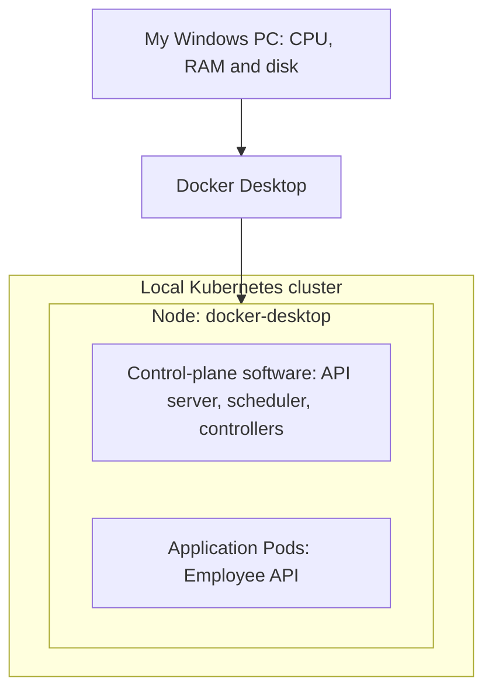

<a id="t001-04"></a>

### T001.04 — Does GKE also need a Node for the control plane?

My follow-up was whether GKE needs a separate Node to run its control plane. The precise correction was: the control plane needs **computing resources**, but those resources do not have to be a worker Node listed by my `kubectl get nodes` command. In the GKE example discussed, Google runs and manages control-plane VMs separately from the worker Nodes that run my application Pods. Those control-plane machines are not normally listed as my cluster's worker Nodes.

| Question                | My Docker Desktop setup                   | GKE example discussed                                     |
| ----------------------- | ----------------------------------------- | --------------------------------------------------------- |
| Computing resources     | My Windows PC supplies local resources    | Google Cloud infrastructure                               |
| Control-plane placement | Shares the local Node environment         | Separate Google-managed machines                          |
| Application placement   | Same local Node                           | Worker Nodes                                              |
| Reason                  | Simple setup and lower local resource use | Managed infrastructure and separation of responsibilities |

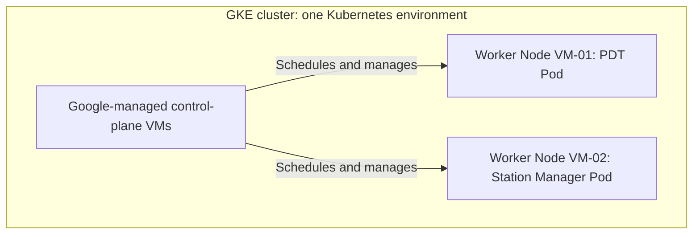

<a id="t001-05"></a>

### T001.05 — The analogies that helped me

I can run SQL Server and a C# application on one development computer even though they do different jobs. Similarly, Station Manager coordinates station activities while PDT executes processing activities. In development both processes can share a PC; production can put them on different servers. Their responsibilities remain separate in either placement. This helped me distinguish a logical responsibility from the machine hosting its software.

## T002 — Image inspection and my first Deployment

<a id="t002-01"></a>

### T002.01 — Reusing my actual local image

I ran `docker image ls` in PowerShell. S007–S008 show multiple Employee API versions, including v10, v11 and v12–v16, Artifact Registry tags and Kubernetes system images. I selected **`employee-api:v16`** instead of rebuilding or introducing another sample app. Having an image in Docker Desktop was a starting point; the running Pod later verified that this Kubernetes runtime could actually use it. Availability on my machine would not automatically make it available on GKE.

<a id="t002-02"></a>

### T002.02 — Image metadata is different from runtime behavior

I inspected the image without starting or changing it:

```powershell
docker image inspect employee-api:v16 --format 'ExposedPorts={{json .Config.ExposedPorts}} Cmd={{json .Config.Cmd}}'
```

Actual output (S009):

```text
ExposedPorts=null
Cmd=["python","-m","app.main"]
```

`ExposedPorts=null` means no EXPOSE port declaration was present in the image metadata. It does not mean that the app cannot listen on a port. EXPOSE documents an intended port; it does not start a listener or publish a port. The default command starts Python's `app.main` module. The application configuration determines its real listening address and port, which I still needed to verify.

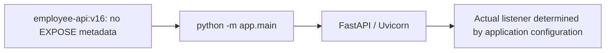

<a id="t002-03"></a>

### T002.03 — main.py, PORT=8000 and the duplicated startup block

In `01-python-fastapi/app/main.py`, S010 showed this startup code:

```python
if __name__ == "__main__":
    port = int(os.getenv("PORT", 8000))
    uvicorn.run("app.main:app", host="0.0.0.0", port=port)
```

`__name__ == "__main__"` identifies execution as the main module. `os.getenv` reads `PORT`; absent an override, the default is **8000**. `int` converts the value to a port number. `host="0.0.0.0"` binds the server to the container's network interfaces, and `uvicorn.run` starts the FastAPI application. The earlier assumption that the app would default to 5000 was corrected. Supplying `PORT=5000` would change this behavior, but my later logs and health check confirmed port 8000 for the deployed image.

The same block appeared twice, at source lines 59–61 and 63–65. One copy was sufficient; removal was suggested for later source cleanup. **Removal was not verified in this lesson.** Editing the current source does not change an image built earlier. I therefore used runtime evidence, rather than assuming the source file and v16 were identical.

<a id="t002-04"></a>

### T002.04 — Creating a Deployment

With the local context selected, I ran:

```powershell
kubectl create deployment employee-api --image=employee-api:v16 --port=8000
```

The response was `deployment.apps/employee-api created` (S011). `create deployment` creates the Deployment resource; `employee-api` is its name; `--image` identifies the container image; `--port=8000` declares the intended container port in the Pod specification. The port flag does not make Python listen or expose the app outside Kubernetes. The command initially requested one replica.

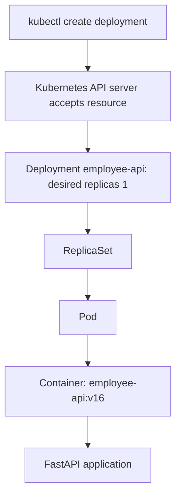

“Created” confirmed acceptance of the Deployment resource. It did not prove that its Pod had started or that an HTTP endpoint worked. This is like Station Manager accepting an operation request: acceptance and successful completion need separate checks.

<a id="t002-05"></a>

### T002.05 — Deployment readiness, Pod readiness and visual inspection

I ran `kubectl get deployments` and `kubectl get pods` (S012). The Deployment showed `READY 1/1`, `UP-TO-DATE 1`, `AVAILABLE 1`. My Pod, `employee-api-cb88dd9c9-mf9bv`, showed `READY 1/1`, `Running`, zero restarts. Deployment READY counts ready replicas against desired replicas; Pod READY counts ready containers against its containers. UP-TO-DATE counts replicas using the current Deployment specification; AVAILABLE counts replicas considered available.

I asked whether I could see `deployment/employee-api` visually. Docker Desktop → Kubernetes, namespace `default`, showed the Deployment Available and its Pod (S013). This resembles locating a workload and its Pods in the GKE Workloads interface. The earlier illustrative dashboard in the explanation was a teaching layout; S013 is my actual evidence. Running/Ready were useful checks, but HTTP success was established separately in T004.04.

## T003 — Three replicas on one Node

<a id="t003-01"></a>

### T003.01 — Scaling changes desired Pod count

After verifying labels and the Service, I ran:

```powershell
kubectl scale deployment employee-api --replicas=3
kubectl get deployments
kubectl get pods -o wide
```

`scale` changes the live Deployment's desired replica count. Kubernetes created two additional Pods while retaining the existing one. `-o wide` adds useful columns such as Pod IP and Node. S022 showed the Deployment `3/3` Ready with three available replicas. All Pods were `1/1` Running with zero restarts.

| Full Pod name                | IP before deletion | Node           |
| ---------------------------- | ------------------ | -------------- |
| employee-api-cb88dd9c9-mf9bv | 10.1.0.6           | docker-desktop |
| employee-api-cb88dd9c9-c58lk | 10.1.0.7           | docker-desktop |
| employee-api-cb88dd9c9-9stqv | 10.1.0.8           | docker-desktop |

<a id="t003-02"></a>

### T003.02 — Replicas do not mean Nodes or Services

I still had **one Deployment, one Employee API Service and one Node**, with three independent Employee API Pods. S023 visually confirmed three running Pods and a 3/3 Deployment in Docker Desktop. Replicas provide additional application instances; creating them did not add machines. This one-node exercise did not demonstrate resilience to loss of that Node.

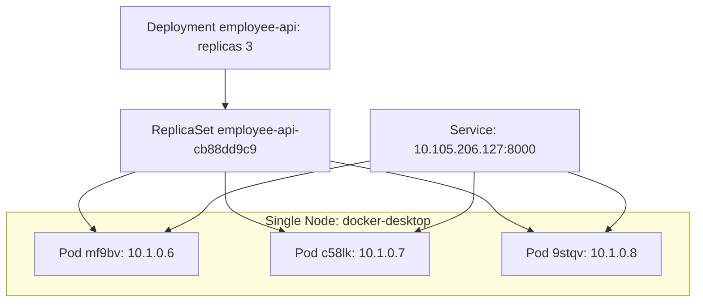

<a id="t003-03"></a>

### T003.03 — The existing Service discovered new backends

I verified with `kubectl describe service employee-api-service`. S024 showed endpoints `10.1.0.6:8000,10.1.0.7:8000,10.1.0.8:8000`. Earlier there had been only `10.1.0.6:8000`. All new Pods used the same application label, so the existing selector found them as eligible backends. I did not edit or recreate the Service; its ClusterIP and port remained stable. This moved the endpoint list from an expectation based on matching labels to an actual observed result.

## T004 — Services, ports, DNS and selectors

<a id="t004-01"></a>

### T004.01 — Deployment versus Service versus Cloud Run

I initially expected deployment to give me a URL, as Cloud Run had. In the earlier Cloud Run exercise, Employee API had a service URL and `order-sa` represented an authorized caller. A suitable Google-issued identity token and invoke permission let Cloud Run IAM authorize the request.

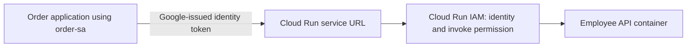

A Kubernetes Deployment runs and maintains application Pods. It does not automatically create a public URL or configure Cloud Run IAM. A Service provides stable networking to matching Pods. A **ClusterIP** Service is internal, and creating it does not automatically provide application authentication. External exposure could later use a Gateway, Ingress or LoadBalancer with appropriate security. Those were future options, not things configured today.

| Responsibility   | Deployment                    | Service                             | Port forwarding                        |
| ---------------- | ----------------------------- | ----------------------------------- | -------------------------------------- |
| Main purpose     | Manage application instances  | Stable networking to eligible Pods  | Temporary access from my Windows PC    |
| Configuration    | Image, Pod template, replicas | Selector, Service port, target port | Local port and selected Pod port       |
| Pod replacement  | Managed through ReplicaSet    | Tracks changing eligible backends   | Session can depend on the selected Pod |
| Public URL / IAM | Not automatic                 | Not automatic for ClusterIP         | Not an external hosting solution       |

<a id="t004-02"></a>

### T004.02 — What is a port, and why localhost needed a bridge?

An IP address identifies a network endpoint; a port helps deliver traffic to a listening application. If Windows has apps listening on ports 5000 and 8000, `localhost:8000` means its own port 8000. My API was inside a Kubernetes Pod with a different network environment. The matching number 8000 did not connect those environments automatically.

I asked exactly how “Local port 8000 → Pod port 8000” happens. My agreed beginner understanding was a **temporary bridge**. `kubectl port-forward` listens locally and establishes forwarding through the Kubernetes API server and Node kubelet to the selected Pod, carrying traffic and responses. I did not need to look up a Pod IP or configure a router for the test. A Deployment is not itself a network endpoint: `deployment/employee-api` lets kubectl select a Pod belonging to it.

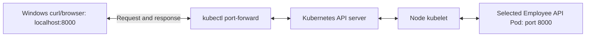

<a id="t004-03"></a>

### T004.03 — Port-forward syntax and alternatives

In Terminal 1 I ran:

```powershell
kubectl port-forward deployment/employee-api 8000:8000
```

The syntax is `LOCAL_PORT:REMOTE_PORT`: the left 8000 is on Windows; the right 8000 is inside the selected Pod. The numbers do not need to match. The **teaching example** `kubectl port-forward deployment/employee-api 9000:8000` would use `http://localhost:9000/health` locally while the app still listens on 8000. That alternative was explained, not observed running. The purpose resembles Docker port mapping, but the mechanism differs.

Port forwarding was an easy temporary test, not the only possible access method. It normally selects one Pod and does not act as a Service load balancer across replicas. A ClusterIP Service can exist while Windows still needs an appropriate route or port-forward for local access. Creating a Service does not automatically connect Windows localhost to it.

<a id="t004-04"></a>

### T004.04 — My actual HTTP health check

S014 showed forwarding from `127.0.0.1:8000` and `[::1]:8000` to 8000, and “Handling connection for 8000”. In Terminal 2 I ran:

```powershell
curl.exe -i http://localhost:8000/health
```

The `-i` option includes response headers. S015 showed **HTTP/1.1 200 OK**, server `uvicorn`, JSON content type and this response:

```json
{ "status": "healthy", "service": "new-learning-api" }
```

This verified the application request/response path through port forwarding. The JSON's service value is `new-learning-api`, although my Kubernetes Deployment is named `employee-api`; I retain the actual response rather than replacing its value with the resource name.

<a id="t004-05"></a>

### T004.05 — What if we close the first terminal?

I explicitly requested that this explanation be preserved. Terminal 1 runs port forwarding; Terminal 2 sends the HTTP request. If I close Terminal 1 or press Ctrl+C, **that forwarding session stops**. Windows `localhost:8000` can no longer reach my Pod through it. The Deployment, Pod and FastAPI process continue running because the forwarding command is not hosting them.

| Component after Terminal 1 closes    | Expected behavior explained |
| ------------------------------------ | --------------------------- |
| Port-forward bridge                  | Stops                       |
| localhost access through that bridge | Stops                       |
| Deployment and Employee API Pod      | Continue running            |
| FastAPI process in the Pod           | Continues running           |

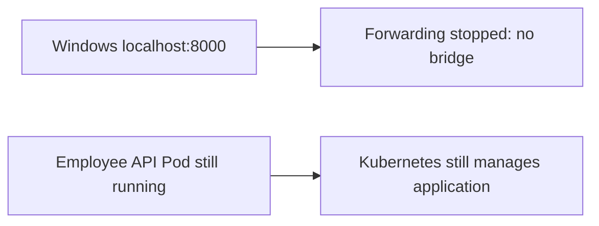

This was explained, not separately demonstrated by a screenshot of a failed request after closing the terminal. Another Windows app could later occupy local port 8000; reaching it would not mean the old Kubernetes forwarding session still existed. I deferred deeper port/networking study to a separate session.

<a id="t004-06"></a>

### T004.06 — Creating my ClusterIP Service

I ran:

```powershell
kubectl expose deployment employee-api --name=employee-api-service --port=8000 --target-port=8000 --type=ClusterIP
kubectl get services
```

`expose deployment employee-api` creates a Service using information from the existing Deployment. `--name` chooses the Service name; `--port` is its client-facing port; `--target-port` is the backend Pod port; `--type=ClusterIP` requests internal cluster networking. The response was `service/employee-api-service exposed` (S016). S017 showed it visually and S018 listed `10.105.206.127`, `8000/TCP`, external IP `<none>`. The separate `kubernetes` Service at `10.96.0.1:443` is the built-in Kubernetes API Service.

A Service does not create another Employee API container. The Deployment still manages the Pods. “Exposed” proves that the Service resource exists; backend discovery requires a separate check. The MES analogy was that several PDT instances may run, while callers need a consistent way to reach the application rather than remembering each instance.

<a id="t004-07"></a>

### T004.07 — Where does the stable DNS name come from?

I asked where to find the address Kubernetes gave me. **I chose `employee-api-service`** in `--name`; it was not randomly assigned. Kubernetes DNS makes Service names resolvable from Pods. For callers in the same namespace, the short name is `employee-api-service`; the discussed full name is `employee-api-service.default.svc.cluster.local`. The pattern is `<service>.<namespace>.svc.<cluster-domain>`. `cluster.local` was the usual assumed domain here, not separately verified by a DNS query.

I can inspect the resource with:

```powershell
kubectl get service employee-api-service -o yaml
```

S019 shows its name, namespace, ClusterIP, selector and ports. A separate Cloud Run-style URL field is not required: I form `http://employee-api-service:8000` from the Service name, protocol and port. The hypothetical Order API request flow is:

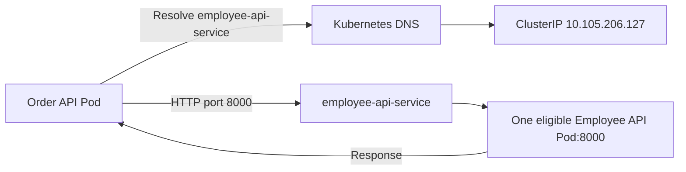

DNS resolves the Service name. The Service networking mechanism chooses an eligible backend; DNS itself does not choose which replica processes the connection. A Service does not broadcast every request to all three Pods. An Order API Pod was a teaching example; I did not deploy one or execute a DNS lookup from it today.

<a id="t004-08"></a>

### T004.08 — Does every application need a Service?

I asked whether an Order application needs an Order Service. If Order API only sends outbound requests to Employee API, it does **not** need its own Service solely to make those calls. If other applications need a stable inbound address to Order API, I would normally create `order-api-service` selecting Pods labelled `app=order-api`.

| Hypothetical receiver           | Service              | Selector         | Pod label        |
| ------------------------------- | -------------------- | ---------------- | ---------------- |
| Employee API                    | employee-api-service | app=employee-api | app=employee-api |
| Order API, if it receives calls | order-api-service    | app=order-api    | app=order-api    |

One Service can select multiple replicas of an application. Three Employee API Pods do not require three Services. A label's value is a name I choose; matching matters, not whether its spelling equals the Deployment name.

<a id="t004-09"></a>

### T004.09 — Labels already existed; metadata is different from a selector

I thought I had not created Pod labels yet. The correction was that `kubectl create deployment` had generated matching application labels in the Pod template, and `kubectl expose` had generated a matching Service selector. I did not have to manually add labels afterward.

S019 showed Service YAML; S020 showed `Selector: app=employee-api` and `Endpoints: 10.1.0.6:8000`. The Service's own `metadata.labels.app` organizes the Service resource. **`spec.selector.app` selects backend Pods.** They can contain the same text but have different purposes.

I ran `kubectl get pods --show-labels` (S021). The Pod had `app=employee-api,pod-template-hash=cb88dd9c9`. The generated hash distinguishes ReplicaSet/Pod-template versions; I did not need to set it myself, and my Service did not select by it.

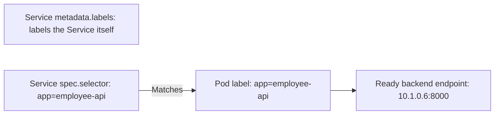

Readiness matters as well as matching labels. An empty endpoint list would mean the Service exists but has no currently usable backend in that view. A matching label alone is not an application HTTP health test.

## T005 — Recovery, logs and Pod diagnostics

<a id="t005-01"></a>

### T005.01 — Deliberately deleting c58lk

After checking `kubectl config current-context` again and confirming `docker-desktop`, I ran:

```powershell
kubectl delete pod employee-api-cb88dd9c9-c58lk
kubectl get pods -o wide
```

S025 preserves the context check and deletion. I deleted one **Pod**, not its Deployment. The desired replica count remained three. This simulated Pod loss. It did not simulate a Node failure, and it was not the same as a crashed process restarting inside an existing Pod. With only one Node, this was not a multi-node failover test.

<a id="t005-02"></a>

### T005.02 — The replacement appeared before I checked

I observed: “before I run kubectl get pods -o wide, it's already created”. S026 showed old `c58lk` at `10.1.0.7` Terminating while new `9ngbl` at `10.1.0.9` was already Running. The other Pods at `.6` and `.8` remained Running. Four rows briefly existed: three Running and one Terminating. That transition was compatible with restoring the desired active replica count.

`kubectl get pods` only reads current state. It did not trigger recovery. The control-plane controllers were already observing the cluster and correcting the difference between desired and actual state. The Deployment manages a ReplicaSet, and the ReplicaSet controller maintains its Pod count.

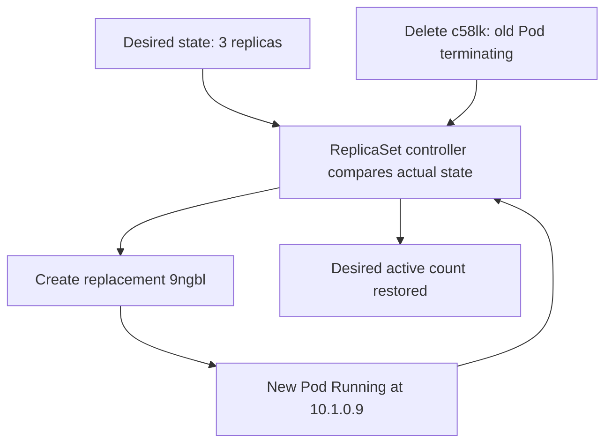

<a id="t005-03"></a>

### T005.03 — Endpoint recovery and stable Service identity

I verified again with `kubectl get pods -o wide` and `kubectl describe service employee-api-service`. S027 showed exactly three Running Pods, the old Pod absent and endpoints `.6:8000,.8:8000,.9:8000`. The Service ClusterIP remained `10.105.206.127`. No Service events/errors were shown in that description.

| Stage             | Ready/running Pod IPs                      | Service backend endpoints                                  |
| ----------------- | ------------------------------------------ | ---------------------------------------------------------- |
| One replica       | 10.1.0.6                                   | 10.1.0.6:8000                                              |
| After scaling     | 10.1.0.6, .7, .8                           | 10.1.0.6:8000, 10.1.0.7:8000, 10.1.0.8:8000                |
| Transition        | .6, .8, new .9 Running; old .7 Terminating | Final transition endpoint list was not captured separately |
| Recovery verified | 10.1.0.6, .8, .9                           | 10.1.0.6:8000, 10.1.0.8:8000, 10.1.0.9:8000                |

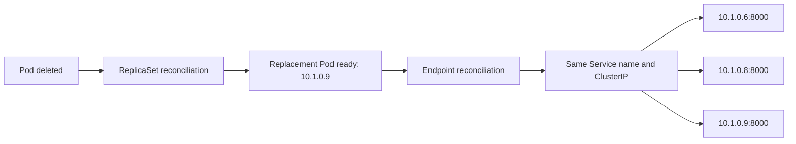

These were two coordinated behaviors: restore application instances and update network backends. I did not manually change the Service selector, IP or desired replicas. This explains why callers should use a stable Service name rather than store Pod IPs.

<a id="t005-04"></a>

### T005.04 — Replacing a process does not restore in-memory business state

Recovery recreated an application instance. It did not prove recovery of its memory. In my MES Station Manager analogy, transaction details held only in a process-local `ConcurrentDictionary` would not automatically appear in a replacement container. Redis, durable state and explicit recovery logic address a different concern from Kubernetes replacing a Pod. None of those persistence mechanisms was configured in this exercise.

<a id="t005-05"></a>

### T005.05 — The logs error and corrected command

I initially ran `kubectl logs` without a target (S028). The error stated that `POD or TYPE/NAME` was required. Each Pod produces its own container logs, so kubectl needs to know which workload/Pod to read.

I corrected it to:

```powershell
kubectl logs employee-api-cb88dd9c9-9ngbl
```

S029 showed:

```text
INFO: Started server process [1]
INFO: Waiting for application startup.
INFO: Application startup complete.
INFO: Uvicorn running on http://0.0.0.0:8000 (Press CTRL+C to quit)
```

This verified the running server's port, supporting the earlier `ExposedPorts=null` explanation. The lack of EXPOSE metadata had not prevented Uvicorn listening on port 8000.

<a id="t005-06"></a>

### T005.06 — Logs versus describe and useful troubleshooting commands

| Command                              | What I learn                                                           | Lesson evidence                  |
| ------------------------------------ | ---------------------------------------------------------------------- | -------------------------------- |
| `kubectl logs <pod-name>`            | Application/container output, such as Uvicorn startup or C# exceptions | Executed for 9ngbl               |
| `kubectl logs -f <pod-name>`         | Follow newly written logs                                              | Explained, not observed executed |
| `kubectl logs --previous <pod-name>` | Previous terminated container instance logs, when available            | Explained, not observed executed |
| `kubectl describe pod <pod-name>`    | Kubernetes state, scheduling information and events                    | Explained targeted form          |
| `kubectl describe pod`               | Describes Pods in the current namespace when no name is supplied       | Actual uploaded command/output   |
| `kubectl get pods -o wide`           | Pod IP and Node as well as basic state                                 | Executed repeatedly              |

My MES troubleshooting sequence is to locate the workload, identify its Pod, inspect application logs and inspect Pod details to distinguish an application problem from startup, scheduling or infrastructure issues. A previous container's logs are not a general archive of every deleted Pod.

<a id="t005-07"></a>

### T005.07 — The complete uploaded Pod description

S030 contains only the upper part of the description. The original `kubectl describe pod results.txt` contains **all three Pod descriptions**, not just 9ngbl. The actual command in the file is `kubectl describe pod` without a name. I retain the full text in the companion attachment and the Markdown appendix, while Excel keeps only a brief reminder beside the original diagnostic screenshots.

| Pod suffix | Pod IP   | Node                        | Ready | Restart count |
| ---------- | -------- | --------------------------- | ----- | ------------- |
| 9ngbl      | 10.1.0.9 | docker-desktop/192.168.65.3 | True  | 0             |
| 9stqv      | 10.1.0.8 | docker-desktop/192.168.65.3 | True  | 0             |
| mf9bv      | 10.1.0.6 | docker-desktop/192.168.65.3 | True  | 0             |

All are in `default`, Running, labelled `app=employee-api` and `pod-template-hash=cb88dd9c9`, controlled by `ReplicaSet/employee-api-cb88dd9c9`. The file shows the v16 image and port 8000 for the first two records; the original third record's container details are shorter, so I do not invent its omitted fields. Conditions shown True include PodReadyToStartContainers, Initialized, Ready, ContainersReady and PodScheduled.

<a id="t005-08"></a>

### T005.08 — ReplicaSet, ServiceAccount and BestEffort

The ownership chain is **Deployment → ReplicaSet → Pods**. Labels select matching resources, while owner references through the ReplicaSet establish the management relationship. The ReplicaSet name explains the middle part of the Pod names.

`Service Account: default` means the Pods use the namespace's default **Kubernetes ServiceAccount**, a Pod identity usable for Kubernetes API access subject to permissions. It is not automatically the Google Cloud `order-sa` used with Cloud Run IAM. I did not configure a dedicated Kubernetes identity or permissions today.

`QoS Class: BestEffort` reflects the lack of CPU/memory requests and limits in this exercise. Under resource pressure these Pods generally have less eviction protection than Pods with stronger QoS guarantees. Resource management was deferred. The projected `kube-api-access-*` mount combines injected sources; the file lists the token expiration, `kube-root-ca.crt` ConfigMap and DownwardAPI. Host Port `0/TCP` is not a published Windows host port. No Node selectors were configured; the file also retains the 300-second not-ready/unreachable tolerations. These are diagnostic observations, not settings I manually added today.

## T006 — YAML, apply, Git and the final state

<a id="t006-01"></a>

### T006.01 — Why I saved YAML

My imperative commands had changed the running cluster. Losing the cluster would lose those resources. YAML gives me a version-controlled description I can review and submit again, provided its image is available to the target runtime. In my `cloud-genai-learning` repository I created `01-python-fastapi/k8s/deployment.yaml` and `service.yaml` (S031–S032). The first VS Code screenshot showed an unsaved-change indicator; I do not treat that intermediate screenshot as proof of a saved file. Later server validation/apply and my Git confirmation establish the later workflow.

<a id="t006-02"></a>

### T006.02 — My full Deployment configuration

This is the configuration supplied in the conversation, retaining its blank-line structure and indentation:

```yaml
apiVersion: apps/v1
kind: Deployment

metadata:
  name: employee-api

spec:
  replicas: 3

  selector:
    matchLabels:
      app: employee-api

  template:
    metadata:
      labels:
        app: employee-api

    spec:
      containers:
        - name: employee-api
          image: employee-api:v16
          imagePullPolicy: IfNotPresent
          ports:
            - containerPort: 8000
```

<a id="t006-03"></a>

### T006.03 — Deployment YAML line by line

Blank lines improve readability. Indentation defines parent/child relationships; the two `spec` and `metadata` blocks refer to different objects because of their position.

| Line(s) | Field/value                   | My explanation and practical effect                                                                                                                                 |
| ------- | ----------------------------- | ------------------------------------------------------------------------------------------------------------------------------------------------------------------- |
| 1       | apiVersion: apps/v1           | Selects the API group/version that understands Deployments.                                                                                                         |
| 2       | kind: Deployment              | Chooses a Deployment resource rather than a Pod or Service.                                                                                                         |
| 4       | metadata                      | Starts the Deployment's identifying information.                                                                                                                    |
| 5       | name: employee-api            | Names the Deployment used by my kubectl commands.                                                                                                                   |
| 7       | spec                          | Begins the Deployment's desired behavior.                                                                                                                           |
| 8       | replicas: 3                   | Requests three application Pods through its ReplicaSet.                                                                                                             |
| 10      | selector                      | Begins the rule identifying managed Pods.                                                                                                                           |
| 11      | matchLabels                   | Requires the listed label equality matches.                                                                                                                         |
| 12      | app: employee-api             | Selects the application label used by this Deployment.                                                                                                              |
| 14      | template                      | Begins the blueprint for new Pods.                                                                                                                                  |
| 15      | metadata                      | Metadata belonging to that Pod blueprint.                                                                                                                           |
| 16      | labels                        | Labels assigned to created Pods.                                                                                                                                    |
| 17      | app: employee-api             | Gives each new Pod the label matching the selector.                                                                                                                 |
| 19      | spec                          | Desired contents of each Pod, not the outer Deployment spec.                                                                                                        |
| 20      | containers                    | Begins the list of containers inside a Pod.                                                                                                                         |
| 21      | - name: employee-api          | Adds and names the one application container.                                                                                                                       |
| 22      | image: employee-api:v16       | Uses the actual earlier-built local image.                                                                                                                          |
| 23      | imagePullPolicy: IfNotPresent | Uses an image already available to the Node runtime; otherwise attempts to pull it. Local Docker availability alone is not a universal guarantee for every runtime. |
| 24      | ports                         | Begins declared container-port metadata.                                                                                                                            |
| 25      | - containerPort: 8000         | Documents the intended container port. It does not start Uvicorn, create a Service or publish Windows port 8000.                                                    |

For GKE I would need the image available to its Nodes, usually through a registry. This local image reference was appropriate for today's Docker Desktop exercise, not a complete cloud deployment configuration.

<a id="t006-04"></a>

### T006.04 — Why selector.matchLabels does not become the Pod label

I asked: “Why does deployment.yaml need selector.matchLabels; ideally does that become the Pod's label?” The answer was that **`template.metadata.labels` assigns labels**, while **`selector.matchLabels` identifies Pods for management**. Both contain `app: employee-api` because the blueprint must produce matching Pods.

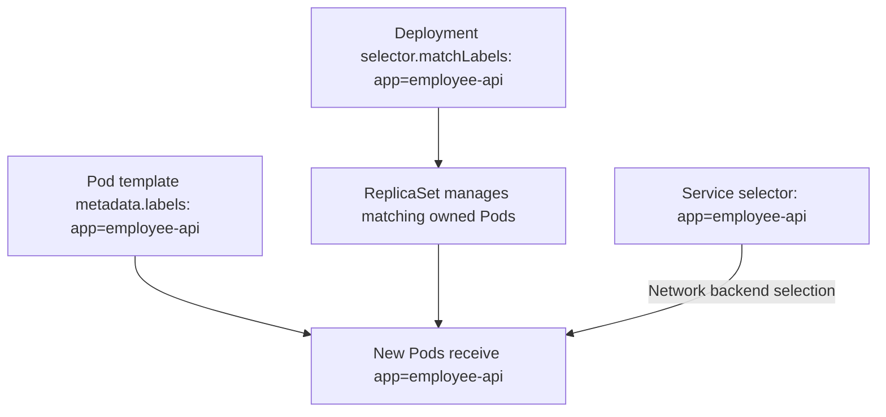

The teaching mismatch was a Deployment selector for `app=employee-api` paired with a Pod template label `app=order-api`. Kubernetes rejects that inconsistent Deployment. It would request management of one label while creating another. For MES, Station Manager could use `app=station-manager` and PDT `app=pdt`. Those were examples, not extra deployments created today. Labels alone do not create owner references.

<a id="t006-05"></a>

### T006.05 — My full Service configuration and each field

```yaml
apiVersion: v1
kind: Service

metadata:
  name: employee-api-service

spec:
  type: ClusterIP

  selector:
    app: employee-api

  ports:
    - port: 8000
      targetPort: 8000
      protocol: TCP
```

| Line(s) | Field/value      | My explanation and practical effect                                                           |
| ------- | ---------------- | --------------------------------------------------------------------------------------------- |
| 1       | apiVersion: v1   | Uses the core v1 API for Services.                                                            |
| 2       | kind: Service    | Creates or updates a Service networking resource.                                             |
| 4–5     | metadata / name  | Names it employee-api-service and supplies the name used in DNS.                              |
| 7       | spec             | Begins desired Service behavior.                                                              |
| 8       | type: ClusterIP  | Requests an internal virtual IP, without automatic public exposure.                           |
| 10–11   | selector / app   | Chooses Pods labelled app=employee-api independently of the Deployment's management selector. |
| 13      | ports            | Begins the Service port list.                                                                 |
| 14      | - port: 8000     | Clients connect to Service port 8000.                                                         |
| 15      | targetPort: 8000 | Service networking sends traffic to port 8000 on the selected Pod.                            |
| 16      | protocol: TCP    | Uses TCP transport.                                                                           |

The YAML does not hard-code `10.105.206.127`. Applying it to the existing Service kept the existing resource identity; creating it in a new cluster can allocate another IP. The stable Service name is the better application reference. The live Service dump in S019 also had server-managed fields such as UID/resourceVersion and assigned IP information; that diagnostic output is not the same as my deliberately small source configuration.

<a id="t006-06"></a>

### T006.06 — kubectl diff failed on Windows

From `01-python-fastapi` in PowerShell, I ran:

```powershell
kubectl diff -f k8s/
```

S033 showed:

```text
error: failed to run "diff": executable file not found in %PATH%
```

`-f k8s/` points to the configuration directory. `kubectl diff` attempted to launch an external `diff` executable, but Windows could not find it in PATH, the executable search-path list. This failure did not establish that my YAML was invalid. It also did not show a successful comparison. A nonzero diff exit status can indicate differences in a functioning setup, but my actual output was a missing-tool error. No diff tool installation or successful rerun was observed.

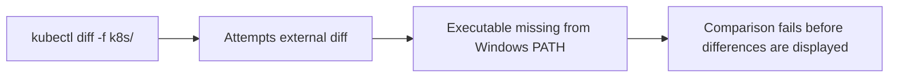

<a id="t006-07"></a>

### T006.07 — Server dry run and the annotation warnings

I used the alternative:

```powershell
kubectl apply --dry-run=server -f k8s/
```

S034 showed both resources `configured (server dry run)`, alongside warnings about missing `kubectl.kubernetes.io/last-applied-configuration`. The API server processed/validated the request without persisting the proposed changes. This was not the same as proving the files matched the live cluster; the failed diff had not done that comparison.

The resources came from imperative `kubectl create` / `expose`, without the last-applied record used by normal client-side apply. The warning said the annotation would be added automatically. A dry run did not save it. This warning was distinct from a validation failure.

<a id="t006-08"></a>

### T006.08 — First actual apply

I ran:

```powershell
kubectl apply -f k8s/
```

S035 showed the missing-annotation warnings again, followed by:

```text
deployment.apps/employee-api configured
service/employee-api-service configured
```

The API accepted changes to the existing named resources. `configured` did not mean two duplicate resources had been created or that final Pod health had been verified. The first real client-side apply established the last-applied annotation for later comparisons. A repeated unchanged apply would normally report `unchanged`; that repeat was proposed, not observed.

<a id="t006-09"></a>

### T006.09 — What does apply actually do?

I understood “commands are imperative, YAML is declarative”, but still asked why apply was needed after the resources already existed. The missing step was that **saving a YAML file does not send it to Kubernetes**. `kubectl apply -f k8s/` reads the files and submits create/update requests for the named resource kinds and namespace. The API server validates and stores accepted changes. Controllers then work toward the desired state stored in the cluster.

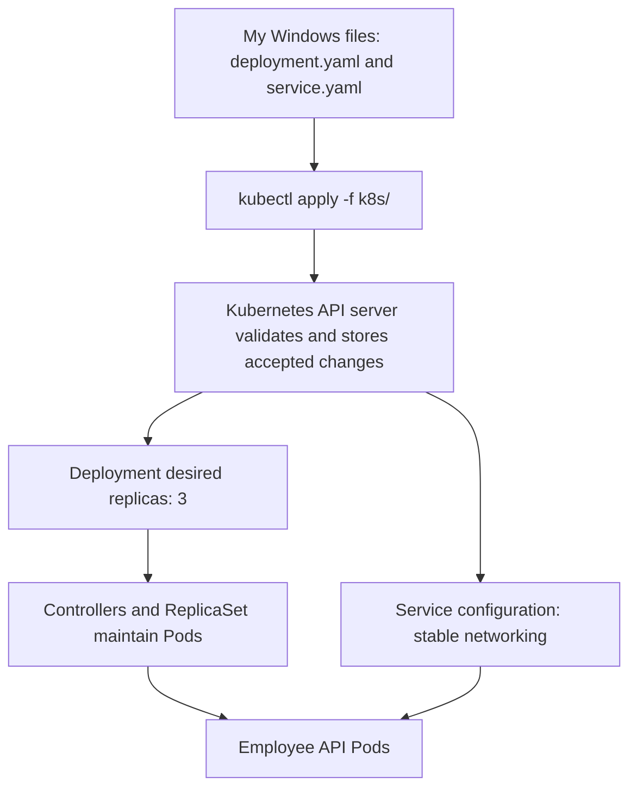

My Station Manager analogy was a configuration saying “Station100, Station Manager, three instances, port 8000”. Saving it does not deploy it; something must submit it to the running environment. Apply performs that submission. **Apply is not a continuously running monitoring process.** Controllers perform ongoing reconciliation.

| Teaching scenario                 | What apply is intended to do                                | Was this separate scenario executed?        |
| --------------------------------- | ----------------------------------------------------------- | ------------------------------------------- |
| Named resources already exist     | Update accepted configuration rather than create duplicates | Yes: first actual apply returned configured |
| A declared resource is absent     | Create that declared resource if valid                      | Discussed scenario; not separately executed |
| Replica setting changes in a file | Submit the new desired replica count                        | Discussed scenario; not separately executed |

The original answer contained an interactive three-scenario element. Only its labels (already exists, deleted, changed replicas) were exposed in recovered text; its hidden selections were unavailable. The table above is a labelled explanatory reconstruction, not a claim to have recovered hidden text or executed those scenarios.

<a id="t006-10"></a>

### T006.10 — What if I scale manually after saving YAML?

The teaching example was YAML with `replicas: 3`, followed by `kubectl scale deployment employee-api --replicas=5`. That command would change the **live desired count** to five. Kubernetes would not continuously reread the file on Windows and automatically restore three. Applying the YAML again can restore the configured value, subject to apply behavior and field ownership. This five-replica example was not executed today. Argo CD or Flux can reconcile Git configuration continuously, but GitOps was only mentioned as a later topic.

<a id="t006-11"></a>

### T006.11 — Git confirmed; final verification and cleanup not observed

The suggested commit message was:

```text
Day 34 - Implemented local Kubernetes deployment, scaling and service configuration
```

I subsequently wrote **“Commited / Day 34 completed”**. This is my explicit confirmation that the Git work was committed. The source does not show a commit hash or independently verify the exact changed-file list/message. I do not turn the earlier “Git pending” advice into the final state.

The final suggested checks were:

```powershell
kubectl get deployments
kubectl get pods
kubectl describe service employee-api-service
```

These were recommended **after** apply but were not observed afterward. The expected result was three ready replicas and eligible endpoints, with `.6,.8,.9` only if no further replacement occurred. I must not label that expected result as a verified post-apply observation.

Final cleanup was optional and not performed in the recorded lesson. Keeping the local cluster/application for Day 35 was acceptable. Stopping Kubernetes in Docker Desktop to save resources was an option, not an action I confirmed. The duplicate Python startup-block cleanup was also not verified. I do not need to delete the saved YAML to stop the local cluster.

<a id="t006-12"></a>

### T006.12 — My quick recall and deferred learning

| If I forget…                   | My reminder                                                                       |
| ------------------------------ | --------------------------------------------------------------------------------- |
| Cluster / Node / control plane | Whole environment / participating machine / cluster-management software           |
| Deployment / ReplicaSet / Pod  | Desired application configuration / replica maintenance / running container group |
| Service                        | Stable internal networking to selected eligible Pods                              |
| EXPOSE or containerPort        | Port declaration does not start a listener or publish Windows localhost           |
| Port forwarding                | Temporary bridge; closing its terminal stops the bridge, not the app              |
| Labels / selectors             | Assign tags / match tags; resource position determines purpose                    |
| get pods                       | Reads state; controllers recover without waiting for it                           |
| logs / describe                | Application output / Kubernetes diagnostic state                                  |
| YAML / apply / controllers     | Describe / submit / continuously reconcile live desired state                     |
| Git commit                     | Confirmed by me; hash not shown                                                   |

Deferred topics were deeper ports/networking, Kubernetes authentication/permissions, external URL exposure, resource requests/limits and GitOps. Today's exercise did not test multi-node failover, persistent transaction recovery, an actual Order API caller, DNS resolution from a Pod or post-apply readiness. Those limits do not erase the practical results I did observe.

## T007 — Follow-up doubts after Day 34: localhost, Deployment, Pod, Container, IP and Namespace

These clarifications came **after** I completed and committed Day 34. I wanted to make sure I really understood what is running, what manages it, and how two separate MES applications communicate. They are conceptual discussions, **not new practical exercises**. I did not inspect my office Anthos manifests or run additional `kubectl` commands for these questions. The IPs and office configurations in this section are illustrations unless explicitly identified as Day 34 observations.

<a id="t007-01"></a>

### T007.01 — My doubt: if Station Manager and MES API are separate Pods, why is the URL `localhost`?

I know my office has **Station Manager** and **MES API** in different Pods. Yet I have seen application configuration similar to:

```yaml
apiUrl: http://localhost:8000  # example; actual port/configuration needs verification
```

I have also seen something similar for RabbitMQ, and the CI/CD team described the applications as being on the "same network". That initially sounded as though `localhost` might route between the Pods. The essential correction is:

> **Same cluster network does not mean the same `localhost`.** In ordinary Kubernetes networking, `localhost` means the network environment **of the caller's own Pod**, not another Pod in the cluster.

For example, suppose the Station Manager Pod is `10.1.0.10` and the MES API Pod is `10.1.0.20`. If Station Manager calls `http://localhost:8000`, the request is delivered to port 8000 **inside the Station Manager Pod's network namespace**. It does not automatically travel to `10.1.0.20:8000`. A local listener might respond; otherwise the connection fails. Containers **within the same Pod** are different: they share the Pod's network namespace and can communicate over `localhost` using appropriate ports.

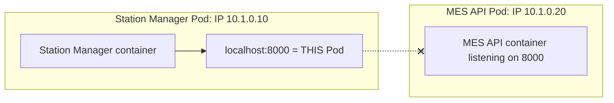

So, **why might my office's configuration work?** We have not established the answer. Possibilities to investigate include a **local sidecar/proxy** forwarding requests from `localhost`, a **host-networked Pod** (`hostNetwork: true`), an **environment-specific URL override**, or the URL referring to a different local process rather than the separate MES API. A RabbitMQ `localhost` setting needs the same investigation: it might target a local proxy/sidecar, a locally accessible broker, a node-level network arrangement or an overridden value. I should not assume that RabbitMQ itself runs in the same Pod or that the config shown is the effective production value.

Our office also uses the term **Anthos**. That tells me something about the broader Kubernetes platform, but it does **not** by itself change the normal meaning of Pod-local `localhost` or prove which networking mode our applications use.

If I later have appropriate access, I can ask the platform team to check a **redacted, deployed** Pod spec and effective runtime configuration: `hostNetwork`, container list (including sidecars), proxy listeners, Services/DNS names, environment variables, ConfigMaps, and how the `localhost` field is consumed. I must not copy credentials, tokens or confidential production configuration into learning notes. Until that inspection, the office setup remains an **open investigation**, not a concluded explanation.

<a id="t007-02"></a>

### T007.02 — Why use a Service rather than `localhost` or a Pod IP?

For **different Pods**, the standard in-cluster example is:

```text
Station Manager -> http://mes-api-service:8000 -> an eligible MES API Pod
```

That Service name resolves inside the cluster (subject to namespace/DNS configuration). The Service tracks matching eligible backend Pods, while their IPs may change when they are replaced. Using `http://10.1.0.20:8000` directly couples the caller to one particular Pod; using `http://localhost:8000` refers back to the caller's own Pod instead. A Service is normally useful **for the receiving application**, not a requirement merely to make outbound calls.

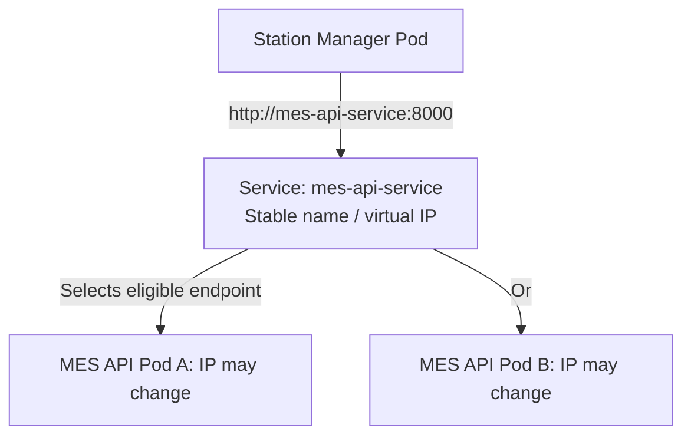

This also revisits T004's port-forwarding confusion. `kubectl port-forward` creates a **temporary bridge from my Windows `localhost` to a selected Pod**; it does not mean the Pod has adopted Windows's loopback network. When I close the terminal running the forwarding command, that bridge stops, but Kubernetes continues running the Employee API.

<a id="t007-03"></a>

### T007.03 — Workload, Deployment and `deployment.yaml`: which is the real object?

I had said, “Workload = actual application,” then wondered whether **Deployment** just means `deployment.yaml`. My corrected understanding:

- **My actual application** is the Station Manager or Employee API program that executes as a process inside a container.
- **Workload** is a general Kubernetes term for a running application/task and the resources that manage it. It is not a separate executable object or merely a name; GKE's *Workloads* screen typically groups workload resources such as Deployments.
- **Deployment** is an actual **Kubernetes API resource** describing the desired application rollout and Pod configuration. A Deployment controller manages ReplicaSets.
- **`deployment.yaml`** is my **local text file** that *describes* the Deployment resource. Saving the file alone does nothing to the cluster; `kubectl apply -f ...` submits the description.

A comparison that helped me:

| File/resource | Meaning |
| --- | --- |
| **Dockerfile** | Recipe for **building an image** containing my code and dependencies |
| **Docker image** (`employee-api:v16`) | Packaged application, ready to instantiate; not a running process |
| **`deployment.yaml`** | Desired configuration for how Kubernetes should **run and maintain** Pods using an image |
| **Deployment resource in Kubernetes** | Live managed object created/updated from that description |

So Dockerfile and Deployment YAML are both **declarations**, but they solve different stages: **build image** versus **deploy and maintain application instances**. Deployment is **not** just a filename.


#### My Dockerfile comparison, explained using the full Employee API flow

My original question was: **"What is Deployment? Is it like a Dockerfile containing a set of instructions?"** The comparison is useful, but they are not interchangeable.

A **Dockerfile** tells the image builder how to *package* my Employee API. For example, it can specify the Python base image, application files, dependencies and startup command. Running `docker build` produces `employee-api:v16`. This does **not** create Kubernetes Pods.

My **`deployment.yaml`** tells Kubernetes how I want that *already-built image* to run: the image name, container port, Pod labels and **three desired replicas**. Running `kubectl apply -f k8s/` submits that YAML. Kubernetes stores a **Deployment resource**, and its controllers arrange for the Pods to exist.

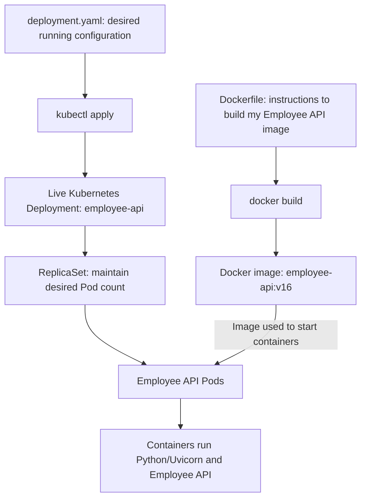

**The key difference for future revision:**

- **Dockerfile:** *How do I build/package this application?*
- **Docker image:** *What packaged application should run?*
- **Deployment YAML:** *How many copies should Kubernetes run, using which image and settings?*
- **Deployment:** *The actual Kubernetes object storing that desired state and managing updates to its Pods.*
- **ReplicaSet:** *The supervisor keeping the intended number of Pods present.*

A Deployment is not the image, not the running process and not simply the YAML file. It is the managed **Kubernetes resource** created or updated from the YAML. My Day 34 Employee API Deployment was the one named `employee-api`.

<a id="t007-04"></a>

### T007.04 — ReplicaSet as a supervisor: my analogy is correct

My analogy was: **“ReplicaSet is a supervisor who ensures the configured workers are there to serve requests.”** Yes, with a small precision: a ReplicaSet controller works to maintain the **requested number of matching Pods**, not to guarantee every business request succeeds. The **Deployment** specifies the desired number and Pod template; it manages the ReplicaSet that maintains the Pods. Service routing and application readiness are separate concerns.

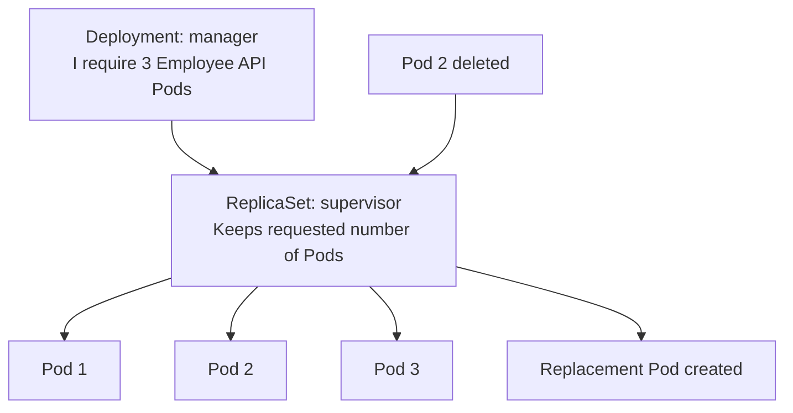

This is the behavior **actually observed** in T005: when I deleted `employee-api-cb88dd9c9-c58lk`, the replacement `9ngbl` appeared without me issuing a second create command. The ReplicaSet does not act like an API gateway or load balancer.

<a id="t007-05"></a>

### T007.05 — Pod versus Container: what is really running?

My confusion was understandable because in my office I open a **Station Manager Pod** to see logs or troubleshoot the **Station Manager application**. In our one-container-per-Pod example, the Pod is the practical unit I select, but the application process **executes inside the container**.

| Layer | My simple definition | Example |
| --- | --- | --- |
| **Image** | Packaged app and runtime files, not running yet | `employee-api:v16` |
| **Container** | Runtime instance created from an image; contains the running application process when started | Python/Uvicorn running FastAPI; or the Station Manager .NET process |
| **Pod** | Smallest Kubernetes **schedulable** unit; defines one or more containers sharing a network namespace and some resources | `employee-api-cb88dd9c9-9ngbl` containing the Employee API container |
| **Node** | Machine/VM providing CPU, memory and OS kernel to host Pods | `docker-desktop` |

A Pod is **not a second copy of the source code**, a separate executable, or a full virtual machine. It is a Kubernetes resource that groups containers, their network identity and shared configuration. Kubernetes schedules **the Pod** onto a Node and the container runtime starts its containers there. That's why we call Pod the **deployable/schedulable unit**.

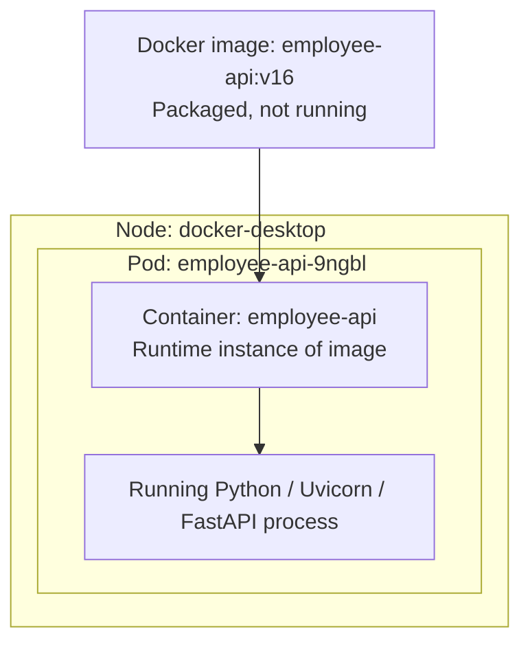

If a Pod has two cooperating containers, **both** are scheduled together on one Node and share its Pod network namespace. If Station Manager and MES API instead live in **different Pods**, they ordinarily have **different** Pod network namespaces. This directly connects the Pod/Container distinction to my `localhost` question.

**Why I look for logs under the Pod:** The Kubernetes tool or GKE interface lets me select the Pod and then view the output of its container(s). For multiple containers I may need to specify which one (`kubectl logs POD -c CONTAINER`). The logs still come from the **application process inside a container**. Saying “the Station Manager Pod is running” is useful operational shorthand, but it does not mean a Pod itself is my `.exe`.

<a id="t007-06"></a>

### T007.06 — My laptop/VM analogy: where it helps and where it fails

I proposed: **Laptop = Node; VM = Pod.** The first half is helpful. The second half needs correcting.

A **VM** normally has a separate guest operating system and its own kernel. A **Pod** normally does **not**: the containers use the **Node's kernel**, while Linux isolation features provide a distinct network namespace and other isolation. The Pod is therefore not a miniature VM with Windows or Linux freshly installed in it.

For **our actual Docker Desktop local setup**, the more accurate layered picture is:

```mermaid
flowchart TB
  L[Physical Windows 11 laptop
Provides CPU, memory, disk] --> VM[Docker Desktop Linux VM/environment]
  VM --> N[Kubernetes Node: docker-desktop
Linux kernel / node resources]
  N --> P[Employee API Pod
Its own network namespace + Pod IP]
  P --> C[Employee API container
Runs FastAPI process]
```

This is an **architecture analogy**, not evidence that we inspected every Docker Desktop virtualization implementation detail. A production GKE Node is usually a Google-managed Compute Engine VM; the Pod remains a Pod inside that Node, not another complete guest VM.

<a id="t007-07"></a>

### T007.07 — If the Node supplies CPU and memory, why does each Pod have its own IP?

I asked: **“If Pod doesn't have its own computing resources, why does it have a separate IP instead of the Node's IP?”** The correction is that **resource ownership and network identity are different**. Sharing the Node's CPU, RAM and OS kernel does not require sharing its IP.

In standard Kubernetes Pod networking, the network implementation gives the Pod a **separate network namespace and a Pod IP**. This lets different Pods be addressed independently and commonly lets several Pods listen on the **same port number** without conflicting with one another.

These values were **actually observed** after Day 34 Pod recovery:

| Layer | Observed address | Meaning |
| --- | --- | --- |
| Node `docker-desktop` | `192.168.65.3` | Address of the Node shown in `kubectl describe pod` |
| Employee API Pod `mf9bv` | `10.1.0.6:8000` | Independent Pod network identity, same container port |
| Employee API Pod `9stqv` | `10.1.0.8:8000` | Another Pod on the same Node |
| Employee API Pod `9ngbl` | `10.1.0.9:8000` | Replacement Pod on the same Node |
| Employee API Service | `10.105.206.127:8000` | Stable virtual Service address, with eligible backend Pods |

```mermaid
flowchart TB
  subgraph N[Single Node: docker-desktop — 192.168.65.3
Shared physical resources / Linux kernel]
    P1[Pod A: 10.1.0.6:8000]
    P2[Pod B: 10.1.0.8:8000]
    P3[Pod C: 10.1.0.9:8000]
  end
  S[Service: 10.105.206.127:8000
Stable frontend] --> P1
  S --> P2
  S --> P3
```

Without Pod-level network isolation, three applications trying to listen on the exact same Node IP and port could conflict. With separate Pod IPs, all three can serve port `8000`. The network plugin handles connectivity between Pods/Nodes. There are exceptions such as `hostNetwork: true`, which is **why my office configuration must be inspected rather than guessed**.

**Does the Pod use any computing resources?** Yes. Its running containers consume Node CPU and memory. Kubernetes can configure container CPU/memory requests and limits that affect scheduling and resource enforcement. It is more accurate to say **“the Pod has no separate hardware or guest OS”** than **“the Pod has no computing resources at all.”** We didn't configure these requests/limits in Day 34; our Pods showed QoS `BestEffort` (T005.08).

<a id="t007-08"></a>

### T007.08 — My final two views of the same Employee API

**Management view: who makes sure enough instances exist?**

```mermaid
flowchart LR
  D[Deployment] --> R[ReplicaSet] --> P[Pod(s)]
```

**Runtime view: where is the real application executing?**

```mermaid
flowchart LR
  N[Node] --> P[Pod] --> C[Container] --> A[Application process]
```

**Quick recall for my future self:**

| My question | What I now mean |
| --- | --- |
| Is a Workload the executable? | No. It is the application/task as managed by Kubernetes; a Deployment is one workload resource. |
| Is `deployment.yaml` the Deployment itself? | No. It describes the live Kubernetes Deployment resource. |
| Is ReplicaSet a supervisor? | Yes: it maintains the desired number of matching Pods, not application business success. |
| Is the Pod the running `.exe`? | No. The process runs inside a **container**, which lives inside a Pod. |
| Why “deployable unit”? | Kubernetes schedules and manages **Pods**, which bundle their container(s). |
| Is a Pod a VM with its own OS? | No. It normally uses the Node's Linux kernel. |
| Why separate Pod IPs on one Node? | Independent network namespaces/identities, despite shared Node hardware. |
| Does same network make `localhost` reach another Pod? | No. Separate Pods normally have separate loopback interfaces. |
| Why create a Service? | Stable name/address for callers to reach eligible Pods even as Pod IPs change. |
| Why does office Station Manager use `localhost` for MES API/RabbitMQ? | **Still unknown**; inspect deployed networking and effective configuration before concluding. |

These clarifications are enough for the current learning objective. **A deeper investigation of office Anthos networking and RabbitMQ routing is deferred**, and I should not claim we verified it during Day 34.

---


<a id="t007-09"></a>

### T007.09 — What is a Namespace? Does every Cluster have its own Namespace?

**My question:** "We haven't discussed Namespace. Does every cluster have its own Namespace?"

The precise answer: **A Kubernetes cluster contains namespaces, and a cluster can contain MANY namespaces.** A namespace is a **logical grouping within one cluster**, not a new cluster, Node, Pod, VM or operating system. Kubernetes normally creates several namespaces for us when the cluster is set up.

Think of one automotive factory (one Cluster) with separate departments or areas (namespaces). Departments organise resources and help teams manage access and quotas. However, the department walls in this analogy are **not automatically network firewalls**.

```mermaid
flowchart TB
  C[One Kubernetes Cluster: docker-desktop]
  C --> D[Namespace: default]
  C --> SYS[Namespace: kube-system]
  C --> PUB[Namespace: kube-public]
  C --> LEASE[Namespace: kube-node-lease]
  D --> DEP[Deployment: employee-api]
  D --> S[Service: employee-api-service]
  DEP --> P[Employee API Pods]
  SYS --> CP[System components such as cluster DNS]
```

In **our actual Day 34 exercise**, we did not pass `-n` or `--namespace` in `kubectl create deployment`, `kubectl get pods` or `kubectl expose`. Our selected context used the **`default` namespace**, so the Employee API Deployment, Pods and Service were created there. The Pod descriptions actually showed `Namespace: default`. The diagram's list of standard namespaces is explanatory; we did **not** record the output of `kubectl get namespaces` during Day 34.

#### Why are namespaces useful?

Suppose my company runs multiple applications and environments on the same cluster:

| Example namespace | Example resources inside it |
| --- | --- |
| `manufacturing-dev` | Station Manager Deployment, MES API Deployment, Services |
| `manufacturing-test` | Separate test Deployments and Services |
| `default` | Our actual Day 34 Employee API Deployment and Service |
| `kube-system` | Kubernetes supporting components |

These are **examples of possible organisation**, not a claim that my office uses those exact namespaces.

Two namespace-scoped resources can have the same name **in different namespaces**, for example `station-manager` in `manufacturing-dev` and `station-manager` in `manufacturing-test`. Names normally must be unique **within the same namespace for that resource type**.

A Namespace by itself **does not guarantee separate Nodes, CPUs, IP networks or blocked communication**. Applications in different namespaces can ordinarily communicate when their Services are reachable; restrictions require policies or other controls. Nodes themselves are **cluster-scoped**, not inside one namespace.

#### How does a Service name work across namespaces?

For the Service we created in namespace `default`, a Pod in the **same namespace** can generally call:

```text
http://employee-api-service:8000
```

A Pod in a **different namespace** can address it more explicitly:

```text
http://employee-api-service.default.svc.cluster.local:8000
```

Here `default` is the namespace, and `cluster.local` is the common default cluster DNS domain used in our explanation; the exact cluster domain is configurable. Cross-namespace routing still depends on network policies, application security and other settings.

#### Commands I can try on my local cluster

```powershell
kubectl get namespaces
kubectl get pods -n default
kubectl get deployments -n default
kubectl get services -n default
kubectl get pods -n kube-system
kubectl config view --minify
```

- `get namespaces` lists namespaces in the selected cluster.
- `-n default` specifically asks for resources within `default`.
- `-n kube-system` lets me inspect system Pods, if permitted.
- `config view --minify` helps inspect the active context; credentials may appear in some configuration views, so do not share unredacted kubeconfig output.

**These namespace commands are suggested future checks, not commands I claimed to have executed in Day 34.**

#### One-sentence recall

> My Cluster is the whole Kubernetes environment. Inside that cluster, namespaces logically organise namespaced resources. In Day 34 I used `default`; the same cluster can also contain many other namespaces.

## Appendix — Full original pod-description attachment

The following block is inserted verbatim from the recovered local file corresponding to the uploaded `kubectl describe pod results.txt`. Any omission within that original text remains an omission rather than an invented diagnostic field.

```text
PS C:\Users\Admin> kubectl describe pod
Name:             employee-api-cb88dd9c9-9ngbl
Namespace:        default
Priority:         0
Service Account:  default
Node:             docker-desktop/192.168.65.3
Start Time:       Sat, 14 Nov 2026 15:47:26 +0000
Labels:           app=employee-api
                  pod-template-hash=cb88dd9c9
Annotations:      <none>
Status:           Running
IP:               10.1.0.9
IPs:
  IP:           10.1.0.9
Controlled By:  ReplicaSet/employee-api-cb88dd9c9
Containers:
  employee-api:
    Container ID:   docker://130ddb51790b2271f48d7f89a0c78a771fbc707cee6477e850fc49680fd19f62
    Image:          employee-api:v16
    Image ID:       docker-pullable://employee-api@sha256:6a2f17f349801c6bd49600978a90b4e6dd6d91e6f5ba8aa8954599b439452570
    Port:           8000/TCP
    Host Port:      0/TCP
    State:          Running
      Started:      Sat, 14 Nov 2026 15:47:27 +0000
    Ready:          True
    Restart Count:  0
    Environment:    <none>
    Mounts:
      /var/run/secrets/kubernetes.io/serviceaccount from kube-api-access-g8lcx (ro)
Conditions:
  Type                        Status
  PodReadyToStartContainers   True
  Initialized                 True
  Ready                       True
  ContainersReady             True
  PodScheduled                True
Volumes:
  kube-api-access-g8lcx:
    Type:                    Projected (a volume that contains injected data from multiple sources)
    TokenExpirationSeconds:  3607
    ConfigMapName:           kube-root-ca.crt
    Optional:                false
    DownwardAPI:             true
QoS Class:                   BestEffort
Node-Selectors:              <none>
Tolerations:                 node.kubernetes.io/not-ready:NoExecute op=Exists for 300s
                             node.kubernetes.io/unreachable:NoExecute op=Exists for 300s


Name:             employee-api-cb88dd9c9-9stqv
Namespace:        default
Priority:         0
Service Account:  default
Node:             docker-desktop/192.168.65.3
Start Time:       Sat, 14 Nov 2026 15:39:31 +0000
Labels:           app=employee-api
                  pod-template-hash=cb88dd9c9
Annotations:      <none>
Status:           Running
IP:               10.1.0.8
IPs:
  IP:           10.1.0.8
Controlled By:  ReplicaSet/employee-api-cb88dd9c9
Containers:
  employee-api:
    Container ID:   docker://c4da50789cdcaaa0e622b38783d402c05618af12f644423144f17ed9538d3f1b
    Image:          employee-api:v16
    Image ID:       docker-pullable://employee-api@sha256:6a2f17f349801c6bd49600978a90b4e6dd6d91e6f5ba8aa8954599b439452570
    Port:           8000/TCP
    Host Port:      0/TCP
    State:          Running
      Started:      Sat, 14 Nov 2026 15:39:33 +0000
    Ready:          True
    Restart Count:  0
    Environment:    <none>
    Mounts:
      /var/run/secrets/kubernetes.io/serviceaccount from kube-api-access-zzx9h (ro)
Conditions:
  Type                        Status
  PodReadyToStartContainers   True
  Initialized                 True
  Ready                       True
  ContainersReady             True
  PodScheduled                True
Volumes:
  kube-api-access-zzx9h:
    Type:                    Projected (a volume that contains injected data from multiple sources)
    TokenExpirationSeconds:  3607
    ConfigMapName:           kube-root-ca.crt
    Optional:                false
    DownwardAPI:             true
QoS Class:                   BestEffort
Node-Selectors:              <none>
Tolerations:                 node.kubernetes.io/not-ready:NoExecute op=Exists for 300s
                             node.kubernetes.io/unreachable:NoExecute op=Exists for 300s


Name:             employee-api-cb88dd9c9-mf9bv
Namespace:        default
Priority:         0
Service Account:  default
Node:             docker-desktop/192.168.65.3
Start Time:       Sat, 14 Nov 2026 14:10:25 +0000
Labels:           app=employee-api
                  pod-template-hash=cb88dd9c9
Annotations:      <none>
Status:           Running
IP:               10.1.0.6
IPs:
  IP:           10.1.0.6
Controlled By:  ReplicaSet/employee-api-cb88dd9c9
Containers:
  employee-api:
    State:          Running
      Started:      Sat, 14 Nov 2026 14:10:26 +0000
    Ready:          True
    Restart Count:  0
    Environment:    <none>
    Mounts:
      /var/run/secrets/kubernetes.io/serviceaccount from kube-api-access-ldtcf (ro)
Conditions:
  Type                        Status
  PodReadyToStartContainers   True
  Initialized                 True
  Ready                       True
  ContainersReady             True
  PodScheduled                True
Volumes:
  kube-api-access-ldtcf:
    Type:                    Projected (a volume that contains injected data from multiple sources)
    TokenExpirationSeconds:  3607
    ConfigMapName:           kube-root-ca.crt
    Optional:                false
    DownwardAPI:             true
QoS Class:                   BestEffort
Node-Selectors:              <none>
Tolerations:                 node.kubernetes.io/not-ready:NoExecute op=Exists for 300s
                             node.kubernetes.io/unreachable:NoExecute op=Exists for 300s
PS C:\Users\Admin>
```
