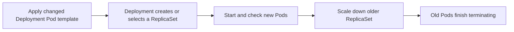
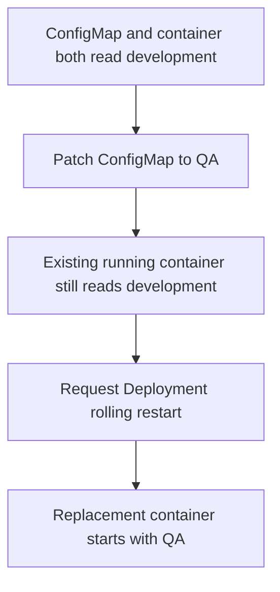
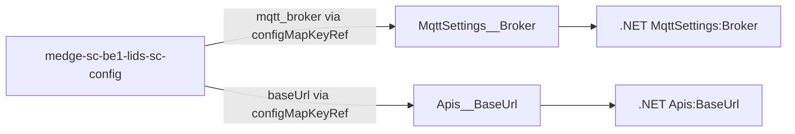

# Day 35 · Kubernetes ConfigMaps & Secrets

**Learning status:** Completed, as I confirmed in New_Learning_3.  
**Scope:** Local Employee API lab and read-only review of a supplied MES Station Manager manifest excerpt.  
**Evidence:** S001–S024 are embedded in the companion Excel workbook. The S009 number is inferred from position and content. An additional unnumbered screenshot documents the failed `/dev/stdin` attempt.

**Where I started:** On Day 34 I deployed the Python Employee API to Kubernetes and scaled it to three Pods. On Day 35 I kept the same image and moved runtime settings outside it. My earlier Cloud Run work gave me a familiar comparison: choose environment-specific settings and supply credentials separately from the application build. In this lab I used Kubernetes ConfigMaps and Secrets for those two jobs.

| If I come back with this question                                | Where I look                                                     |
| ---------------------------------------------------------------- | ---------------------------------------------------------------- |
| Why did my Kubernetes commands fail before the lab started?      | T001 · Context and API connectivity                              |
| How do I supply settings without rebuilding the image?           | T002 · External configuration                                    |
| What is a rollout, and which action replaces which Pods?         | T003 · Rollout vocabulary, strategies and single-Pod replacement |
| Why did my running Pod still show the old value?                 | T004 · Startup environment and the PowerShell patch experiment   |
| How do I select one key or import many? What does dry-run check? | T005 · Secret injection and validation                           |
| How do I prove all replicas received the settings?               | T006 · Per-Pod checks                                            |
| What belongs in Git?                                             | T007 · Declarative YAML and the placeholder Secret               |
| How do I identify the correct Station Manager Pod?               | T008 · Namespace, label, owner and station assignment            |

## T001 · Verify my Kubernetes environment

I first checked whether my local Employee API cluster was usable. My current context was `docker-desktop`, but the Kubernetes API connection to `127.0.0.1:6443` was refused before I started Docker Desktop. The context selects a cluster and related settings. The API still has to be reachable.

```powershell
kubectl config current-context
kubectl get nodes
kubectl get deployments,pods,services
```

I started Docker Desktop, waited for Kubernetes to come up, and repeated the checks. The lab showed Kubernetes `v1.36.1`, node `docker-desktop` Ready, Deployment `employee-api` at 3/3, three Running Pods, and `employee-api-service` as a ClusterIP Service on port 8000. The Pods showed two prior restarts each. I recorded that observation without diagnosing their cause. S001 captures the connection refusal. S002 captures the recovered environment.

I treat the node, Deployment, Pods and Service as distinct checks. A reachable API lets me query them. Ready Pods and a Service object still leave application-level health to test separately.

## T002 · Create and inspect a ConfigMap

I wanted the same Employee API image to run with different environment settings. For example, I can ship the same station application image to two environments and give each environment its own non-sensitive service address or logging level. I created an independent ConfigMap and checked it from PowerShell and Docker Desktop.

### Why external configuration matters

I can promote the same tested image through environments and supply different settings at runtime. These were the teaching examples from the discussion. My actual lab started with `development` and `INFO`, then changed `APP_ENV` to `QA`.

| Illustrative environment | `APP_ENV`     | `LOG_LEVEL` |
| ------------------------ | ------------- | ----------- |
| Development              | `development` | `DEBUG`     |
| Testing                  | `testing`     | `INFO`      |
| Production               | `production`  | `WARNING`   |

For MES, I might use the same PDT build at different plants while supplying each plant's MQTT broker address, Redis endpoint and logging level. Credentials for those services belong in a Secret or a managed secret provider. I still need application code that reads and uses those settings.

### Create and inspect the lab ConfigMap

```powershell
kubectl create configmap employee-api-config --from-literal=APP_ENV=development --from-literal=LOG_LEVEL=INFO
kubectl get configmaps
kubectl describe configmap employee-api-config
```

`--from-literal` takes a key and value directly. I observed `APP_ENV=development` and `LOG_LEVEL=INFO`. The ConfigMap existed before any Pod template referenced it. This explains why creating it alone did not change the running containers. S003 shows creation, S004 shows stored values, and S005 shows Docker Desktop’s resource view.

## T003 · Inject configuration and follow a Deployment rollout

I opened my existing `01-python-fastapi/k8s/deployment.yaml` (S006). It used the `employee-api:v16` image, three replicas, the `app=employee-api` selector, `IfNotPresent`, and port 8000. I added `envFrom` under the existing container, at the same indentation level as `image` and `ports`. This lets the container receive the ConfigMap keys as environment variable names.

```yaml
containers:
  - name: employee-api
    image: employee-api:v16
    imagePullPolicy: IfNotPresent
    envFrom:
      - configMapRef:
          name: employee-api-config
    ports:
      - containerPort: 8000
```

```powershell
kubectl apply --dry-run=server -f .\k8s\deployment.yaml
kubectl apply -f .\k8s\deployment.yaml
kubectl rollout status deployment/employee-api
kubectl get pods
kubectl exec deployment/employee-api -- printenv APP_ENV LOG_LEVEL
```

S007 shows server dry-run. S008 shows the apply and successful rollout with three new Pods running while three old Pods were terminating. Terminating Pods can remain visible after rollout completion. This snapshot does not establish a six-replica target or guarantee uninterrupted service. S009 shows `development` and `INFO` in one selected container.

### What does “rollout” mean?

In plain English, when I say “we're rolling out a new PDT version to the plants,” I mean we're putting the change into service. In Kubernetes, I use **rollout** for the workload's progression to a desired Pod template revision. The **Pod template** under `spec.template` describes the Pods the controller should create. The Employee API Deployment manages revisions through **ReplicaSets**, each of which maintains the requested count of Pods for its template.

| Term                   | What it means in practice                                                                                                                                                                     |
| ---------------------- | --------------------------------------------------------------------------------------------------------------------------------------------------------------------------------------------- |
| Rollout                | Deploy a new Pod template revision. In my lab, adding the ConfigMap reference changed the template even though the image stayed at `employee-api:v16`.                                        |
| Rolling update         | Replace old Pods progressively according to the workload's update strategy. Old and new revisions can serve at the same time.                                                                 |
| Rollout restart        | Request workload-wide Pod replacement by changing a timestamp annotation on the Pod template. The image and env references can stay the same. The controller follows its configured strategy. |
| Single-Pod replacement | Remove one controller-owned Pod. The controller reconciles the replica count by creating its replacement. The other Pods are not deliberately cycled.                                         |
| Rollback               | Return the workload to a previous Pod template revision if its history is available. ConfigMap or Secret contents live in separate objects and need their own restoration if they changed.    |

### Which update strategies are available?

For a **Deployment**, `RollingUpdate` is the default. `maxSurge` controls how far Kubernetes can scale above the desired count during an update, and `maxUnavailable` controls how far availability can fall below it. With three replicas and the default 25% settings, these resolve to one surge Pod and zero unavailable Pods by rounding up and down respectively. With that policy, the controller can start one replacement, wait for it to become available, scale down an old replica, and continue. Terminating Pods can remain visible beyond the surge calculation, which explains the six Pod rows in S008. Readiness, any minimum ready time, and application shutdown affect the actual transition. A successful rollout status does not establish end-to-end availability.

`Recreate` is the other Deployment strategy. During a revision update it terminates the existing Pods before bringing up the new Pods, which can create a service interruption. I used `RollingUpdate` in the lab.

A **StatefulSet** has different strategy names. Under its default `RollingUpdate` behaviour, the controller typically updates from the highest ordinal to the lowest and waits for an updated Pod to become Ready before continuing. Under `OnDelete`, changing the template does not automatically update existing Pods. Each Pod gets the new template when it is replaced. As a result, I check the actual StatefulSet strategy before expecting a restart request to replace its Pods. These are Kubernetes behaviours for reference. I did not verify the office strategy. [Deployment strategies](https://kubernetes.io/docs/concepts/workloads/controllers/deployment/#strategy), [StatefulSet update strategies](https://kubernetes.io/docs/concepts/workloads/controllers/statefulset/#update-strategies)



### Which action replaces my three Pods?

| My action                                                                   | Effect on the lab Deployment                                                                                                                                      |
| --------------------------------------------------------------------------- | ----------------------------------------------------------------------------------------------------------------------------------------------------------------- |
| Change the image, env refs or another field under `spec.template` and apply | Kubernetes rolls out the new template and replaces the old Pods according to the strategy.                                                                        |
| Scale by changing `spec.replicas` only                                      | Kubernetes adjusts the desired count. This does not create a new template revision.                                                                               |
| Change the referenced ConfigMap or Secret data only                         | Existing containers retain their startup environment. New containers can start with the updated object values, so replicas can temporarily have different values. |
| Run `kubectl rollout status deployment/employee-api`                        | Observe progress. The command itself does not change the workload.                                                                                                |
| Run `kubectl rollout restart deployment/employee-api`                       | Request replacement of all Pods via the Deployment strategy. Each replacement can pick up the current settings.                                                   |
| Delete one confirmed ReplicaSet-owned Pod                                   | Its controller brings the replica count back up. The replacement reads current settings, and the remaining two Pods can continue with their previous settings.    |

### How would I replace only one Pod?

There is no `kubectl restart pod` command. In the **local lab**, I would first list the Pods and select a specific name. Before deleting it, I would verify the current context, namespace and owner. For this Deployment, I expect the Pod owner to be a ReplicaSet and that ReplicaSet's owner to be `Deployment/employee-api`. A standalone Pod without a controller may have no automatic replacement. A new Pod starts with new container processes. A container restart inside an existing Pod is a separate event and retains that Pod's UID.

```powershell
# Local lab example. Fill in the actual namespace and one confirmed Pod name.
kubectl config current-context
$ns = '<lab namespace>'
kubectl get pods -n $ns -l app=employee-api -o wide
$pod = '<confirmed lab Pod name>'
kubectl describe pod $pod -n $ns
# Run the delete only after verifying the target and accepting the impact.
kubectl delete pod $pod -n $ns
kubectl get pods -n $ns -l app=employee-api -w
```

I check that the replacement becomes Ready and that the other replicas remain healthy. In MES, removing one Pod can still interrupt the station it serves. A service with many replicas can carry on serving requests while the affected station waits for its MQTT subscription or application state to recover. The office case in T008 was read-only. The single-Pod deletion here is a reference example.

```powershell
# Reference commands for Deployment revision history and rollback.
kubectl rollout history deployment/employee-api
kubectl rollout history deployment/employee-api --revision=2
kubectl rollout undo deployment/employee-api --to-revision=2
kubectl rollout status deployment/employee-api
```

I would first identify the intended revision from history. The number `2` is illustrative. A revision stores the old template, which can still point to the same ConfigMap name. If I rolled back the T004 restart without also restoring the ConfigMap, new containers could still receive `QA`. [kubectl rollout](https://kubernetes.io/docs/reference/kubectl/generated/kubectl_rollout/)

## T004 · Update the ConfigMap and compare old and replacement Pods

I tried changing `APP_ENV` from `development` to `QA`. On Windows PowerShell 5.1, the inline JSON patch reached the API with broken quoting. The server reported `error decoding patch: invalid character 'd' looking for beginning of object key string` (S010). A follow-up suggestion used the Linux path `/dev/stdin`, which failed in my Windows shell (supplemental screenshot). I moved the JSON into a file and used `--patch-file`.

```powershell
'{"data":{"APP_ENV":"QA"}}' | Set-Content -Path .\configmap-patch.json -Encoding ASCII
kubectl patch configmap employee-api-config --type=merge --patch-file=.\configmap-patch.json
kubectl get configmap employee-api-config -o jsonpath='{.data.APP_ENV}'
kubectl exec deployment/employee-api -- printenv APP_ENV
kubectl rollout restart deployment/employee-api
kubectl rollout status deployment/employee-api
kubectl exec deployment/employee-api -- printenv APP_ENV
```

| Checkpoint            | ConfigMap `APP_ENV` | Checked container `APP_ENV` | Evidence   |
| --------------------- | ------------------- | --------------------------- | ---------- |
| Initial integration   | development         | development                 | S004, S009 |
| Merge patch           | QA                  | development                 | S011, S012 |
| After rolling restart | QA                  | QA                          | S013       |

The merge patch touched a single key and left `LOG_LEVEL=INFO`. Kubernetes supplies environment values at container startup. I verified the stale value on an existing container and the current value after replacement. A ConfigMap projected as a volume has different update semantics. Kubernetes can refresh the projected files eventually, the application must reread them, and a `subPath` mount does not receive those updates. The experiment used environment injection. [Kubernetes ConfigMaps](https://kubernetes.io/docs/concepts/configuration/configmap/)



## T005 · Create and inject a Kubernetes Secret

I used a dummy key for a generic `Opaque` Secret. Here, arbitrary key-value data means I choose application-specific keys such as `EMPLOYEE_API_KEY`. Some other Secret types define required keys. Base64 is reversible encoding. Access controls and cluster encryption at rest are separate protections.

```powershell
# Local lab dummy value from the learning session.
kubectl create secret generic employee-api-secret --from-literal=EMPLOYEE_API_KEY=demo-key-123
kubectl get secrets
kubectl describe secret employee-api-secret
```

The description reported the key and its 12-byte size (S014). I also saw the Secret in Docker Desktop (S015). For the lab container, I retained the ConfigMap `envFrom` and added the following sibling field (S016).

```yaml
env:
  - name: EMPLOYEE_API_KEY
    valueFrom:
      secretKeyRef:
        name: employee-api-secret
        key: EMPLOYEE_API_KEY
```

### Does `envFrom` load a whole file?

I apply YAML to create a Kubernetes resource. At container startup, `envFrom` imports that live resource's eligible keys as variables. Kubernetes does not mount the YAML file in the container through this mechanism. Both ConfigMaps and Secrets work with bulk import and with selected-key import. Both references resolve in the Pod's namespace.

| What I want                          | ConfigMap                         | Secret                         |
| ------------------------------------ | --------------------------------- | ------------------------------ |
| Import the resource's keys together  | `envFrom[].configMapRef`          | `envFrom[].secretRef`          |
| Select and optionally rename one key | `env[].valueFrom.configMapKeyRef` | `env[].valueFrom.secretKeyRef` |

For a selected key, `env[].name` names the variable in the container, the reference's `name` names the Kubernetes object, and `key` identifies the entry. The two names can differ. Here I import `APP_ENV` under the illustrative name `MY_APP_ENV` and declare each required Secret key separately.

```yaml
env:
  - name: MY_APP_ENV
    valueFrom:
      configMapKeyRef:
        name: employee-api-config
        key: APP_ENV
  - name: EMPLOYEE_API_KEY
    valueFrom:
      secretKeyRef:
        name: employee-api-secret
        key: EMPLOYEE_API_KEY
  - name: EMPLOYEE_API_SQL_PWD
    valueFrom:
      secretKeyRef:
        name: employee-api-secret
        key: EMPLOYEE_API_SQL_PWD
```

### If I have 100 Secret values, do I write 100 references?

One `secretKeyRef` selects exactly one key. If I need another selected key, such as the hypothetical `EMPLOYEE_API_SQL_PWD`, I add a separate entry under `env`. If one app legitimately needs all keys in a dedicated Secret, I can use bulk import and avoid declaring each key in the template.

```yaml
envFrom:
  - configMapRef:
      name: employee-api-config
  - secretRef:
      name: employee-api-secret
```

Adding a key to a Secret already referenced by `envFrom` needs no template edit, but existing containers still need replacement to receive that new variable. If the values serve several applications, I group Secrets by application, purpose and access requirements, then give each container the keys it needs. In the actual lab I selected one API key. The SQL, Redis and MQTT examples were discussion examples.

### What does server dry-run validate? Is it like compiling C#?

The analogy helped me distinguish **checking a declaration** from **running what it describes**. A C# compiler checks types and produces a build artifact. With `kubectl apply --dry-run=server`, kubectl parses the YAML and submits a dry-run request to the Kubernetes API. The API applies normal validation, defaulting and applicable admission checks without persisting the resource or starting Pods. It can reject an invalid API version, a field of the wrong type such as `replicas: three`, or a Deployment whose selector does not match its template labels.

| Command                                                   | What I can conclude from success                                                                                            |
| --------------------------------------------------------- | --------------------------------------------------------------------------------------------------------------------------- |
| `kubectl apply --dry-run=server -f .\k8s\deployment.yaml` | The request was accepted for server-side validation. Any reported `configured (server dry run)` result is simulated.        |
| `kubectl apply -f .\k8s\deployment.yaml`                  | Kubernetes accepted the real change. The controller can now act on the persisted template.                                  |
| `kubectl rollout status deployment/employee-api`          | The controller reports rollout progress and completion or failure.                                                          |
| `kubectl exec` and an application check                   | I can verify what reached the container, then separately test behaviour such as a health endpoint or authenticated request. |

For example, `image: employee-api:v999` can have a valid format and pass dry-run. The Pod can later fail to obtain that image. Similarly, accepting a Secret reference structurally does not establish that the named object and key are available when the Pod starts. Dry-run also leaves scheduling, image availability, Python startup, readiness, `/health`, and connections such as database or Redis to later checks. S017 shows dry-run acceptance. S018 shows the real rollout, with three new Running Pods at zero restarts and three old Pods Terminating.

```powershell
kubectl exec deployment/employee-api -- python -c "import os; print('APP_ENV:', os.getenv('APP_ENV')); print('EMPLOYEE_API_KEY exists:', bool(os.getenv('EMPLOYEE_API_KEY')))"
```

S019 showed `QA` and `True` in one container. The Boolean verifies a non-empty variable without printing the value. It does not exercise authentication or prove that the app reads the variable. Secret values injected into the environment follow the same startup rule as ConfigMap values. [Kubernetes Secrets](https://kubernetes.io/docs/concepts/configuration/secret/)

## T006 · Verify all three Pods individually

I used the `app=employee-api` selector to enumerate the Pods, then targeted each Pod explicitly. This was stronger evidence than repeating `kubectl exec deployment/employee-api`, which selects a Pod for me. I ran this after rollout. In a multi-container Pod, I would pass `-c employee-api` to target the application container explicitly.

```powershell
$pods = kubectl get pods -l app=employee-api -o jsonpath='{.items[*].metadata.name}'
foreach ($pod in ($pods -split '\s+' | Where-Object { $_ })) {
  Write-Host "Checking Pod: $pod"
  kubectl exec $pod -- python -c "import os; print('APP_ENV:', os.getenv('APP_ENV')); print('API Key Present:', bool(os.getenv('EMPLOYEE_API_KEY')))"
}
```

S020 shows all three checked Pods reporting `APP_ENV: QA` and `API Key Present: True`. It establishes consistency across the three containers at that time. I did not validate application-level log behaviour or authentication.

## T007 · Put non-sensitive configuration and a Secret example in YAML

I declared the ConfigMap with the values already verified in the lab. I ran a server dry-run, applied it and verified the stored data (S021–S023).

```yaml
apiVersion: v1
kind: ConfigMap
metadata:
  name: employee-api-config
data:
  APP_ENV: "QA"
  LOG_LEVEL: "INFO"
```

```powershell
kubectl apply --dry-run=server -f .\k8s\configmap.yaml
kubectl apply -f .\k8s\configmap.yaml
kubectl get configmap employee-api-config -o yaml
```

The resource had been created imperatively without the `kubectl.kubernetes.io/last-applied-configuration` annotation. The subsequent client-side apply warned about the missing annotation and added it. The third screenshot verified both values and the annotation. The declarative manifest now records the intended ConfigMap data for repeatable application.

**Should I create `secret.yaml`?** I created `k8s/secret.example.yaml` with a placeholder (S024). `stringData` accepts plain text. `data` takes Base64-encoded values. If I apply this example to the lab Secret of the same name and namespace, the placeholder may overwrite the working dummy key. I kept the working Secret separate.

```yaml
apiVersion: v1
kind: Secret
metadata:
  name: employee-api-secret
type: Opaque
stringData:
  EMPLOYEE_API_KEY: "REPLACE_WITH_YOUR_API_KEY"
```

My Git plan was to review and stage the Deployment, ConfigMap and example only. The existing Service manifest is also suitable for Git. If I create a local `k8s/secret.yaml`, the suggested ignore pattern is `**/k8s/secret.yaml`. It applies to untracked files and cannot remove values already in history. `configmap-patch.json` was a temporary lab file. The commands below record the proposed Git workflow from `01-python-fastapi`. The conversation did not record a completed commit.

```powershell
git status --short
git add k8s/deployment.yaml k8s/configmap.yaml k8s/secret.example.yaml
git diff --cached --stat
git diff --cached
git commit -m "Kubernetes - Added ConfigMap and Secret integration for Employee API"
```

## T008 · Read my office MES Station Manager manifest

### What does `kind` mean in Kubernetes YAML?

When I open a manifest, I look at `apiVersion` and `kind` to see which Kubernetes object it describes. For example, `apiVersion: apps/v1` selects an API group and version, and `kind: StatefulSet` selects the resource type within that API. The exact value from my office YAML is **`StatefulSet`**. I used “Stateful” as shorthand in conversation. `metadata.name` identifies the particular object, and the file name `deployment.yaml` is simply how I find the file.

| YAML `kind`   | What it does                                                                                                                                                                                                          | Where I saw it                                          |
| ------------- | --------------------------------------------------------------------------------------------------------------------------------------------------------------------------------------------------------------------- | ------------------------------------------------------- |
| `Deployment`  | Manages replicas of an app through a ReplicaSet. Replicas are generally interchangeable and replacements receive generated names.                                                                                     | My local Employee API, with three replicas.             |
| `StatefulSet` | Manages replicas with stable ordinal identities. A replacement can reuse the same ordinal name with a new Pod UID. If the manifest defines per-replica persistent volume claims, the replacement can reuse its claim. | My office MES Station Manager manifest.                 |
| `Pod`         | Runs one or more containers together. A workload controller can create and replace Pods from its template.                                                                                                            | The running Employee API and Station Manager instances. |
| `Service`     | Provides a stable network endpoint for a changing set of Pods.                                                                                                                                                        | My local `employee-api-service`.                        |
| `ConfigMap`   | Holds non-sensitive configuration that a Pod can reference.                                                                                                                                                           | The Employee API and Station Manager settings.          |
| `Secret`      | Holds sensitive values that a Pod can reference.                                                                                                                                                                      | The Employee API lab's dummy API key.                   |

### Example 1 · What stays the same when a StatefulSet Pod is replaced?

Imagine my Station Manager StatefulSet has two replicas, `station-manager-0` and `station-manager-1`. I am using a short example name and an illustrative replica count. The office excerpt did not confirm the actual count.

| What I check                                           | Before Pod 0 is replaced                        | After Pod 0 is replaced                                                               |
| ------------------------------------------------------ | ----------------------------------------------- | ------------------------------------------------------------------------------------- |
| Pod 0 name                                             | `station-manager-0`                             | `station-manager-0`                                                                   |
| Pod 0 UID, Kubernetes' unique ID for that specific Pod | `uid-A`                                         | `uid-B`                                                                               |
| Application process                                    | The original Station Manager process is running | A new process starts with fresh memory                                                |
| Disk claim, if the StatefulSet gives each replica one  | `data-station-manager-0`                        | The replacement can mount `data-station-manager-0` again and read files written there |

The **ordinal** is the number at the end of the name. Here, `0` and `1` identify two replica positions. If Kubernetes replaces the Pod at position `0`, the new Pod takes that position and keeps its name. The UID lets me tell the two Pod objects apart. If the old process wrote its work only to memory, the replacement loses that work. If it wrote a file to its persistent disk and the replacement mounts that same disk, the file can still be there. The supplied office YAML did not show whether such a disk exists.

### Example 2 · What is inside a Pod?

In my local lab, the Employee API Deployment asks for three Pods. Each Pod runs its own copy of the `employee-api` container. That gives me **three Pods and three application containers**.

Imagine I extend the Pod template to include a second container that ships logs from a shared volume. Each Pod would then hold **one API container and one log shipper**, for three Pods and six containers. The two containers inside each Pod share its network and can share a volume if I configure one. The controller creates three copies of the entire Pod template.

If the API container crashes and Kubernetes restarts it inside the same Pod, the Pod keeps its name and UID. If the ReplicaSet replaces the entire Pod, it creates a new Pod from the template. In the two-container example, both containers start in the replacement Pod. The log shipper is illustrative. The lab template showed just the API container.

### How would I recognise the difference after a Pod is replaced?

For the **Employee API Deployment**, the Service gives callers a stable endpoint while individual Pods come and go. The Deployment's ReplicaSet creates a replacement with a generated name. This model fits replicas that can serve the same requests without callers needing to address a particular Pod.

For the **Station Manager StatefulSet**, a Pod might be named `medge-sc-be1-lids-stn-be1-5010a-download-0`. If the controller replaces ordinal `0`, the replacement can use that same name while getting a new UID and starting new container processes. The ordinal describes Kubernetes identity. The manifest excerpt does not establish that the Pod has a persistent volume, why the office team chose a StatefulSet, or which station the application serves. A Deployment can also use persistent storage if configured, so I check the workload's storage and app configuration directly. [Kubernetes Deployments](https://kubernetes.io/docs/concepts/workloads/controllers/deployment/), [Kubernetes StatefulSets](https://kubernetes.io/docs/concepts/workloads/controllers/statefulset/)

I began with a question about a station identifier such as `STN-100-XX` and how to find a specific Station Manager Pod among perhaps 100–200 instances across the environment. The shared file was called `deployment.yaml`, and the excerpt identified the object as a **StatefulSet**. Its workload name was `medge-sc-be1-lids-stn-be1-5010a-download`. Both its selector and Pod template showed `app: medge-sc-be1-lids-stn-be1-5010a-download`. The image was Google Artifact Registry’s `merge-sc:4c7c5d5c` under the supplied `europe-west2-docker.pkg.dev` registry path.

| Container variable       | ConfigMap key in the excerpt | Finding                                                                                                                           |
| ------------------------ | ---------------------------- | --------------------------------------------------------------------------------------------------------------------------------- |
| `MqttSettings__Broker`   | `mqtt_broker`                | Confirmed reference to `medge-sc-be1-lids-sc-config`. The supplied value is `rabbitmqcluster.stg-gbwol-medge.svc.cluster.local`.  |
| `Apis__BaseUrl`          | `baseUrl`                    | Confirmed reference to the same ConfigMap. The supplied value is `http://medge-api:5000/api/`.                                    |
| `MqttSettings__UserName` | Unconfirmed                  | Variable name is visible. The ConfigMap contains `mqtt_userName`, but the supplied env entry stops before its value or reference. |
| Port variable            | Unconfirmed                  | The ConfigMap contains `mqtt_Port: "1883"`. No port injection is visible in the excerpt.                                          |

The .NET environment configuration provider interprets `__` as the hierarchy delimiter, so `MqttSettings__Broker` maps to `MqttSettings:Broker` and `Apis__BaseUrl` to `Apis:BaseUrl` when that provider is used. This is the office counterpart to my local Python app receiving `APP_ENV`. The excerpt establishes Kubernetes wiring for two variables. It leaves actual process configuration and application binding to runtime verification. [Microsoft .NET configuration providers](https://learn.microsoft.com/en-us/dotnet/core/extensions/configuration-providers#environment-variable-configuration-provider)



| What I compared | Employee API lab                                        | Office Station Manager excerpt                               |
| --------------- | ------------------------------------------------------- | ------------------------------------------------------------ |
| Workload        | Deployment via ReplicaSet                               | StatefulSet                                                  |
| Configuration   | Bulk ConfigMap import and one selected Secret key       | Two individually selected ConfigMap entries confirmed        |
| Pod identity    | Generated ReplicaSet and Pod suffix                     | Stable ordinal name within the StatefulSet                   |
| Replica count   | Three verified                                          | Unknown                                                      |
| Replacement     | Controller creates a new Pod, typically with a new name | An ordinal can be recreated with the same name and a new UID |

I can use a label to find candidates and the Pod’s controller owner reference to confirm ownership. The label alone does not prove the application’s station assignment. A name ending in `-0` is an illustrative ordinal, and `mes` was an illustrative namespace. I have no evidence that 100–200 stations translate to 100–200 replicas of this StatefulSet, or that `STN-100-XX` is a workload name. The office inspection discussed these read-only commands. No output from them was supplied.

### How do I go from a station ID to the correct Pod?

1. I establish what the station ID describes. It may be part of a workload name, a Pod label, or an assignment held inside the application. A command using `station=STN-100-XX` is useful only if the actual Pod labels contain that key and value.
2. I locate the Kubernetes workload and its namespace, then read its actual selector. In the supplied example the selector is `app=medge-sc-be1-lids-stn-be1-5010a-download`.
3. I list matching Pods and confirm the controller owner reference. An owner of `StatefulSet/<name>` is direct. For a Deployment, I follow `Pod → ReplicaSet → Deployment`.
4. I confirm the app-level station assignment from the approved source for that workload. If multiple replicas match, the ordinal tells me which Pod I am looking at. It does not establish which station the process is serving.

```powershell
kubectl config current-context
kubectl get pods -A -l app=medge-sc-be1-lids-stn-be1-5010a-download
$ns = '<namespace from the pod list>'
$pod = '<pod name from the pod list>'
kubectl get pod $pod -n $ns -o 'jsonpath={.metadata.ownerReferences[?(@.controller==true)].kind}/{.metadata.ownerReferences[?(@.controller==true)].name}'
kubectl get statefulset medge-sc-be1-lids-stn-be1-5010a-download -n $ns
```

If I ever evaluate a single office Pod replacement, I need the actual owner and ordinal, namespace, workload update strategy, current readiness, storage and shutdown behaviour. For MES I also need to understand in-flight transactions, MQTT subscription recovery, station ownership and any takeover behaviour. A stable ordinal preserves identity within the StatefulSet. It cannot establish continuity of in-memory state or availability. Deployment-wide restart and individual Pod replacement have different scope. I made no office changes. [Kubernetes StatefulSets](https://kubernetes.io/docs/concepts/workloads/controllers/statefulset/)

## Troubleshooting in the order I would use it

| Symptom                                          | What I check                                                                                                          | How I interpret it                                                                         |
| ------------------------------------------------ | --------------------------------------------------------------------------------------------------------------------- | ------------------------------------------------------------------------------------------ |
| API connection refused                           | Current context, Docker Desktop startup, `kubectl get nodes`                                                          | A configured context can point to an unavailable API.                                      |
| Patch returns BadRequest                         | JSON and PowerShell argument quoting. Try the file-based command above.                                               | The API rejected the payload before changing the ConfigMap.                                |
| `/dev/stdin` fails                               | Windows PowerShell 5.1 and file path                                                                                  | Write a small JSON file and pass its actual Windows path.                                  |
| ConfigMap shows QA, container shows development  | Read the object and the existing container separately                                                                 | Restart or otherwise replace the lab Pods to reload environment variables.                 |
| Container does not start after applying env refs | `kubectl describe pod <pod>`, events, namespace, key spelling and required references                                 | A successful server dry-run does not confirm runtime references.                           |
| Rollout stalls                                   | `kubectl rollout status deployment/employee-api`, `kubectl get rs,pods -l app=employee-api`, Pod events and readiness | Diagnose the failed startup or readiness condition before attributing it to the ConfigMap. |
| Secret check prints False                        | Confirm Secret resource/key, target container and current Pod revision                                                | Test presence without dumping the environment.                                             |
| Apply warns about last-applied annotation        | Check whether the object was initially created with an imperative command                                             | Client-side apply can add the missing annotation. Verify the result.                       |
| Station label matches multiple Pods              | Check namespace and controller owner, then confirm app-level assignment                                               | Pod discovery and station ownership are separate checks.                                   |

## Evidence audit and limits

| Topic | Evidence                         | What I can establish                                                           |
| ----- | -------------------------------- | ------------------------------------------------------------------------------ |
| T001  | S001–S002                        | Connection refusal and restored local cluster access.                          |
| T002  | S003–S005                        | CLI and GUI verification of the ConfigMap.                                     |
| T003  | S006–S009                        | Deployment wiring workflow, rollout and one-container check. S009 is inferred. |
| T004  | S010–S013 and supplemental image | Quoting and path failures, successful patch, stale env and refreshed env.      |
| T005  | S014–S019                        | Dummy Secret, reference, validation, rollout and one-container presence check. |
| T006  | S020                             | All three lab Pods sampled individually.                                       |
| T007  | S021–S024                        | Declarative ConfigMap and placeholder Secret manifest.                         |
| T008  | User-provided YAML text          | Manifest findings only. No numbered office screenshot or runtime output.       |

I used the Day 35 history in [New_Learning_3](https://chatgpt.com/c/6af89cb9-1d64-83ed-a629-1c7d6264d774) and recovered the images directly from the chat attachments. I matched multi-image messages in upload order against their adjacent captions. S009 is the one-container `development` and `INFO` check between explicit S008 and S010. The `/dev/stdin` failure was unnumbered, so it appears as supplemental evidence. The workbook records each asset’s SHA-256 and native dimensions for traceability. The images depict earlier lab results. I did not rerun cluster or Git commands while preparing this documentation.

The office excerpt does not identify the live namespace, Pod names, replica count, update strategy, volumes, complete environment references, Secret wiring or actual station ownership. It also does not establish PDT configuration, MQTT reconnect behaviour or transaction continuity. The chat confirms that I completed the learning day. The Git commit remains a separate pending action..

## References

- [Kubernetes ConfigMaps](https://kubernetes.io/docs/concepts/configuration/configmap/)
- [Kubernetes Secrets](https://kubernetes.io/docs/concepts/configuration/secret/)
- [Kubernetes Deployments](https://kubernetes.io/docs/concepts/workloads/controllers/deployment/)
- [Kubernetes StatefulSets](https://kubernetes.io/docs/concepts/workloads/controllers/statefulset/)
- [Microsoft .NET configuration providers](https://learn.microsoft.com/en-us/dotnet/core/extensions/configuration-providers)
