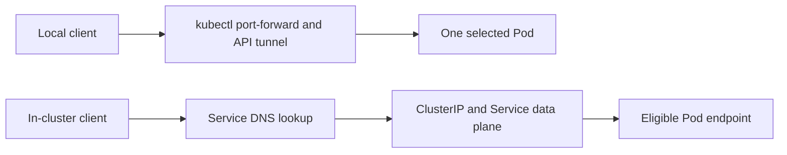
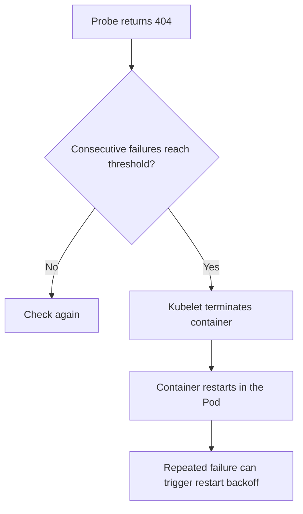
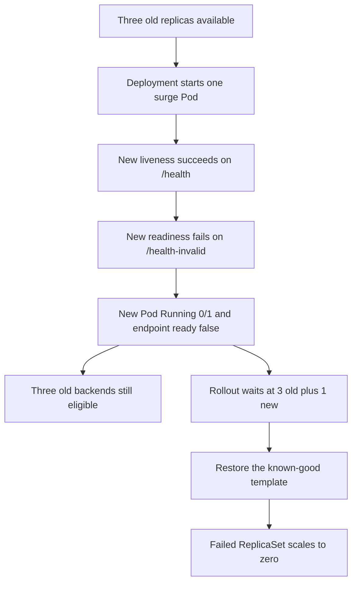
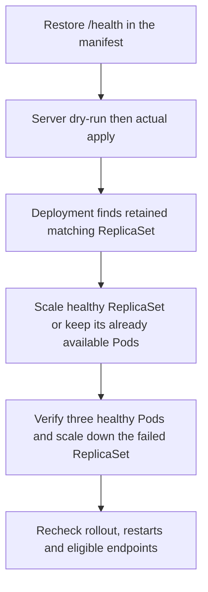
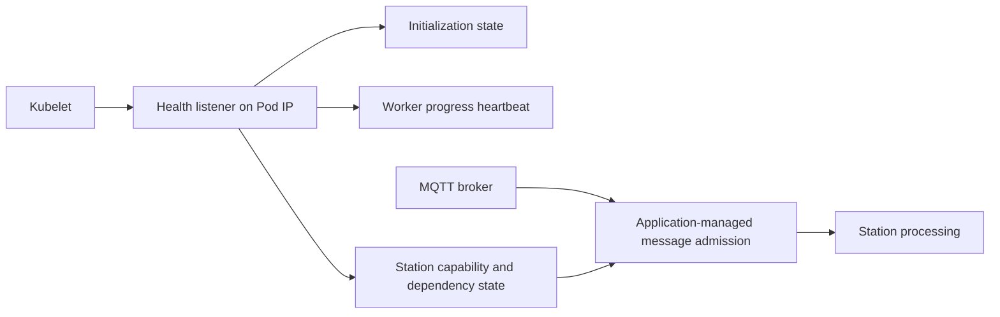

# Day 36 · Kubernetes health probes and rolling updates

I completed Day 36 in my Employee API Kubernetes lab. I verified the final Deployment with all three probes configured, then mapped the same ideas to the MES Station Manager StatefulSet.

**Scope and evidence.** I worked through the Day 36 discussion in [New_Learning_3](https://chatgpt.com/c/6af89cb9-1d64-83ed-a629-1c7d6264d774), from the Day 36 task and start messages to the completion request. I preserved the lab observations, questions and corrections alongside reference commands and production design examples. The Excel workbook contains the original screenshots, an index in chronological order and a topic audit. I kept this Markdown text-only, with Mermaid flowcharts and screenshot references.

### My actual lab sequence

Baseline and tunnel → liveness setup → readiness setup → readiness failure and recovery → liveness failure and recovery → workload log discussion → startup setup and verification → production design.

| Topic | What I covered | Evidence |
| --- | --- | --- |
| T001 | Pod health, port-forwarding, Service routing and [what DNS does](#what-is-dns) | S001–S005 and source questions |
| T002 | Liveness, probe failures, restart and backoff | S006–S012 and S034–S043, plus four supplemental occurrences |
| T003 | Readiness, EndpointSlices and a blocked rollout | S013–S033, including Pod/IP mapping and readiness recovery |
| T004 | Startup probe and final verification | S044–S048, revision 11 and three available replicas |
| T005 | [Final Employee API probe YAML](#final-employee-api-probe-yaml), apply and verification, RollingUpdate and ReplicaSets | S011–S012, S014, S044–S048 |
| T006 | Failure simulation and recovery | S022–S043 and the source recovery transcript |
| T007 | Troubleshooting and workload-wide logs | Explained in source, workload-wide command not executed |

## T001 · Pod health, port-forwarding and DNS

### What I actually saw in Docker Desktop

I started in the local Docker Desktop cluster, in namespace `default`. S001 showed Deployment `employee-api` at 3/3 Ready and three Running Pods under ReplicaSet `employee-api-7cdb9b7b75`. The three Pods each showed one prior restart. The Service was ClusterIP `10.105.206.127:8000`, with no external IP. S005 showed image `employee-api:v16`, container port `8000/TCP`, ConfigMap `employee-api-config`, Secret reference `employee-api-secret` and no application probes configured yet. The output exposed the Secret reference, without the value.

In a second terminal, `curl.exe -i http://localhost:8000/health` returned HTTP 200 from Uvicorn and `{"status":"healthy","service":"new-learning-api"}`. The request to `/health/ready` returned HTTP 404 and `{"detail":"Not Found"}`. The second result meant the image did not define that route. It did not invalidate the successful `/health` response. A Kubernetes readiness probe does not require an endpoint literally called `/health/ready`.

I initially pictured localhost forwarding to the Service IP, then the Service choosing a different Pod for each request. I corrected the picture: kubectl bound `127.0.0.1:8000` and `[::1]:8000`, resolved the Service to one Pod, and forwarded that session to that Pod's port 8000. The FastAPI process was running inside the Kubernetes-managed container. There was no separately started Python application on my laptop. The selector `app: employee-api` links the Service to matching Pod labels. From a client inside a GKE cluster, normal Service DNS and cluster networking provide the in-cluster path. A laptop outside the cluster still needs a path such as port-forwarding or a deliberately exposed endpoint.

```powershell
kubectl get deployments,pods,services
kubectl describe deployment employee-api
curl.exe -i http://localhost:8000/health/ready
```

Evidence: Networking worksheet, S001–S005. The in-cluster DNS commands below are reference checks. I demonstrated the tunnel and HTTP responses in this exercise.

I used three different questions to interpret the lab. A Pod phase of Running tells me the Pod is scheduled and containers have started or are starting/restarting. The READY column tells me how many containers are ready. An HTTP response from one Pod shows that this request reached that application path.

I use the localhost tunnel to check one backend. To test normal Service routing, I send a request from inside the cluster to the Service name and inspect its EndpointSlices (T003).

When I reopened Docker Desktop, the existing Deployment still declared three replicas. Kubernetes reconciled that desired state and the container runtime launched FastAPI through Uvicorn. I could resume the lab without running Uvicorn or starting a Docker container myself. The same idea applies to a one-replica Station Manager workload. Its controller replaces a missing Pod, while probes tell Kubernetes how the application inside it is doing.



### What is DNS?

I asked what “DSN” meant. The term was **DNS**, short for **Domain Name System**. DNS looks up the IP address associated with a name. It lets me type a hostname like `google.com` without memorising the server address.

In my lab, a Pod in the same namespace could call `http://employee-api-service:8000/health`. Kubernetes DNS would resolve `employee-api-service` to the Service ClusterIP, **`10.105.206.127`**. The client would then connect to that IP on port `8000`. The **Service selector** matches Pod labels, and the **Service data plane** routes the connection to an eligible Pod endpoint. DNS answers the address question. The port and `/health` path are used by the client after lookup.

From another namespace I can use `employee-api-service.default` or the full name `employee-api-service.default.svc.cluster.local` when the cluster uses the usual `cluster.local` domain. In the MES example, Station Manager could reach RabbitMQ using the Service name `rabbitmqcluster.stg-gbwol-medge.svc.cluster.local`, even when RabbitMQ Pods were replaced and got new IP addresses. In GKE, Pods can use this in-cluster path directly. An external client needs an appropriate entry point, such as a Gateway or LoadBalancer Service, since a ClusterIP is internal.

```powershell
kubectl get deployment employee-api
kubectl get service employee-api-service -o wide
kubectl get pods -o wide
kubectl port-forward service/employee-api-service 8000:8000
# Separate terminal while the tunnel runs
curl.exe -i http://localhost:8000/health
# Example from a Pod with the relevant tools already installed
kubectl exec <client-pod> -- nslookup employee-api-service
kubectl exec <client-pod> -- curl -i http://employee-api-service:8000/health
```

Use `-n <namespace>` where needed. I replace the placeholders before running commands. [Port forwarding](https://kubernetes.io/docs/reference/kubectl/generated/kubectl_port-forward/) · [DNS for Services and Pods](https://kubernetes.io/docs/concepts/services-networking/dns-pod-service/)

## T002 · Liveness, restart and CrashLoopBackOff

### First deploy healthy liveness, then isolate its failure

I added only liveness after the container's `ports` block. Its initial delay was 10 seconds, check period 10 seconds, timeout 2 seconds, and failure threshold 3. The server dry run passed, the apply succeeded, and three new `employee-api-5d4c4895c7` Pods showed `1/1 Running`, each with zero restarts. S006–S012 show the YAML, dry run, apply, rollout, Pod list and Deployment events. The first new ReplicaSet scale event was from 0 to 1. I revisit the ordering calculation under T005.

After completing the readiness test and restoring readiness, I changed only liveness to `/health-invalid`. The new ReplicaSet was `employee-api-764d87476d`. I could initially see all three Pods Ready because readiness kept checking `/health`. The slice showed `10.1.0.47`, `10.1.0.48` and `10.1.0.49` eligible in that snapshot. I asked why a deliberately broken version had `Ready: true`. The EndpointSlice reports readiness at the sampled moment, while a worker can pass readiness until liveness reaches its threshold or recover readiness between restarts. I check restart history and events alongside that snapshot.

| Pod under employee-api-764d87476d | Ready at the first restart snapshot | Restarts there |
| --- | --- | --- |
| `j4kmk` | 1/1 | 3 |
| `srmmz` | 1/1 | 3 |
| `zhx65` | 1/1 | 3 |

S041–S043 showed `Last State: Terminated`, `Reason: Error`, `Exit Code: 137`, a warning that the liveness probe got HTTP 404, and a Killing event stating that the container failed its liveness probe and would be restarted. I use that combination for attribution. Exit 137 is consistent with SIGKILL by itself. The later snapshots show counts of 5–6, then 9 and a described Pod reaching 10. I asked why the Pod name stayed the same and why READY could fall to 0/1. The kubelet replaces a failed container inside the existing Pod. While the container is stopped or waiting in restart backoff, there is no Ready container. During the short running interval it can become Ready again. The supplemental images capture both states.

I use liveness to detect when a container is stuck and restarting it could restore service. For the negative test I point only liveness at `/health-invalid`. A 404 tells me the server answered and the requested route failed the probe. Kubernetes considers HTTP statuses from 200 through 399 successful. When failures reach the configured consecutive threshold, the kubelet terminates that container and starts a replacement according to the restart policy. The Pod identity can stay the same while its container restart count increases. Repeated restarts can leave the container waiting in `CrashLoopBackOff`, which means Kubernetes is delaying the next attempt.

I interpret exit `137` as consistent with `128 + 9`, meaning SIGKILL in the usual Linux convention. To identify the reason, I compare the previous terminated state with events and logs. A liveness probe failure followed by a killing event supports probe-triggered termination. A process that fails to exit within its termination grace period can receive SIGKILL. `OOMKilled` in the previous termination reason is distinct evidence for a memory-related kill. The screenshot sequence above records the named Pods, restart counts, events and previous termination reason.



```powershell
kubectl get pods -w
kubectl describe pod <failing-pod>
kubectl get pod <failing-pod> -o yaml
kubectl logs <failing-pod> -c <container> --previous --timestamps
```

### What is CrashLoopBackOff?

I asked what `0/1 CrashLoopBackOff 5 (64s ago)` meant. I break the name into three parts:

- **Crash** — The container starts and then stops. In my lab, the process came up, but the kubelet terminated the container after repeated liveness failures on `/health-invalid`.
- **Loop** — Kubernetes starts the container again, the same failure happens, and the cycle repeats. The container can restart inside the same Pod, so the Pod name stays the same while the restart count increases.
- **BackOff** — Kubernetes waits before trying again. As failures continue, it increases the delay between attempts, up to a limit. I see `CrashLoopBackOff` during that waiting period.

My lab cycle was **start → briefly Ready → repeated liveness failures → container terminated → wait → restart**. The Events explain why the container was terminated. The status tells me where it is in the retry cycle.

In that row, **`0/1`** meant zero of one containers were Ready, **`5`** meant the container had restarted five times, and **`64s ago`** was the time since its last restart. Between attempts I could see `0/1 CrashLoopBackOff`. After Kubernetes started the container again and `/health` passed its readiness check, I could briefly see `1/1 Running` with the same restart history. The liveness probe was still calling `/health-invalid`, so repeated HTTP 404s could start the cycle again.

I used `kubectl describe pod <pod-name>` to check the last termination and events, and `kubectl logs <pod-name> --previous` to inspect the previous container's logs. In this lab the `Unhealthy` and `Killing` events identified the failing liveness probe. The backoff status told me Kubernetes was waiting to retry.

## T003 · Readiness, EndpointSlices and a blocked rollout

### The healthy-to-unready comparison I checked

I added readiness with delay 5s, period 5s, timeout 2s, failure threshold 2 and explicit `successThreshold: 1`, while keeping liveness enabled. The apply replaced `employee-api-5d4c4895c7` with `employee-api-56d588ccd6`. I saw rollout status progress from 0 to 1 to 2 of 3 updated replicas, then report success while old Pods could still be visible as Terminating. S013–S018 show the rollout and list the Service EndpointSlice using its label.

After two consecutive failed readiness checks, the container becomes unready. Once the readiness check succeeds again, the configured success threshold of one lets the container become ready. Kubernetes can check more frequently than the configured period while the container is unready. I reused the working `/health` route because `/health/ready` returned 404 in this image.

### EndpointSlices · How the Service knows where to send traffic

My Service uses its selector, `app: employee-api`, to identify Pods with the matching label. Kubernetes maintains one or more **EndpointSlices** for that Service, recording the matching Pods' IP addresses, backend ports, and readiness conditions. The Service data plane uses that information to route ordinary new traffic to eligible backends.

| What I checked | What it told me |
| --- | --- |
| Service selector `app: employee-api` | Which Pod labels match the Service |
| EndpointSlice label `kubernetes.io/service-name=employee-api-service` | Which slices belong to this Service |
| Endpoint `addresses` and `targetRef` | The backend IP address and the Pod it belongs to |
| Endpoint condition `ready` | Whether the endpoint was eligible for ordinary Service traffic in this lab |

`kubectl get endpointslices -l kubernetes.io/service-name=employee-api-service` listed the matching slices and their endpoint addresses. I used `kubectl describe endpointslices -l kubernetes.io/service-name=employee-api-service` to see individual Pod references and `Ready` conditions. Listing an address alone does not tell me whether it is Ready. My first lookup by generated name returned `NotFound`. The label-based lookup succeeded and showed `employee-api-service-cwqg7` without my having to type the suffix. See S018–S021 in Excel.

| Address | Pod | Readiness-negative test |
| --- | --- | --- |
| `10.1.0.43` | `employee-api-56d588ccd6-l4mpb` | Ready true |
| `10.1.0.44` | `employee-api-56d588ccd6-vsffc` | Ready true |
| `10.1.0.45` | `employee-api-56d588ccd6-sr2s9` | Ready true |
| `10.1.0.46` | `employee-api-7446f8bf96-hhfzg` | Ready false, Pod Running 0/1 with zero restarts in S025 |

The new Pod still matched the selector and appeared in the slice at `10.1.0.46`. Its readiness probe failed, so the endpoint showed `Ready: false` and ordinary new Service traffic continued to use the three older Ready Pods. The EndpointSlice showed routing eligibility. I verified the zero restart count separately in the Pod output.

I asked what would happen if all the Pods failed readiness. In a steady group of three, one unready Pod leaves two eligible backends. If all three become unready, the Service still exists and its normal ClusterIP DNS record still resolves, but ordinary traffic has no eligible backend until a Pod recovers. In my rollout, the one unready replacement used the surge slot. The controller could neither remove an available old replica within the availability limit nor add another active replacement within the surge limit.

I considered commenting out liveness to isolate the failure. Instead I kept its working path and changed readiness alone. I could reuse the same image and deliberately invalidate one probe without breaking the shared healthy endpoint. S022–S027 preserve the failure. S028–S033 record the restoration, with three Ready Pods, zero restarts, and three ready endpoints.



### How I checked the negative test

I watched the Deployment, Pod output and EndpointSlices together. A `kubectl rollout status` timeout ends the client wait. The Deployment can separately report `ProgressDeadlineExceeded` if it stops making progress past its configured deadline. Neither event automatically rolls it back.

```powershell
kubectl get pods -o wide
kubectl get rs -o wide
kubectl get endpointslices -l kubernetes.io/service-name=employee-api-service -o yaml
kubectl describe endpointslices -l kubernetes.io/service-name=employee-api-service
kubectl rollout status deployment/employee-api --timeout=60s
kubectl describe deployment employee-api
```

[EndpointSlice conditions](https://kubernetes.io/docs/concepts/services-networking/endpoint-slices/) · [Deployment progress](https://kubernetes.io/docs/concepts/workloads/controllers/deployment/)

## T004 · Startup probe and verified completion

### Final rollout evidence

I added `startupProbe` after recovering liveness. S044 shows the actual fragment with no explicit `initialDelaySeconds` line. S047 shows the API default of 0s. I verified Deployment revision 11, `3 desired | 3 updated | 3 total | 3 available | 0 unavailable`, and the three new Pods `employee-api-8547896dd5-72kp7`, `employee-api-8547896dd5-cn47h` and `employee-api-8547896dd5-q7mvw` at `1/1 Running`, each with zero restarts. S046 still shows three old Pods terminating and S048 shows the corresponding ReplicaSet scaling. I verified positive startup behavior and configuration. The slow-start and startup-failure cases remained teaching scenarios.

I added a startup probe after exercising liveness and readiness. While startup has yet to succeed, kubelet holds back the other two probes. Once startup succeeds, liveness and readiness take over. Repeated startup failures at the configured threshold trigger a container restart. I used the existing `/health` endpoint for all three probes in the lab. I verified the startup configuration and healthy rollout. A deliberately slow startup was outside the completed tests.

In the MES example, Station Manager might need about 45 seconds to load its configuration and initialise. A liveness check beginning after 10 seconds could fail repeatedly and restart it before it finishes. A startup probe gives initialisation its own retry window, stops checking after the first success for that container instance, and starts over for the next instance after a restart. I would return startup success only when initialisation actually completes.

I asked whether 12 consecutive failures was the default. I explicitly set `failureThreshold: 12` and `periodSeconds: 5` for startup. The default failure threshold is 3 and the default period is 10 seconds. The 60 seconds from 12 × 5 is a sizing estimate. Scheduling, the first probe timing and the duration of individual checks affect the actual result.

| Config field | Kubernetes default | Startup lab value |
| --- | --- | --- |
| `initialDelaySeconds` | 0 seconds | 0 seconds, as reported by describe |
| `periodSeconds` | 10 seconds | 5 seconds |
| `timeoutSeconds` | 1 second | 2 seconds |
| `failureThreshold` | 3 consecutive failures | 12 consecutive failures |
| `successThreshold` | 1 consecutive success | 1 by default, required for startup and liveness |

| Probe handler | What I can check |
| --- | --- |
| `httpGet` | HTTP endpoint on the Pod, normally using its Pod IP |
| `exec` | Command inside the container, successful on exit code 0 |
| `tcpSocket` | Ability to open a TCP connection to the port |
| `grpc` | Application implements the gRPC Health Checking Protocol and returns SERVING |

```text
Container starts → Startup probe repeats until success or failure threshold
    ├─ Success → Enable liveness and readiness
    └─ Failure threshold → Terminate and restart according to policy
```

I recorded the following results from the closing conversation.

| Check | Reported result |
| --- | --- |
| Dry run | `deployment.apps/employee-api configured (server dry run)` |
| Apply and rollout | Configured successfully, rollout successful |
| Replica counts | 3 desired, 3 updated, 3 available |
| New Pods | Restart count 0 |
| ReplicaSet transition | `employee-api-56d588ccd6` → `employee-api-8547896dd5` |
| Rollout snapshot | Three old Pods terminating while three new Pods were running |

[Probe semantics and defaults](https://kubernetes.io/docs/concepts/workloads/pods/probes/) · [Configure probes](https://kubernetes.io/docs/tasks/configure-pod-container/configure-liveness-readiness-startup-probes/)

## T005 · YAML, dry run, RollingUpdate and ReplicaSet reuse

### Why the first scale event was 0 → 1

My first mental model was to stop an old Pod, start a new one, then repeat. The observed event sequence in S012 goes the other way: new 0 → 1, old 3 → 2, new 1 → 2, old 2 → 1, new 2 → 3, old 1 → 0. S011 shows `RollingUpdate`, `MinReadySeconds: 0`, and the actual 25% settings. For three replicas, `ceil(3 × 0.25) = 1` surge and `floor(3 × 0.25) = 0` unavailable. The desired active total can reach 4. The controller aims to preserve 3 available replicas during normal scale-down. I originally read zero unavailable as “at least one Pod stays available.” It means the controller aims to preserve all three available replicas. Availability can still fall due to failures outside that rollout decision.

| Desired replicas | floor(25% × desired) | Explicit `maxUnavailable: 0` |
| --- | ---: | ---: |
| 3 | 0 | 0 |
| 4 | 1 | 0 |
| 10 | 2 | 0 |
| 100 | 25 | 0 |

For three replicas, a healthy rollout with zero unavailable alternates between 3 and 4 available Pods as each new Pod becomes available and an old Pod is removed. If I set `maxUnavailable: 1`, the controller could proceed with only 2 available Pods. In the three-instance PDT example, keeping three Kubernetes Pods available supports continuity, and the application readiness checks still need to reflect whether those instances can process MES transactions.

At three replicas, `0`, `0%`, and the rounded 25% allowance produce the same unavailability limit. At a different scale the default adapts. A strict zero-unavailable rollout still needs a positive surge allowance to make progress. It can use `maxSurge: 1` with `maxUnavailable: 0`, a configuration I discussed and did not apply. A Pod must be Ready for at least `minReadySeconds` to count as available. In this lab that minimum was zero.


For dry-run output I read `created (server dry run)` as a proposed create, `configured (server dry run)` as an accepted proposed update, and `unchanged (server dry run)` as no detected change. Real `configured` came from the actual apply. S023 passed even with an intentionally wrong readiness path. The server validates and processes the resource request. Runtime route existence and rollout health require separate confirmation.

### Final Employee API probe YAML

I keep this copy-ready fragment under the existing `employee-api` container in `01-python-fastapi/k8s/deployment.yaml`, at the same indentation level as `ports`. All three probes use `/health` on port `8000`. I show the startup delay of zero explicitly because that was the effective value in the final Deployment. See S044 for the original YAML and S047 for the running configuration.

```yaml
livenessProbe:
  httpGet:
    path: /health
    port: 8000
  initialDelaySeconds: 10
  timeoutSeconds: 2
  periodSeconds: 10
  failureThreshold: 3
readinessProbe:
  httpGet:
    path: /health
    port: 8000
  initialDelaySeconds: 5
  timeoutSeconds: 2
  periodSeconds: 5
  failureThreshold: 2
  successThreshold: 1
startupProbe:
  httpGet:
    path: /health
    port: 8000
  initialDelaySeconds: 0
  timeoutSeconds: 2
  periodSeconds: 5
  failureThreshold: 12
```

### Apply and verify the final configuration

From `01-python-fastapi` in PowerShell, I validate the manifest, apply it, and check the rollout, Pods, ReplicaSets, and effective probe settings.

```powershell
kubectl apply --dry-run=server -f .\k8s\deployment.yaml
kubectl apply -f .\k8s\deployment.yaml
kubectl rollout status deployment/employee-api
kubectl get pods
kubectl get rs -o wide
kubectl describe deployment employee-api
```

I interpreted `configured (server dry run)` as the API server accepting the simulated update of the existing Deployment. The request passed server-side processing and made no persisted change. The real apply changes the Pod template, leading to a rollout. Adding, deleting or changing probes in the Pod template can do this even when the image stays identical. A change to replica count alone does not create a new Deployment revision.

With the default Deployment RollingUpdate values, both limits are 25%. `maxSurge` rounds up and `maxUnavailable` rounds down. For three desired replicas that permits one extra non-terminating Pod and zero unavailable replicas during the controller-directed update, assuming the workload starts healthy. The new replica must be available before a corresponding old one can be scaled down under those limits. A Pod listed as terminating can remain visible and keep using resources while its shutdown finishes, so a snapshot can show more Pods than the active surge calculation suggests. S011 and S047 confirm those 25% settings and zero minimum Ready seconds in my lab.

When the Deployment controller finds a retained ReplicaSet with the same effective Pod template, it can scale that ReplicaSet back up. If the matching ReplicaSet was cleaned up or the template differs, a new ReplicaSet can be created. Reuse of the ReplicaSet does not mean reuse of old Pod objects. Its controller creates Pods to meet the desired count. I confirmed two recoveries that reused the healthy ReplicaSet and a later startup rollout that produced a new ReplicaSet.

[Deployment rolling updates and revisions](https://kubernetes.io/docs/concepts/workloads/controllers/deployment/) · [Kubernetes API dry run](https://kubernetes.io/docs/reference/using-api/api-concepts/#dry-run)

## T006 · Run failure experiments and recover

### Why an old Pod showed Error during recovery

When I restored readiness, the matching `56d588ccd6` ReplicaSet was reused and its three existing healthy Pods were still in place. The one faulty readiness Pod reached Terminating and then disappeared (S030–S031). When I restored liveness later, the healthy ReplicaSet was reused again. This time it had to create new Pods, because its earlier Pods had already been replaced by the liveness-negative version. The recovery snapshot showed `employee-api-56d588ccd6-gqcdc`, `employee-api-56d588ccd6-m9cfg` and `employee-api-56d588ccd6-pljpb` at `1/1 Running`, zero restarts. The old `employee-api-764d87476d-zhx65` still showed `0/1 Error` and 11 restarts in the observed handover. That row belonged to the failing previous template. I judge recovery by the healthy ReplicaSet, its Ready Pods and the old ReplicaSet's scale-down. A single old row can be visible during that transition. The conversation records the recovery row in text.



I isolate each failure so its symptom is interpretable. For readiness-negative I change the readiness path alone, watch the rollout and compare Pod readiness with EndpointSlice conditions. For liveness-negative I restore readiness and change only liveness, then correlate the failed probe and killing events with restarts and previous logs. If readiness passes before liveness fails, a new Pod may briefly receive traffic and a rollout may advance before failure becomes visible. I inspect live state instead of assuming that the old replicas are all still present.

To recover I return the tested path to `/health`, validate, apply, and wait for the Deployment to converge. I recheck all desired/updated/available counts, current container restart counts, probe paths, endpoint membership, and an actual Service request. Applying the known-good manifest keeps the checked-in file aligned with the running configuration. `kubectl rollout undo deployment/employee-api` is a possible runtime recovery when a known-good revision is retained. If used, I also reconcile the manifest so a later apply does not bring back the failure.

## T007 · Read logs across the workload

### The exact selectors I discussed

I used `app=employee-api` for the lab's label selector. The MES example used `app=medge-sc-be1-lids-stn-be1-5010a-download` with the office namespace supplied separately. I would confirm the label and namespace from the StatefulSet before using it. This part of the lesson was explained. I did not record running the workload-wide log command or any output from it.

```powershell
kubectl logs -l app=employee-api --all-containers=true --prefix=true --tail=20 --max-log-requests=10
kubectl logs -n <namespace> -l app=medge-sc-be1-lids-stn-be1-5010a-download --all-containers=true --prefix=true --tail=100
```

I use `--tail` per log stream, `--prefix` to identify the Pod and container, `-f` to follow live logs and `--max-log-requests` to set the allowed concurrent streams. Prior container logs can be queried with `--previous` while retained. A centralized system is needed for longer-term search across Pod deletion and log rotation.

I distinguish application log output from kubelet and controller events. I use prefixed workload or selector logs to compare replicas, and use `--previous` with a specific Pod and container after a restart. Plain `kubectl logs deployment/employee-api` commonly selects one Pod. I ask for `--all-pods=true` explicitly on a supporting kubectl client, or select Pods by the Deployment's actual labels. The selector can include old and new ReplicaSets during an update. I confirm scope before drawing conclusions.

```powershell
kubectl logs deployment/employee-api --all-pods=true --all-containers=true --prefix --tail=100
kubectl logs -l <deployment-selector> --all-containers=true --prefix --tail=100
kubectl logs -f -l <deployment-selector> --all-containers=true --prefix --tail=20 --max-log-requests=10
kubectl logs <pod> -c <container> --previous --timestamps
kubectl describe pod <pod>
kubectl describe deployment employee-api
kubectl get events --sort-by=.metadata.creationTimestamp
```

[Official kubectl logs reference](https://kubernetes.io/docs/reference/kubectl/generated/kubectl_logs/)

## Production application · MES Station Manager StatefulSet

I asked how to translate the probes to a .NET console application and what to choose for production. I would keep the station-processing worker and publish three small health checks from the same process, using a Pod-reachable ASP.NET Core/Kestrel listener if modifying the worker is practical. That lets the endpoints read actual worker state. A probe-only listener can be reached by kubelet without creating a Service for the health port.

| Probe | What I would check | What I would do on failure |
| --- | --- | --- |
| Startup | I have valid configuration for my assigned station from the MES API or the approved source. Required controllers and workers are initialized. | Keep startup gated until usable initialization completes. Size the retry window from measured startup and expected configuration fetch/retry times. |
| Liveness | My essential worker loops are making progress or cycling through a healthy idle wait. I update the heartbeat from those loops and evaluate its age against a deadline. | Restart when internal work is genuinely stuck. Keep shared broker, SQL and API outages out of this signal so a dependency outage does not trigger a fleet restart. |
| Readiness | My configuration is valid, my required MQTT connection and subscriptions are usable, the necessary MES API capability works, and direct SQL is usable if this worker actually depends on it. | Report unavailable after a bounded tolerance for transient faults. Coordinate admission and retry with my worker, especially when MQTT delivers the work. |

I would check required capabilities per assigned station or ordinal. If Station Manager uses only the API, I would check the API capability it needs and leave API-owned SQL checks with that API. If it directly queries SQL, I would use a bounded, inexpensive check with the worker's expected access. I would publish recent connection and subscription state and bounded dependency checks so the probe itself stays cheap and the kubelet's request rate cannot amplify a dependency incident.

My original “Hi → I'm here” idea proves responsiveness only if the reply comes from the essential processing loop or reflects its fresh state. A web listener or an independent timer can keep answering through a deadlock. I would design the worker heartbeat to advance during idle cycles and use elapsed time to assess freshness.



A Kubernetes unready condition controls eligibility for normal Service traffic and affects rollout availability. The same condition does not disconnect MQTT clients, cancel subscriptions, pause background loops, or undo already delivered work. I would coordinate MQTT reconnect/resubscribe and admission with the same application state. Where business rules require it, I would pause new work, handle in-flight work according to acknowledgement and retry semantics, and resume only after the required capabilities recover. I would confirm how station identity maps to StatefulSet ordinals and how the StatefulSet's ordered rollout behaves when an updated Pod stays unready.

Example probe fragment for a listener on port 8080. These production timing values are illustrative and would need measurement.

```yaml
ports:
  - name: health
    containerPort: 8080
startupProbe:
  httpGet:
    path: /health/startup
    port: health
  periodSeconds: 5
  timeoutSeconds: 2
  failureThreshold: 24
livenessProbe:
  httpGet:
    path: /health/live
    port: health
  periodSeconds: 10
  timeoutSeconds: 2
  failureThreshold: 3
readinessProbe:
  httpGet:
    path: /health/ready
    port: health
  periodSeconds: 5
  timeoutSeconds: 2
  failureThreshold: 3
  successThreshold: 2
```

If an HTTP listener is impractical, I can add an `exec` utility inside the container that reads locally maintained state. For liveness it must verify a fresh heartbeat written by the worker, since an old marker file can survive a hang. The executable and its dependencies must exist in the image. A plain TCP probe proves connection acceptance. A gRPC probe is an option if the application already implements the required health protocol.

```yaml
# Alternative example. The utility must be implemented and packaged with the worker.
livenessProbe:
  exec:
    command:
      - /app/station-health
      - live
  periodSeconds: 10
  timeoutSeconds: 2
  failureThreshold: 3
```

[ASP.NET Core health checks](https://learn.microsoft.com/en-us/aspnet/core/host-and-deploy/health-checks) · [StatefulSet rollout behavior](https://kubernetes.io/docs/concepts/workloads/controllers/statefulset/)

## Screenshot coverage and quick recall

| Source sequence | Where I review it in Excel |
| --- | --- |
| S001–S005 | Networking |
| S006–S012 | Liveness Setup |
| S013–S021 | Readiness Setup |
| S022–S033 | Readiness Test |
| S034–S043, then Supplements A and B1–B3 | Liveness Test |
| S044–S048 | Startup |

I accounted for 52 screenshot occurrences across 50 byte-distinct originals. I preserved both occurrences of each of the two exact-image duplicate pairs. The workbook records the source turn, original download filename, image hash, worksheet and anchor for every occurrence. S019 is assigned by position between S018 and S020. The four supplemental occurrences were discussed without numbered IDs and appear in chronological position before S044. A milestone photo before the Day 36 start was outside this lab.

For troubleshooting, I start by asking **which signal failed?** Running with 0/1 and stable restart counts points me toward readiness. A rising restart count and kubelet Killing event point me toward liveness or startup, depending on the event and configuration. A successful dry run confirms resource acceptance. A successful rollout, healthy probes and eligible endpoints confirm different parts of the live result. For the background Station Manager, I also check whether the application itself paused or resumed MQTT work.
