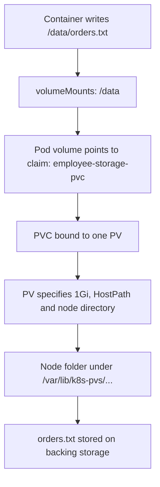
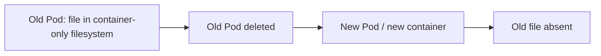
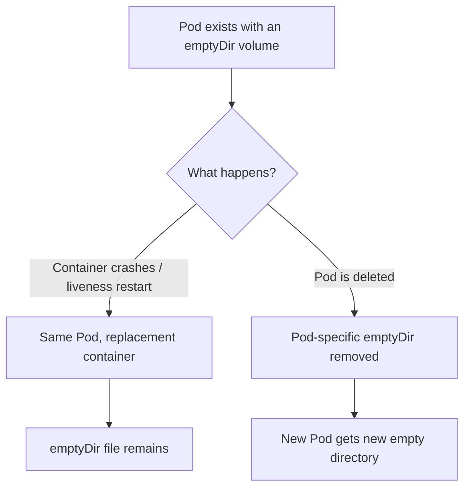
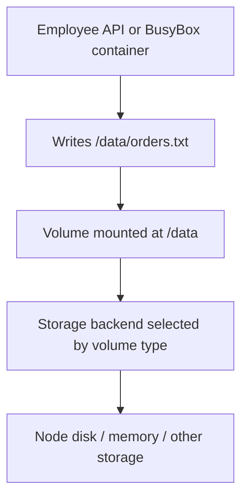
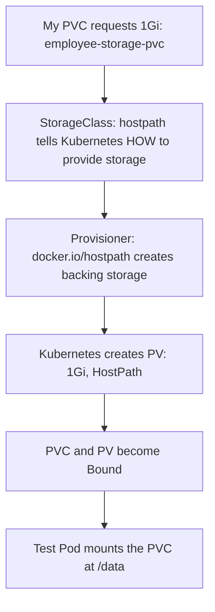
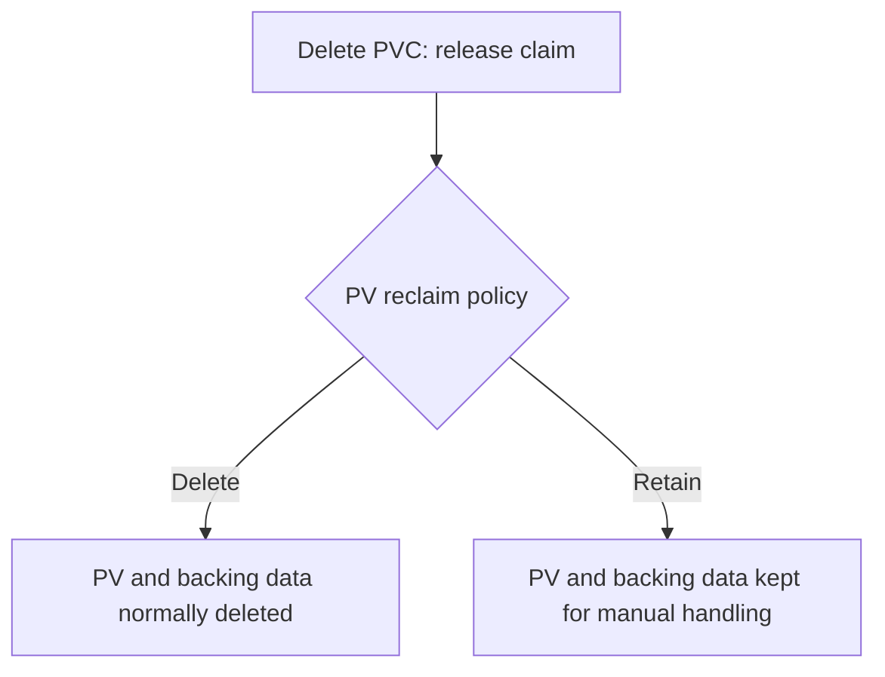
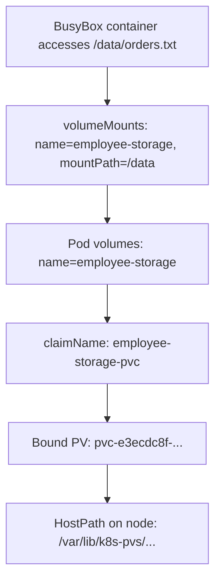
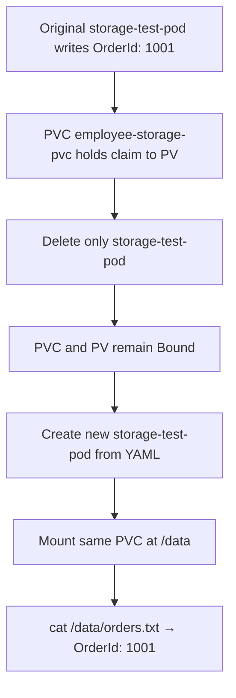
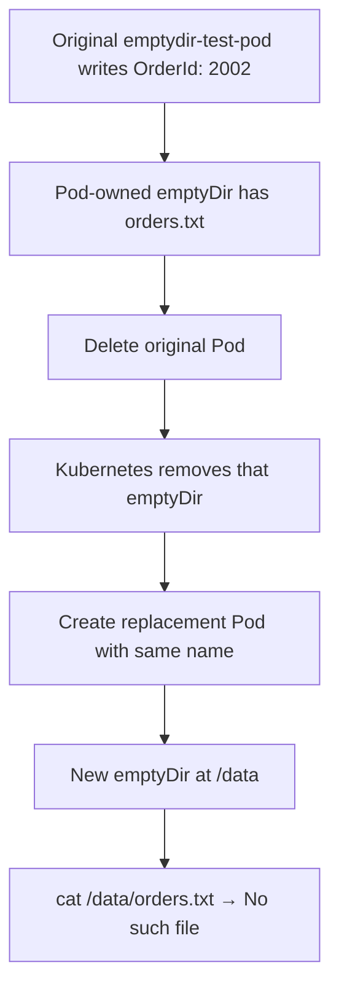

# Day 39 — Kubernetes Persistent Storage: Volumes, PV, PVC, StorageClass and `emptyDir`

**My hands-on environment:** Windows PowerShell, VS Code, Docker Desktop Kubernetes (`docker-desktop`), project `01-python-fastapi`, namespace `default`.  
**My main application:** `employee-api`, still managed by an HPA; I used separate BusyBox Pods for storage testing so I did not change the API Deployment.  
**Status:** Learning and practical verification completed. Both temporary test Pods were deleted at the end. The PVC and its PV were intentionally retained for future testing.  
**Documentation conventions:** `[Observed]` means I saw it in a command/screenshot. `[Configured]` means I saved/applied that YAML. `[Example]` is an illustration, not a measurement. `[Expected]` was a prediction that I later checked. `[Decision]` is what I chose to keep or defer. Screenshot IDs refer to the **Day 39 Excel Screenshot Workbook**; these notes deliberately do not embed screenshots.

---

## What made this topic clear to me — start here

I originally found the statement **“PV represents storage”** too abstract. I wanted to know: **Where is the actual file?** Once I saw the real node directory, the whole relationship made sense.

**Inside the container:** I open or write **`/data/orders.txt`**.

**On the Docker Desktop Kubernetes node:** the same data is stored under the `hostPath.path` of my PV:

```text
/var/lib/k8s-pvs/employee-storage-pvc/pvc-e3ecdc8f-9cf3-4e37-b522-06aba3bcd7d2/orders.txt
```

The parent directory was verified from `kubectl describe pv` and `kubectl get pv ... -o yaml` (**S006–S007**). The `orders.txt` filename at the end comes from the file I created through the mounted volume; I did not directly browse that host directory.



**The simple definitions I want to remember:**

| Word | My simple understanding | Important detail |
|---|---|---|
| **Storage** | The real place holding file data, such as a disk, memory or network storage. | The physical backend depends on the volume type/provider. |
| **Volume** | Storage that Kubernetes makes available to a Pod. | A Pod defines a volume; its containers mount it. |
| **Volume mount** | The path **inside the container** where I access that volume, e.g. `/data`. | `mountPath` is not the node's physical directory. |
| **PVC — PersistentVolumeClaim** | I request storage **and keep a claim to it**. | A PVC is a living Kubernetes object, not only a one-time API call. |
| **PV — PersistentVolume** | Kubernetes' record of the supplied storage: capacity, type, and backing location/identifier. | The PV is not itself a disk. For our HostPath PV, the location appears in `hostPath.path`. |
| **StorageClass** | Tells Kubernetes **how to create storage** when a PVC requests it. | Our local StorageClass is `hostpath`. |
| **`emptyDir`** | Temporary storage belonging to one Pod. | It survives a container restart in that Pod, but is removed when the Pod is removed. |

**MES analogy:** If Station Manager saves logs under `D:\MES\Logs`, that is the path the application uses. The underlying drive holds the bytes. In Kubernetes, `/data/orders.txt` is the container's path, while a PV may point to storage elsewhere. If I were designing MES transaction recovery, I would still consider Redis/SQL as appropriate for shared transaction state; a PVC-backed file is not automatically a replacement for a transaction database.

---

## T001 — Why persistent storage matters

A container has a writable filesystem. If it writes `/app/temp.txt` only inside that writable layer, the data belongs to that container instance. When Kubernetes creates a **new container** rather than reusing the same writable layer, those unsaved changes do not automatically move across.

Our application is managed by a Deployment. Rolling updates, failed Pods and autoscaling can all result in replacement Pods. Suppose I wrote this file in a container:

```text
/data/orders.txt
OrderId: 1001
Status: Completed
```

Without an appropriate volume, a **new Pod** would not automatically have it. This is why I learned to distinguish a container filesystem from Pod volumes and persistent volumes.



With a PV-backed PVC, I can mount the **same claim** in a replacement Pod. The new Pod sees the data left behind in the persistent storage as long as that storage remains available and the volume can be mounted.

**Important limitation:** “Persistent” does not mean impossible to lose. Removing the PVC when the reclaim policy is `Delete`, failure of the local storage, or removing Docker Desktop's backing storage can still destroy the data.

## T002 — Container filesystem, `emptyDir`, persistent volume, and restarts

### The three kinds of storage I compared

| Type | Example file inside container | Where it is kept | Container restarts inside same Pod | Pod deleted and replaced |
|---|---|---|---|---|
| Container writable filesystem | `/app/temp.txt` | Container writable layer | Lost for a new container instance | Lost |
| `emptyDir` | `/data/orders.txt` | Usually Pod-specific directory on the node | **Retained** | **Lost** |
| PVC-backed persistent volume | `/data/orders.txt` | Backing store identified by PV | **Retained** | **Retained if the same PVC/storage is reused** |

### My question: “I've only seen Pods restart. Can a container restart by itself?”

**Yes.** A Pod and a container are not the same resource. In our earlier liveness-probe test, the same Pod name could remain while its container restarted; its `RESTARTS` count increased. By contrast, deleting a Pod and letting a Deployment create another gives a **new Pod**, generally with a new generated name.



I also asked **where `emptyDir` physically lives**. A normal disk-backed `emptyDir` is managed on the node; a typical kubelet directory looks like:

```text
/var/lib/kubelet/pods/<pod-uid>/volumes/kubernetes.io~empty-dir/<volume-name>/
```

This is **a typical path, not a path verified in our local cluster**. The real kubelet root can differ. With `emptyDir: {}`, storage is normally node-backed ephemeral storage. If I set `medium: Memory`, Kubernetes uses memory-backed storage instead. In both cases it belongs to the Pod, so deletion removes the volume's contents.

My short explanation: **PVC/PV storage was independent of my particular test Pod. `emptyDir` storage belonged to that particular Pod UID.** The folder naming itself is not the reason data is deleted: Kubernetes' volume lifecycle is the reason.

### “What is a volume? Is it storage?”

I now say: **A volume is the way Kubernetes presents storage to a Pod.** The storage could be node disk, memory, or an external system. A `volumeMount` makes that volume appear at a container directory such as `/data`.



This is the **complete Employee API example** I explicitly wanted retained, with the flowchart, not only a definition. The `/data/orders.txt` path was a teaching example for Employee API; my **actual Day 39 file-writing experiment** used BusyBox, not the Employee API code.

---

## T003 — Inspecting StorageClass and learning exactly what a PV holds

### Commands and my first observed result

These were run in **Windows PowerShell**, connected to Docker Desktop Kubernetes:

```powershell
kubectl get storageclass
kubectl get pv
kubectl get pvc
```

**[Observed; S001]**

```text
NAME                 PROVISIONER          RECLAIMPOLICY  VOLUMEBINDINGMODE  ALLOWVOLUMEEXPANSION
hostpath (default)   docker.io/hostpath   Delete         Immediate          false

kubectl get pv
No resources found

kubectl get pvc
No resources found in default namespace.
```

The third command queries PVCs in the **current (`default`) namespace**. PVs and StorageClasses are cluster-scoped; PVCs are namespaced.

### The StorageClass settings, in plain English

| Displayed field | Actual value | Meaning |
|---|---|---|
| `NAME` | `hostpath (default)` | The default way this cluster can create persistent storage. |
| `PROVISIONER` | `docker.io/hostpath` | Docker Desktop component that creates a HostPath-backed volume. |
| `RECLAIMPOLICY` | `Delete` | When the claim is released and deletion is allowed, the dynamically provisioned PV and backing storage are normally removed. |
| `VOLUMEBINDINGMODE` | `Immediate` | Provisioning/binding can happen when I create the claim; it does not need to wait for a Pod. |
| `ALLOWVOLUMEEXPANSION` | `false` | This class does not advertise online PVC storage expansion. |

### What is a StorageClass, and why did I need it?

**StorageClass tells Kubernetes how to create storage when an application requests it.** It is a set of instructions for the storage system, **not the disk, not the PV, and not the PVC**.

I found this easier to understand by following what happened in my own cluster:

1. My PVC `employee-storage-pvc` asked for **1Gi** of storage and said `storageClassName: hostpath`.
2. Kubernetes found the **`hostpath` StorageClass**. It was already installed by Docker Desktop, and it was marked **default**.
3. That StorageClass told Kubernetes to use the **`docker.io/hostpath` provisioner** to prepare local storage.
4. The provisioner created a PV and recorded its backing Node directory, `/var/lib/k8s-pvs/employee-storage-pvc/pvc-e3ecdc8f-9cf3-4e37-b522-06aba3bcd7d2`.
5. Kubernetes bound the PVC to that PV. **Only after this did my test Pod use the PVC and mount it at `/data`.**



**Why does `(default)` matter?** If I omit `storageClassName` in a new PVC, Kubernetes can choose this default StorageClass automatically. I included `storageClassName: hostpath` explicitly so I could see which storage method my PVC was using.

**What the other settings mean in this exercise:** `Immediate` meant a PV could be created when I created the PVC, **before** creating a Pod. `Delete` means deleting the PVC can also lead to deletion of its PV and backing files; it did **not** mean deleting a Pod deletes storage. `ALLOWVOLUMEEXPANSION: false` means this StorageClass is not set up to expand an existing PVC on request. I do not need to configure any of those options myself for this experiment.

**In one line:** The **PVC asks for storage**, the **StorageClass says how to create it**, the **PV describes what was created**, and the **volume mount lets the container use it**. See **S001** for the actual StorageClass and **S005–S007** for the PV and its backing directory.

### Who creates a PV?

- **Static provisioning [Concept]:** An administrator creates a PV first, then a PVC claims it.
- **Dynamic provisioning [Used here]:** I create a PVC; the `hostpath` provisioner creates and binds a PV automatically. This is why I did **not** create `pv.yaml`.

### A PV is a Kubernetes record, and I can inspect its backing storage

At first, `kubectl get pv` showed a long name but no physical path. I asked, “Where in this output is the actual storage?” The short listing did not include it. The more detailed commands exposed it:

```powershell
kubectl describe pv pvc-e3ecdc8f-9cf3-4e37-b522-06aba3bcd7d2
kubectl get pv pvc-e3ecdc8f-9cf3-4e37-b522-06aba3bcd7d2 -o yaml
```

**[Observed; S006–S007]**

```text
Name:             pvc-e3ecdc8f-9cf3-4e37-b522-06aba3bcd7d2
StorageClass:     hostpath
Status:           Bound
Claim:            default/employee-storage-pvc
Reclaim Policy:   Delete
Access Modes:     RWO
VolumeMode:       Filesystem
Capacity:         1Gi
Source:
  Type: HostPath (bare host directory volume)
  Path: /var/lib/k8s-pvs/employee-storage-pvc/pvc-e3ecdc8f-9cf3-4e37-b522-06aba3bcd7d2
```

Relevant YAML section:

```yaml
spec:
  accessModes:
    - ReadWriteOnce
  capacity:
    storage: 1Gi
  claimRef:
    kind: PersistentVolumeClaim
    name: employee-storage-pvc
    namespace: default
  hostPath:
    path: /var/lib/k8s-pvs/employee-storage-pvc/pvc-e3ecdc8f-9cf3-4e37-b522-06aba3bcd7d2
    type: ""
  persistentVolumeReclaimPolicy: Delete
  storageClassName: hostpath
  volumeMode: Filesystem
```

**Meaning:** the PV describes a **1Gi HostPath filesystem volume** at that node directory and records which PVC claims it. The PV name is **not** a storage path; the `hostPath.path` field is the storage location in this local setup. I can use a Windows analogy: a configuration record says `StorageName = StationLogs`, `Capacity = 1GB`, `PhysicalPath = D:\MES\Logs`. The record tells me about the storage; the record is not the disk.

**Local-only caution:** HostPath-backed storage is tied to a node. This demo does not demonstrate production-grade failover to a different node, shared network storage or backups.

---

## T004 — PVC: request, ongoing claim, binding, and deletion

### My original confusion: “PVC is only a request. Why would deleting a PVC delete storage?”

I learned that a PVC is **a persistent Kubernetes object**. It does two things:

1. Requests storage with requirements such as size, access mode and StorageClass.
2. After binding, continues to **hold the claim** to the PV. It is not discarded after one API call.

**[Configured; S002–S005]** My `k8s/pvc.yaml`:

```yaml
apiVersion: v1
kind: PersistentVolumeClaim
metadata:
  name: employee-storage-pvc
spec:
  accessModes:
    - ReadWriteOnce
  resources:
    requests:
      storage: 1Gi
  storageClassName: hostpath
```

| YAML property | Meaning and chosen value |
|---|---|
| `apiVersion: v1` | The core Kubernetes API version used for PVCs. |
| `kind: PersistentVolumeClaim` | Creates a claim, **not** a PV or Pod. |
| `metadata.name: employee-storage-pvc` | The exact claim name later referenced from the test Pod. |
| `accessModes: [ReadWriteOnce]` | Read/write mounting is allowed from **one node at a time**; this is **not necessarily only one Pod**. |
| `resources.requests.storage: 1Gi` | Request a 1 GiB-capacity volume; `1Gi = 1,073,741,824 bytes` of capacity units. It is a requested capacity, not a measurement of free space used. |
| `storageClassName: hostpath` | Select Docker Desktop's local storage provisioner; here it is the default anyway. |

**Commands:**

```powershell
# From 01-python-fastapi
kubectl apply --dry-run=server -f .\k8s\pvc.yaml
kubectl apply -f .\k8s\pvc.yaml
kubectl get pvc
kubectl get pv
```

**[Observed; S003–S005]** Dry-run showed `persistentvolumeclaim/employee-storage-pvc created (server dry run)`; actual apply showed `... created`. The PVC became `Bound` at `1Gi`, `RWO`, `hostpath`. Kubernetes dynamically created a PV named `pvc-e3ecdc8f-9cf3-4e37-b522-06aba3bcd7d2`, with reclaim policy `Delete`, `Bound` to `default/employee-storage-pvc`.

### “Can one PVC be linked to many PVs? How does Kubernetes choose?”

A PVC is **bound to one PV at a time**. Many PVs can exist in the cluster, but each bound claim identifies its volume. The `VOLUME` column of `kubectl get pvc` shows its PV name, and `CLAIM` in `kubectl get pv` shows the matching PVC.

```text
PVC name:    employee-storage-pvc
PV name:     pvc-e3ecdc8f-9cf3-4e37-b522-06aba3bcd7d2
PV CLAIM:    default/employee-storage-pvc
```

If ten other PVs existed, the Pod would still refer only to `employee-storage-pvc`, and Kubernetes would find its **already-bound** PV. Multiple Pods may use the same PVC if the access mode, driver and scheduling allow; that does **not** mean a PVC binds multiple PVs.

### Why can deleting the PVC delete the PV and files?

Our dynamically provisioned PV has **reclaim policy `Delete`**. Releasing/deleting the PVC can trigger deletion of the PV and its storage backend **after any protection/finalizer requirements are met**. The PVC is the active claim, so deleting it is more consequential than deleting a Pod.



| Action | Effect for our experiment |
|---|---|
| Delete **test Pod only** | PVC/PV remain, stored `orders.txt` remains accessible to a replacement Pod. **Observed.** |
| Delete PVC with `Delete` reclaim policy | Usually results in deletion of linked PV and backed files; **not tested**, because I chose to retain the PVC. |
| Use `Retain` reclaim policy | Keeps backing volume after claim deletion, but manual steps may be needed to reuse it; **concept only**. |

**[Decision]** I did **not** delete the PVC. I intentionally retained both the PVC and PV for later exercises.

---

## T005 — `volumeMounts`: how the container reaches the storage

**My question:** “The Pod YAML mentions only a PVC. Where is the PV?”

**Answer:** A Pod refers to the **PVC by name**. Kubernetes has already bound that PVC to one PV. The Pod does **not** need the PV's generated name.

```yaml
volumes:
  - name: employee-storage
    persistentVolumeClaim:
      claimName: employee-storage-pvc
```

This makes a Pod-level volume named `employee-storage` backed by the PVC. The **container mount** is another section:

```yaml
volumeMounts:
  - name: employee-storage
    mountPath: /data
```

This tells the container to use `/data` to access the Pod volume. **The `name` values must match** (`employee-storage` in both places); `claimName` must match the actual PVC (`employee-storage-pvc`). The Pod's volume name is my own choice and does not need to equal the PV's name.



### Which location is which?

| Location or name | What it is |
|---|---|
| `/data/orders.txt` | File path **inside** BusyBox container. |
| `mountPath: /data` | Where the volume appears **inside** container. |
| `employee-storage` | Name joining the Pod volume to the container mount. |
| `employee-storage-pvc` | Name of the PVC Kubernetes looks up. |
| `pvc-e3ecdc8f-...` | Kubernetes-generated PV name shown in cluster listings. |
| `/var/lib/k8s-pvs/...` | **Verified node-backed directory** from PV configuration. |

---

## T006 — Build the PVC-backed BusyBox test Pod

### Why I used BusyBox rather than editing `employee-api/deployment.yaml`

At first I suggested editing `deployment.yaml` to add `volumes`, because our application was Employee API. But Employee API is already managed by an HPA with **3–6 replicas**. Mounting a single `ReadWriteOnce` HostPath PVC into a multi-replica Deployment would introduce questions about shared files, same-node access and instance behaviour. A separate single test Pod is a safer, simpler storage demo. **This was an explicit design choice.**

### What is BusyBox? Does it create files by itself?

`busybox:1.36` is a small Linux image with basic commands such as `sh`, `sleep`, `cat`, `ls` and `tee`. In my YAML it runs only `sleep 3600`: it stays alive for roughly one hour. **It does not create `/data/orders.txt` automatically.** I wrote that file manually.

**[Configured; S008]** `k8s/storage-test-pod.yaml`:

```yaml
apiVersion: v1
kind: Pod
metadata:
  name: storage-test-pod
spec:
  containers:
    - name: storage-test
      image: busybox:1.36
      command: ["sh", "-c", "sleep 3600"]
      volumeMounts:
        - name: employee-storage
          mountPath: /data
  volumes:
    - name: employee-storage
      persistentVolumeClaim:
        claimName: employee-storage-pvc
```

| Setting | Meaning |
|---|---|
| `kind: Pod` | Directly creates one Pod with the fixed name. Not a Deployment. |
| `name: storage-test-pod` | Stable Pod name used by all `kubectl exec` tests. |
| `image: busybox:1.36` | Small image with Linux testing commands. |
| `command: ["sh", "-c", "sleep 3600"]` | Keeps container running for tests; it doesn't write a file. |
| `volumeMounts: ... /data` | Makes storage visible at `/data` in this container. |
| `volumes: ... claimName` | Uses our existing PVC and therefore its bound PV. |

**Commands [Observed; S009]:**

```powershell
kubectl apply --dry-run=server -f .\k8s\storage-test-pod.yaml
kubectl apply -f .\k8s\storage-test-pod.yaml
kubectl get pod storage-test-pod
```

Server dry-run accepted the YAML (`pod/storage-test-pod created (server dry run)`); the apply created the Pod; `kubectl get pod` showed **`1/1 Running`, `0` restarts**. Dry-run checks with the API server but does not keep the Pod; actual apply creates it.

---

## T007 — PVC file persistence: failed first command, fix, and Pod replacement

### Step A: First attempt to write file (failed)

I ran in **Windows PowerShell 5.1**:

```powershell
kubectl exec storage-test-pod -- sh -c 'echo "OrderId: 1001" > /data/orders.txt'
```

**[Observed; S010]** It printed `OrderId:` in the terminal. Then:

```powershell
kubectl exec storage-test-pod -- cat /data/orders.txt
```

returned:

```text
cat: can't open '/data/orders.txt': No such file or directory
command terminated with exit code 1
```

This meant the file was not created. The issue was in how the quoting/redirection command was passed through Windows PowerShell to `kubectl`/the container shell. It did **not** prove any failure in the PVC/PV itself.

### Step B: Correct write command, using `tee`

We avoided tricky remote-shell quotes and used PowerShell's pipeline:

```powershell
'OrderId: 1001' | kubectl exec -i storage-test-pod -- tee /data/orders.txt
kubectl exec storage-test-pod -- cat /data/orders.txt
kubectl exec storage-test-pod -- ls -l /data
```

| Part | Meaning |
|---|---|
| `'OrderId: 1001'` | Text sent from PowerShell. |
| `|` | Pipes text to `kubectl`. |
| `kubectl exec -i` | Passes standard input into the running container. |
| `tee /data/orders.txt` | Writes input into the file on the mounted volume. |
| `cat` | Reads the file back. |
| `ls -l /data` | Lists files in the mounted directory. |

**[Observed; S011]** Both `tee` and `cat` printed `OrderId: 1001`, and `ls` showed `orders.txt` in `/data`. This proved the mounted PVC volume was writable and readable. **No file was created automatically by BusyBox.**

### Step C: Delete the Pod, but not storage

```powershell
kubectl delete pod storage-test-pod
kubectl get pvc
kubectl get pv
```

**[Observed; S012–S013]** The Pod was deleted. The PVC `employee-storage-pvc` was still `Bound` to the same `1Gi` HostPath PV, and the PV was still `Bound`. Deleting the Pod did not release the claim.

### Step D: Recreate the Pod and read the ORIGINAL file

```powershell
kubectl apply -f .\k8s\storage-test-pod.yaml
kubectl get pod storage-test-pod
kubectl exec storage-test-pod -- cat /data/orders.txt
```

**[Observed; S014]** The recreated Pod was **`1/1 Running`** and, without writing a new file, `cat` returned:

```text
OrderId: 1001
```

This is the crucial result: **same PVC → same PV/backing directory → old file remains across Pod deletion/recreation**.



**This experiment verified persistence across Pod replacement on my local node; it did not test node loss, disk failure, backup or multi-node portability.**

---

## T008 — `emptyDir` hands-on comparison, warning and cleanup

### Why use a second Pod?

I wanted to compare **the same `/data/orders.txt` path** with a different type of volume. In the PVC test, data survived Pod deletion. With `emptyDir`, I expected the data to disappear when its original Pod was deleted.

**[Configured; S015]** `k8s/emptydir-test-pod.yaml`:

```yaml
apiVersion: v1
kind: Pod
metadata:
  name: emptydir-test-pod
spec:
  containers:
    - name: storage-test
      image: busybox:1.36
      command: ["sh", "-c", "sleep 3600"]
      volumeMounts:
        - name: temporary-storage
          mountPath: /data
  volumes:
    - name: temporary-storage
      emptyDir: {}
```

Compare the important part:

```yaml
# Temporary storage, no PVC
volumes:
  - name: temporary-storage
    emptyDir: {}
```

This means Kubernetes creates a new **temporary empty volume owned by that Pod**. There is no `claimName`, no PVC and no PV for this `emptyDir` storage. The matching `volumeMounts` makes it available at `/data` inside BusyBox.

### Step A: Validate, create, write and read

```powershell
kubectl apply --dry-run=server -f .\k8s\emptydir-test-pod.yaml
kubectl apply -f .\k8s\emptydir-test-pod.yaml
kubectl get pod emptydir-test-pod

'OrderId: 2002' | kubectl exec -i emptydir-test-pod -- tee /data/orders.txt
kubectl exec emptydir-test-pod -- cat /data/orders.txt
```

**[Observed; S016–S017]** Server-side dry-run passed, the Pod showed `1/1 Running`, and both `tee` and `cat` printed `OrderId: 2002`.

### Step B: Delete/recreate — why the first apply warned

I ran `kubectl delete pod emptydir-test-pod`, then applied the same YAML very soon afterward. I saw this warning (**S018**):

```text
Warning: Detected changes to resource emptydir-test-pod which is currently being deleted.
```

**My question:** Was Kubernetes deleting the VS Code YAML? **No.** Deleting a Kubernetes Pod does **not** delete a local `.yaml` file. `kubectl apply -f` reads the local file and asks Kubernetes to create/update the object described in it.

**The actual issue:** This YAML has `kind: Pod` and a **fixed name** `emptydir-test-pod`. At the time of the first re-apply, the old Pod object was **still being deleted**, so Kubernetes could not create a second Pod with exactly that name in the same namespace. A subsequent `kubectl get pod` reported `NotFound`. After deletion completed, applying again created a new Pod with that same name.

This was a **race in resource deletion/creation**, not a conflict with the YAML file itself. The `No resources found`/`NotFound` messages while checking the Pod were transient results; the eventual Pod showed `1/1 Running`.

For a safer future command sequence:

```powershell
kubectl delete pod emptydir-test-pod
# Ensure deletion is finished before creating a new Pod with the same name.
kubectl wait --for=delete pod/emptydir-test-pod --timeout=60s
kubectl apply -f .\k8s\emptydir-test-pod.yaml
kubectl get pod emptydir-test-pod
```

If the deletion already completed, `kubectl wait` may report the object is already absent; the important rule is to **confirm the old object is gone** before re-creating it.

### Step C: Verify the file is gone after Pod replacement

Without writing `orders.txt` again, I ran:

```powershell
kubectl exec emptydir-test-pod -- cat /data/orders.txt
```

**[Observed; S018]** The response was:

```text
cat: can't open '/data/orders.txt': No such file or directory
command terminated with exit code 1
```

**This was the expected result**: the first Pod's `emptyDir` was removed with it, so the replacement Pod got a **fresh empty directory**. There was no PVC or PV preserving `OrderId: 2002`.



### My other discovery: Deployment vs directly created Pod

I realised our Employee API Deployment replaces Pods with generated names, while `emptydir-test-pod.yaml` creates a fixed-name Pod:

| Deployment | Direct `kind: Pod` |
|---|---|
| `kind: Deployment` | `kind: Pod` |
| A ReplicaSet creates/manages its Pods. | I directly create one Pod. |
| Pod names are generated, e.g. `employee-api-856d9dc6ff-266dg`. | Uses exactly `emptydir-test-pod`. |
| If I delete a managed Pod, the controller creates a replacement automatically. | If I delete my standalone Pod, I must apply the YAML again myself. |
| Manages its desired replicas. | No built-in replacement controller for this Pod. |

**Important correction:** The warning was **not** because a new duplicate-named Pod was successfully created. Rather, the old Pod still occupied the name while terminating, so the first apply tried to work on that existing resource. Once it had gone, the next apply created the replacement.

### Final clean-up: delete test Pods, keep persistent storage

**[Decision; S019]** I wanted to keep all YAML files for learning, delete both test Pods, and retain the persistent storage.

```powershell
kubectl delete pod storage-test-pod emptydir-test-pod
kubectl get pods
kubectl get pvc
kubectl get pv
```

**[Observed; S019]** Kubernetes confirmed deletion of `storage-test-pod` and `emptydir-test-pod`. `kubectl get pods` listed only three Employee API Pods, each `1/1 Running`. `kubectl get pvc` showed **`employee-storage-pvc` still `Bound`**, `1Gi`, `RWO`, `hostpath` and associated with the same PV. The final screenshot shows the `kubectl get pv` command being entered but **does not show its resulting table**, so I will not pretend that last output was captured. Earlier screenshots already verified PV binding and the final PVC displayed the linked volume name.

**Saved for future:** `pvc.yaml`, `storage-test-pod.yaml`, `emptydir-test-pod.yaml`, the `employee-storage-pvc` PVC and its backing PV/data.  
**Deleted:** both temporary test Pods.  
**Expected if I remount later:** `OrderId: 1001` should still exist because the PVC/PV were retained; no final remount test was performed after cleanup.  
**Expected lost:** the `emptyDir` file `OrderId: 2002` (already verified missing after Pod replacement).

---

## End-to-end comparison: what I actually proved

| Question | PVC-backed `storage-test-pod` | `emptydir-test-pod` |
|---|---|---|
| Does the Pod use `/data`? | Yes | Yes |
| What is behind `/data`? | `employee-storage-pvc` → bound PV | `emptyDir: {}` |
| Is there a PVC/PV? | Yes | No |
| Test file content | `OrderId: 1001` | `OrderId: 2002` |
| File created with | PowerShell pipeline + `kubectl exec -i ... tee` | Same working command |
| Delete Pod | PVC/PV remain | Pod's emptyDir deleted |
| Recreate Pod | Mounts **same PVC** | Gets **fresh emptyDir** |
| Read old file afterward | **Found `OrderId: 1001`** | **No such file** |
| Physical backing storage in my environment | Verified `/var/lib/k8s-pvs/...` HostPath directory | Typical Pod UID-specific kubelet path; not directly inspected |
| Best use | Data that should survive Pod replacement on this backend | Scratch files that can be discarded with Pod |

## Practical MES / HMI takeaways

- A **Station Manager temporary workspace** can use `emptyDir` when losing the files on Pod deletion is acceptable (e.g. recalculable intermediate files).
- A **file that must survive a Station Manager Pod replacement** may use a PVC-backed volume, provided the storage remains available and the architecture handles ownership and concurrent access.
- **Transaction truth, PLC/MQTT state and station ownership** still need sound application logic; attaching a PVC alone does not make message processing reliable or shared between replicas.
- A **HostPath PV** is useful for my local Docker Desktop exercise but is not automatically portable if the Pod must run on a different node.
- For **production logs**, sending logs to central logging often works better than making a single Pod's local filesystem the only copy. The PVC exercise is about Kubernetes persistence, not a complete logging/recovery design.
- If I run multiple Station Manager instances, I must still consider which instance owns which station and whether it can write the same file safely. `ReadWriteOnce` means **one node**, not necessarily one writer.

---

## Quick recall guide — revisit this after months or a year

1. **Volume:** Kubernetes makes storage accessible to a Pod.
2. **Mount:** `/data` is the path **inside the container**.
3. **PVC:** Requests storage and **keeps the claim**.
4. **PV:** Kubernetes record saying which real storage exists; for our HostPath PV, look at **`hostPath.path`**.
5. **StorageClass:** Tells Kubernetes **how to create storage**; ours is `hostpath`.
6. **One PVC binds one PV** at a time; the Pod names the PVC, not the PV.
7. **Our exact Node directory:** `/var/lib/k8s-pvs/employee-storage-pvc/pvc-e3ecdc8f-9cf3-4e37-b522-06aba3bcd7d2`.
8. **PVC-backed file test:** `OrderId: 1001` **survived** delete/recreate of `storage-test-pod`.
9. **`emptyDir` file test:** `OrderId: 2002` **did not survive** delete/recreate of `emptydir-test-pod`.
10. **Container restart ≠ Pod deletion:** `emptyDir` survives the former, not the latter.
11. **PowerShell fix:** `'OrderId: 1001' | kubectl exec -i storage-test-pod -- tee /data/orders.txt` worked after my `sh -c` quoting failed.
12. **Pod deletion warning:** I reapplied a fixed-name `kind: Pod` before the old one finished deleting. It did not affect my local YAML file.
13. **Reclaim policy `Delete`:** Removing the PVC can remove its PV and data; removing just the Pod does not.
14. **Current cleanup:** Both test Pods deleted; PVC/PV retained; three Employee API Pods healthy.

### Commands I can reuse

```powershell
# Discover what storage the cluster supports
kubectl get storageclass
kubectl get pvc
kubectl get pv

# Inspect the PV's actual backing path
kubectl describe pv pvc-e3ecdc8f-9cf3-4e37-b522-06aba3bcd7d2
kubectl get pv pvc-e3ecdc8f-9cf3-4e37-b522-06aba3bcd7d2 -o yaml

# Create / verify the PVC and its test Pod
kubectl apply --dry-run=server -f .\k8s\pvc.yaml
kubectl apply -f .\k8s\pvc.yaml
kubectl apply -f .\k8s\storage-test-pod.yaml
kubectl get pod storage-test-pod

# Write and read a PVC-backed file
'OrderId: 1001' | kubectl exec -i storage-test-pod -- tee /data/orders.txt
kubectl exec storage-test-pod -- cat /data/orders.txt
kubectl exec storage-test-pod -- ls -l /data

# Compare with emptyDir
kubectl apply -f .\k8s\emptydir-test-pod.yaml
'OrderId: 2002' | kubectl exec -i emptydir-test-pod -- tee /data/orders.txt
kubectl exec emptydir-test-pod -- cat /data/orders.txt

# Delete only test Pods, not PVC/PV
kubectl delete pod storage-test-pod emptydir-test-pod
```

**Safety reminder:** The commands above include creation and deletion operations. They describe the completed test sequence. Do not run everything blindly if the resources already exist; check current cluster state first, especially before any storage deletion. The `sleep 3600` container eventually exits; if revisiting much later, recreate a Pod or adjust the test so it is running before issuing `kubectl exec`.

---

## Day 39 screenshot reference index

The matching Excel workbook embeds all **19 original screenshots available for Day 39**, rather than replacing them with recreated diagrams. The screenshot index provides exact sheet names and rows.

| Screenshot | Learning evidence | Topic |
|---|---|---|
| S001 | First storage inspection: default `hostpath`, no PV/PVC | T003 |
| S002 | `pvc.yaml` written in VS Code | T004 |
| S003 | PVC server dry-run successful | T004 |
| S004 | PVC created with `kubectl apply` | T004 |
| S005 | `kubectl get pvc` and `kubectl get pv` show binding | T004 |
| S006 | PV description reveals exact HostPath node directory | T003/T004 |
| S007 | PV YAML shows `hostPath.path`, `claimRef`, `Delete` | T003/T004 |
| S008 | PVC-backed BusyBox test Pod YAML and mount | T005/T006 |
| S009 | Test Pod server dry-run, created and Running | T006 |
| S010 | First PowerShell quoting attempt failed to create file | T007 |
| S011 | Correct `tee`, `cat`, `ls` prove file exists | T007 |
| S012 | PVC-backed test Pod deleted | T007 |
| S013 | PVC and PV still `Bound` after Pod deletion | T007 |
| S014 | PVC-backed Pod recreated; original `OrderId: 1001` found | T007 |
| S015 | `emptydir-test-pod.yaml` in VS Code | T008 |
| S016 | emptyDir Pod validated, created and Running | T008 |
| S017 | `OrderId: 2002` written/read in emptyDir | T008 |
| S018 | Warning during deletion/reapply, recreation, file missing | T008 |
| S019 | Final cleanup: both test Pods deleted, PVC still Bound | T008 |

**Evidence note:** The final screenshot shows the PVC still `Bound`, but the final `kubectl get pv` result was not visible. Earlier screenshots confirm the PV was `Bound` and show its backing directory; I did not repeat the file-read test after final cleanup.
